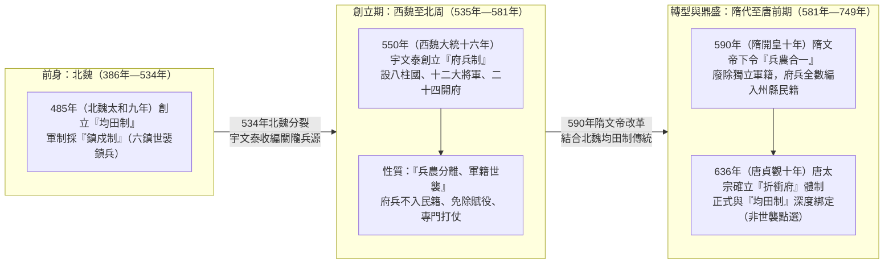
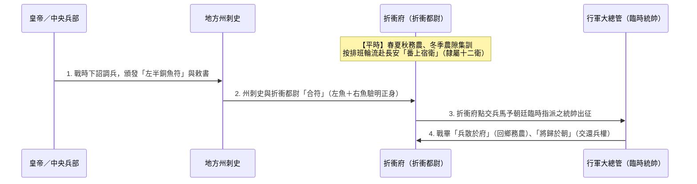

# 府兵制

## 歷史背景與制度淵源

府兵制的形成經歷了從**北魏**的制度前身、**西魏與北周**的正式創立，到**隋唐**轉型為「兵農合一」的三階段演進，並於618年（唐武德元年）至741年（唐開元二十九年）發展至成熟鼎盛。

### 1. 為什麼常誤認起源於「北魏」？（制度前身與均田制根基）

歷史敘述中常有「府兵制源於北魏」的印象，主要是因為其兩大基因皆孕育於**北魏（386年—534年）**：

- **經濟基礎創於北魏（[均田制](./均田制.md)）**：485年（北魏太和九年），北魏孝文帝與馮太后頒布均田制，奠定了後世隋唐「以田養兵」的土地制度基礎。但北魏當時尚未建立府兵制，而是實行「**鎮戍制**」（如北方「六鎮」）。
- **兵源結構源於北魏（六鎮世兵制）**：北魏鎮戍軍人世代當兵（軍籍與民籍分開，屬於「世兵制」或「部族兵制」）。523年（北魏正光四年）爆發「六鎮之亂」，北魏最終於534年分裂為**西魏**與**東魏**。西魏權臣宇文泰正是收編了這批原屬北魏武川鎮等地的鮮卑鎮兵與關隴豪強，才進一步創立了府兵制。

### 2. 三階段演進脈絡（從「世襲軍戶」到「兵農合一」）

- **第一階段：西魏創立（543年—550年，兵農分離、軍戶世襲）**
  - 543年（西魏大統九年）邙山之戰大敗後，西魏權臣**宇文泰**為補充枯竭的鮮卑兵源，廣募關隴漢人豪強（鄉兵）入軍，並於550年（西魏大統十六年）前後正式建立「**八柱國 — 十二大將軍 — 二十四開府**」系統。因軍隊編入「開府」統領，始稱「**府兵**」。
  - 此時的府兵繼承北魏鎮兵傳統，採「**軍民異籍**」：府兵擁有獨立軍籍（不入州縣民籍），世代相傳、專門作戰，性質上反而更接近後世明代的「[衛所制](../../明朝/制度/軍事/衛所制.md)」。
- **第二階段：隋代轉型（590年，軍民合籍、兵農合一）**
  - 590年（隋開皇十年），隋文帝楊堅平定江南後下詔改革，廢除軍人獨立軍籍，將府兵全數編入州縣民籍（「凡是軍人，可悉屬州縣，墾田籍帳，一與民同」）。自此，「西魏的府兵制」才正式與「源自北魏的[均田制](./均田制.md)」合二為一，轉型為「平時務農、戰時出征」的兵農合一制。
- **第三階段：唐代鼎盛（636年—749年，折衝府體制）**
  - 636年（唐貞觀十年），唐太宗將軍府統一改稱「**折衝府**」，確立了初唐國力強盛的軍事基礎。

---

## 核心內容摘要

### 1. 制度設計與運作（隋唐成熟期）

- **編制單位**：全國設立「**折衝府**」（軍府，分上、中、下三等），士兵編入府籍，稱為「府兵」或「衛士」。
- **兵農合一**：士兵平時務農，農隙訓練，戰時出征。國家依據「[均田制](./均田制.md)」配給口分田與永業田，士兵出征時需自備弓矢、橫刀與隨身衣糧。
- **輪番服役（番上）**：府兵需按距離遠近定期前往京師（長安）宿衛或派駐邊疆防戍，戰畢則「兵散於府，將歸於朝」，確保中央對軍權的絕對掌控。

---

## 核心基層機構：「折衝府」深度解析

「**折衝府**」（又稱折衝都尉府）是唐代推行府兵制時的**地方基層軍事基地與管理機構**。若以明代的[衛所制](../../明朝/制度/軍事/衛所制.md)對照，唐代的「折衝府」地位與規模即相當於明代地方上的「衛」或「千戶所」。

### 1. 名稱由來與確立時間

- **確立時間**：**636年（唐貞觀十年）**，唐太宗李世民改革軍制，將隋代與唐初稱為「驃騎府」、「統軍府」的地方軍府，統一改名為「**折衝府**」，最高長官稱為「**折衝都尉**」（副職為左右果毅都尉）。
- **典故含義**：「折衝」出自《晏子春秋》與《戰國策》的成語「**折衝樽俎**」。「衝」指古代用來撞擊城門的戰車（衝車），「折衝」字面原意為「**折斷敵人的戰車、擊退敵軍進攻**」，引申為克敵制勝、保家衛國。

### 2. 內部編制與層級（三等規模與「火伴」典故）

唐代依所在地人口與戰略地位，將折衝府分為**上、中、下三等**（規模與明代一個「千戶所」的 1,120 人極為接近）：

- **上府**：1,200 人
- **中府**：1,000 人
- **下府**：800 人

**組織層級（府 ➔ 團 ➔ 旅 ➔ 隊 ➔ 火）**：

- **「夥伴（火伴）」語源**：折衝府最基層單位為「**火**」（10 人一火，設火長），10 名府兵行軍時共用一口鍋灶吃飯、共養一匹馱馬（六駄馬制），彼此遂互稱「**火伴**」，即現代漢語「夥伴」、「合夥」的典故由來。

### 3. 核心職能：管訓與調兵分離（銅魚符制度）

折衝府在制度設計上嚴格實踐「**管訓權**」與「**調兵權**」分離，折衝都尉僅負責日常管理與冬訓，**無權自行發兵出戰**：

1. **平時農隙冬訓**：春、夏、秋三季府兵在鄉村耕作（[均田制](./均田制.md)）；冬季農閒時，由折衝都尉召集至折衝府進行武藝、射箭、陣法與狩獵演練。
2. **平時番上宿衛**：全國折衝府皆隸屬於中央「**十二衛**」與東宮「**六率**」。折衝府須按排班表，定期派遣府兵輪流前往京師長安擔任皇家宿衛（番上）。
3. **戰時合符發兵**：遇有戰事，須由皇帝下詔、中央**兵部**發出信物「**銅魚符**」（左半留中央、右半存折衝府），經地方州刺史與折衝都尉將兩半銅魚核對吻合（「**符合**」一詞之由來），折衝府始能將士兵點交予朝廷臨時任命的「行軍大總管」統率出征。戰事結束後「**兵散於府，將歸於朝**」，杜絕將領私養軍隊。

### 4. 「關中本位」的戰略佈局（居重馭輕）

唐代全國共設立約 **630 餘個折衝府**，但其地理分佈並非平均配置，而是呈現極端的「**內重外輕**」格局：

- **關中高度集中**：在京師長安所在的關中地區（京兆、岐、同、華、蒲等州），密集部署了約 **260 餘個折衝府**，佔全國總兵力 **40% 以上**（約二十餘萬精兵）。
- **居重馭輕（關中本位政策）**：此種佈局旨在確保中央擁有壓倒性的武力優勢。一旦地方發生叛亂，朝廷可隨時從關中各折衝府徵調大軍迅速平亂，形成以關中控制全國的戰略威懾。

### 5. 折衝府的結局：「無兵可交」

唐玄宗開元、天寶年間，隨著[均田制](./均田制.md)瓦解與邊疆常年征戰，府兵大量逃亡，各地折衝府淪為空有營房與軍官的空殼。**749年（唐天寶八載）**，宰相李林甫奏請唐玄宗，因各折衝府已徹底「**無兵可交**」，正式下令停廢調兵用的「上下魚書（銅魚符）」。折衝府名存實亡，關中防務隨之空虛，導致僅僅 6 年後（755年，唐天寶十四載）安史之亂爆發時，長安面臨無府兵可調的致命危機。

---

### 2. 兵源與身份性質（世襲性分析）

- **初期（西魏、北周）**：具備強烈**世襲色彩**。當時實行「軍民分治（兵農分離）」，府兵擁有專門軍籍，全家免除租調徭役，身份世代相傳，並形成了橫跨西魏、北周、隋、唐四朝的「關隴集團」軍事貴族。
- **鼎盛期（隋唐）**：轉為**非世襲的「點選制」**。
  - **選拔機制**：政府每三年（或六年）根據[均田制](./均田制.md)下的家庭財力（資產）、丁口數與體格進行「簡點」（挑選），遵循「財均者取強，力均者取富，財力又均先取多丁」原則，通常從中等以上均田農戶中選拔。
  - **退役機制**：男子一般21歲入軍服役，60歲免役（或因傷病解役），退役後恢復普通平民（農民）身份，不具備永久世襲義務。
- **本質區別**：西魏初創期的府兵與明代[衛所制](../../明朝/制度/軍事/衛所制.md)皆屬「軍戶世襲」（基礎是身份）；而隋唐鼎盛期的府兵則是「兵農合一」的義務兵役（基礎是均田土地）。

### 3. 制度優點（初唐強盛原因）

- **財政負擔極低**：國家無需支付常備軍巨額軍餉，大幅節省行政與軍事開支。
- **抑制軍閥割據**：軍權集中於中央（兵部調遣、將帥臨時任命），士兵平時分散於各地務農，地方將領難以長期私養兵力。
- **戰鬥力穩定**：初唐府兵多為具備經濟能力的自耕農（均田戶），社會地位較高（帶有勳官榮譽），體質與士氣俱佳。

### 4. 致命問題與結構性矛盾

- **均田制崩壞（關鍵原因）**：唐高宗、武則天以後，隨著貴族官僚土地兼併嚴重，農民失去授田，府兵失去自備資糧的經濟基礎，導致制度根基瓦解。
- **戰爭性質改變**：武則天至唐玄宗時期（690年—749年），大唐對外開邊戰爭頻繁且戰線拉長，府兵由短期輪戍變為長期戍邊，荒廢農務、死傷慘重，引發大規模逃亡（「逃散略盡」）。
- **社會不公與地位貶值**：富戶常透過賄賂或庇護逃避點選，兵役負擔全落在貧苦農民身上；加上勳官氾濫貶值，當府兵從榮譽變為苦役，至749年（唐天寶八載）折衝府因「無兵可交」正式停廢上下魚書。

---

## 軍制演化與跨代比較

（詳細跨代分析請參見：[府兵、募兵與衛所制度之軍事演化比較研究](../../明朝/制度/軍事/府兵募兵衛所比較.md)）

| 面向 | 府兵制（西魏北周初期） | 府兵制（隋唐鼎盛期） | 募兵制（唐中後期） | 衛所制（明朝） |
| :--- | :--- | :--- | :--- | :--- |
| **核心模式** | 兵農分離、軍籍世襲 | 兵農合一、定期點選 | 職業軍人 | 軍戶世襲（半兵農） |
| **經濟基礎** | 國家免除全家賦役 | 靠土地養兵（[均田制](./均田制.md)） | 靠金錢養兵（國庫／藩鎮） | 靠身分與[屯田](../../明朝/制度/屯田制.md)養兵 |
| **國家負擔** | 中等 | 極低 | 極高 | 中等（設計上自給） |
| **戰力評價** | 極強（關隴精銳） | 前期強，後期逃亡崩潰 | 極強，專業化程度高 | 初期強，後期因腐敗弱化 |
| **致命缺陷** | 兵源有限（後由隋改革） | 土地兼併流失即瓦解 | 引發安史之亂（軍閥化） | 軍屯遭吞、軍戶大量逃亡 |

---

## 歷史影響與意義

府兵制的演變與瓦解是中國中古史的重要轉折點。它從北魏六鎮世兵制的廢墟中誕生，經西魏宇文泰創立、隋文帝「兵農合一」改革，造就了初唐盛世；又在722年（唐開元十年）至749年（唐天寶八載）間因均田制崩壞而全面轉向「募兵制」。雖然募兵提升了邊防專業戰力，卻也導致軍權下放至地方節度使，最終釀成755年（唐天寶十四載）的「安史之亂」（詳見[軍閥問題比較](../../明朝/制度/軍事/軍閥問題比較.md)）。

這條演化線展現了中國歷代政權在「成本、戰力、控制力」三者間的無解三角困境：

1. **府兵制（隋唐）**：追求低成本與高控制，但毀於經濟結構（均田土地）改變。
2. **募兵制（中晚唐／宋）**：追求高戰力，但導致國庫空虛或地方藩鎮失控。
3. **衛所制（明代）**：試圖折衷並回溯西魏、元代的「世襲軍戶」傳統，卻因制度僵化與軍屯腐敗而再次走向崩潰。

## 研究結論

府兵制不僅是一項軍事制度，更是從「北朝部族世兵」轉向「隋唐均田小農義務兵」的關鍵樞紐。其興衰見證了唐代從「小農自足」轉向「專業軍事官僚化」的必然過程——一旦國家無法保障士兵的土地所有權，這種「低成本國防」便難以為繼。
