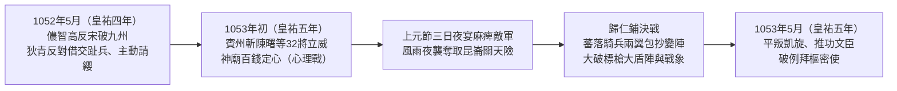

# 狄青

## 歷史背景

北宋立國之初，鑑於唐末[安史之亂](../../../唐朝/事件/安史之亂/安史之亂.md)以來的[籓鎮節度使](../../../唐朝/制度/籓鎮節度使.md)割據亂象，以及宋太祖趙匡胤透過「陳橋兵變、黃袍加身」篡奪後周政權的歷史記憶（參見[金匱之盟](../../事件/金匱之盟.md)與宋初皇權猜忌脈絡），確立了**「崇文抑武（重文輕武）」**與**「守內虛外」**的祖宗家法。為徹底根絕武將擁兵自重的隱患（參見[軍閥問題比較](../../../明朝/制度/軍事/軍閥問題比較.md)），北宋建構了嚴密的「二府三司」與兵權分割體制：

| 機構名稱                                   | 職權定位                                         | 首長出身與制衡設計                                                   |
| :----------------------------------------- | :----------------------------------------------- | :------------------------------------------------------------------- |
| **中書門下（政事堂）**                     | 掌管全國行政與政令大權。                         | 由文官宰相主持，居百官之首。                                         |
| **樞密院（樞府）**                         | 掌管全國軍政機密與「調兵權」，但無「統兵實權」。 | 依祖宗家法傳統均由**文官**出任樞密使或樞密副使。                     |
| **三衙（殿前司、侍衛馬軍司、侍衛步軍司）** | 掌管禁軍日常訓練與「統兵實權」，但無「調兵權」。 | 由武將分掌，彼此牽制；戰時則另派文臣或受文臣節制之「帥臣」統兵出征。 |

在此「以文制武」的制度結構與「萬般皆下品，惟有讀書高」的社會風氣下，底層士兵因實行殘酷的「黥面制度」（於面部刺字以防逃亡，見[府兵募兵衛所比較](../../../明朝/制度/軍事/府兵募兵衛所比較.md)），被士大夫與社會大眾鄙視為「賊配軍」或「赤佬」。武將在體制內被默許平庸、貪財甚至好色，卻絕不被允許「完美無瑕且深得軍心」。

狄青（1008年－1057年，字漢臣，汾州西河人）正是在這樣極度壓抑武人的制度環境中，成為北宋建國二百年間**唯一一位從底層黥面配軍憑藉實戰軍功晉升至全國最高軍事長官（樞密使）**的傳奇統帥；然而，其登頂之日亦成為觸發北宋文官集團系統性恐慌與政治清洗之始。

---

## 核心生平與事蹟

### 1. 寒門頂罪與「黥面配軍」的早年歲月

- **寒門出身與替兄頂罪**：1008年（北宋大中祥符元年），狄青出生於山西汾陽（河東路汾州西河）的貧苦農家，父親狄普為純樸農夫。狄青天生體格雄壯、性格豪俠悍勇。1023年（北宋天聖元年）前後，年僅十六歲的狄青因兄長與鄉人鬥毆並將對方推入河中淹死，毅然挺身替兄頂罪。在宋代嚴苛律法下，狄青被判處充軍，面部遭刺針刺上終身無法抹滅的墨字（黥面），淪為社會最底層的「賊配軍」。
- **選入禁軍與仁宗朝拒除黥文**：狄青被發配京師編入衛戍禁軍「拱聖軍」，憑藉偏執般的刻苦訓練與卓越騎射天賦，被選入「散直班」（御前侍衛）。日後狄青位極人臣，宋仁宗趙禎心疼其早年遭遇，特賜宮廷秘製敷藥准其洗去臉上刺字，狄青卻指著面龐婉拒道：「陛下以功擢臣，不問門地，臣所以有今日，由此涅爾。臣願留以勸軍中，不敢奉詔。」此舉展現其不忘本色、與百萬底層士卒同甘共苦的胸襟，在軍中樹立了無可比擬的威望，卻也在士大夫眼中留下「拒絕被士大夫化、堅守武夫認同」的潛在威脅印象。

### 2. 西北戰場的血火洗禮與名將蛻變

1038年（北宋寶元元年），西夏李元昊稱帝反宋，宋軍於三川口之戰慘敗，朝野震動。年滿三十歲的狄青主動報名赴邊，出任延州指使，在西北邊陲展開長達四年的血火淬鍊。

- **銅面具與心理威懾戰術**：面對畏敵如虎的宋軍與來去如風的西夏鐵騎，狄青打造了一副猙獰的青銅面具，每逢出戰必披頭散髮、戴銅面具持槍獨騎衝入敵陣。西夏士兵驚呼其為「狄天使」或惡鬼索命，往往未交鋒便已膽寒。四年間（1038年－1042年，北宋寶元、康定至慶曆年間），狄青親歷大小二十五戰，八次身中流矢，使西夏軍連年不敢進逼邊境：

| 年代／時期                         | 關鍵戰役／行動       | 戰術策略與決策表現                                                   | 實質戰果                                                                             |
| :--------------------------------- | :------------------- | :------------------------------------------------------------------- | :----------------------------------------------------------------------------------- |
| **1038年－1040年（北宋寶元年間）** | 安遠砦保衛戰         | 身負重傷仍飛身上馬，率親兵大吼殺出寨門，激發守軍求生本能與復仇怒火。 | 以少勝多，擊退兵力懸殊且圍困多日的西夏優勢主力。                                     |
| **1040年－1041年（北宋康定年間）** | 奇襲宥州與攻克金湯城 | 摒棄朝廷遠程發放的僵化陣圖，因地制宜、靈活機動進行遠程奔襲。         | 攻克金湯城，焚毀西夏囤積多年之糧草數萬石，俘獲牛羊無數及奴隸五千餘人，重創敵軍後勤。 |
| **1041年－1042年（北宋慶曆初年）** | 邊境堡寨建設         | 於邊境關鍵要衝精準選址，修築十餘座堅固堡寨。                         | 如釘子般楔入敵境，扼守西夏騎兵南下要道，扭轉宋軍被動挨打局面。                       |
| **1042年前後（北宋慶曆年間）**     | 深淵止追             | 於大勝追擊之際，敏銳察覺敵軍突然停滯必有埋伏，果斷下令停止追擊。     | 事後勘查前方果為萬丈深淵與伏兵，成功避免全軍覆沒，展現高度戰場冷靜。                 |

- **折節讀書與戰略轉型**：在西北任職期間，狄青遇見生命中的兩位貴人——經略判官尹洙與經略使范仲淹。范仲淹賞識其將才，贈予一部《左氏春秋》，並訓誡道：「將不知古今，匹夫勇爾。」狄青深受震動，自此折節讀書，於軍旅間隙精讀《春秋》與秦漢以來歷代兵法，洗滌行伍粗鄙之氣，由單純衝鋒陷陣的猛將蛻變為統籌地形、後勤、士氣與外交的戰略統帥。經范仲淹與韓琦推薦，狄青歷任秦州刺史、涇原路兵馬都監、捧日天武四廂都指揮使，直至升任樞密副使。
- **水落城事件的早期芥蒂**：西北任內，經略判官尹洙與知州劉滬等人因修築水落城問題發生嚴重分歧，狄青奉上司尹洙軍令，將堅持築城的文官劉滬、董士廉逮捕入獄監禁達一月之久。儘管狄青僅是奉命執行軍令，但在文官集團眼中卻是「武人粗暴踐踏士大夫權威」的越界之舉，為日後朝堂衝突埋下伏筆。

### 3. 嶺南破局：平定儂智高之亂與登頂樞密使

1052年（北宋皇祐四年）五月，嶺南廣源州蠻族首領儂智高因長期受交趾壓迫、多次請求內附宋朝遭拒，遂起兵反宋，建立「大南國」，自稱「仁惠皇帝」，改元「啟歷」，連破邕州及沿江九州，兵鋒直逼廣州。嶺南武備廢弛，地方官棄城逃竄，朝廷所派廣南安撫使楊畋及諸將皆因將帥不和、不習水土而潰敗。朝中甚至有人提議借交趾兵平叛，狄青上疏力陳借外援乃「引狼入室」，並主動請纓立下軍令狀。宋仁宗遂任命狄青為宣徽南院使、宣撫荊湖南北路，罕見賦予其「便宜行事」之專斷權。

- **賓州斬將立威與「百錢定心」心理戰**：1053年（北宋皇祐五年）初，狄青率西北精銳「蕃落騎兵」抵達前線賓州。面對軍紀渙散、倒賣軍糧與擅自出戰潰敗的亂局，狄青升帳議事，當眾歷數前任主帥麾下敗將陳曙及佐吏等三十二人罪狀，立斬於轅門之外，全軍肅然震懾。針對嶺南迷信鬼神之風，狄青出師前率諸將至賓州神廟祈願，取出特製的一百枚雙面同文銅錢拋地，落地後百枚銅錢「全部正面朝上」，狄青命人以釘固定並覆以青紗，宣示神明庇佑必勝，瞬間將全軍士氣推向頂峰。
- **上元夜襲昆崙關與歸仁鋪決戰**：
  - **瞞天過海奪昆崙**：面對易守難攻的昆崙關天險，適逢上元節，狄青下令大張燈火、連擺三晚酒宴以麻痺儂智高探子。至第三夜酒過三巡，狄青藉口更衣離席，實則披甲率精銳騎兵「人銜枚、馬裹蹄」，趁狂風暴雨連夜急行軍，於次日黎明神兵天降般奪取毫無防備的昆崙關，直抵歸仁鋪。
  - **歸仁鋪騎步協同破陣**：儂智高傾巢而出，以「兩人持長標槍、一人持大盾牌」的嚴密步兵方陣正面頂住宋軍前鋒，致宋將孫節戰死。狄青策馬立於高崗執白旗指揮，精準發揮西北「蕃落騎兵」的高機動性，採左右兩翼包抄與穿插割裂戰術，並下令陣型實行「左翼變右翼、右翼變左翼」的靈活變陣，反覆切入敵軍側後，配合火攻與箭雨驚倒敵方戰象。叛軍大盾標槍陣徹底崩潰，宋軍斬首五千餘級、追擊五十里，儂智高敗逃大理國，嶺南大亂不到一個月即告平定。
- **推功文官與拜相爭議**：凱旋後，狄青極度克制謙遜，主動將平叛謀略功勞歸於同行文官孫沔，並悉心照拂故去恩人尹洙的家屬。1053年（北宋皇祐五年）五月，宋仁宗欲破格拔擢狄青為最高軍事長官「樞密使」，引發朝堂激烈博弈：
  - **宰相龐籍的反對**：起初支持狄青南征的龐籍，此時引開國名將曹彬平定南唐僅賜錢二十萬而未即授樞密使為例，質疑若此刻封樞密使，「日後若再立大功，陛下將何以賞之？」
  - **參知政事梁適的算計**：梁適力挺狄青升任樞密使，實則出於文官內部爭奪相位的私心——因狄青身為武人絕無可能入主中書門下拜相，讓狄青佔據樞密使大位，梁適未來角逐宰相時便少了一名文官競爭對手。
  - **打破祖宗家法**：最終在宋仁宗堅持下，狄青正式拜樞密使，打破了北宋開國以來「文官壟斷樞密院」的政治鐵律，卻也將自己推向文官集團集體圍剿的風暴中心。

### 4. 文官集團的集體圍剿與陳州貶所之死

狄青出任樞密使期間，既掌國家軍政樞機，又在軍中享有神祇般的威望（京師百姓爭相圍觀其風采，士卒領糧時皆稱「此狄爺爺所賜」），在文官集團眼中無異於安祿山或趙匡胤重現的體制隱患。

- **文彥博六字誅心與皇權保護傘的瓦解**：面對文臣接連彈劾，宋仁宗起初力保狄青，對宰相文彥博表示：「狄青是忠臣，朕信得過他。」文彥博卻冷冷反問六個字：**「太祖皇帝難道不忠嗎？」**（指宋太祖趙匡胤在陳橋兵變前亦是後周世宗柴榮最信任的忠臣）。這句話精準刺中趙宋皇室得位不正的歷史恐懼，揭示「人性與忠誠在絕對軍權面前不可信賴」的制度底線，瞬間擊碎了宋仁宗對狄青的信任保護傘。
- **立體化的政治獵殺與輿論圍剿**：文官集團從階級羞辱、民間流言到[言官](../../../明朝/制度/言官.md)（諫官）奏疏，對狄青展開三重圍剿：

| 圍剿維度                   | 主導人物／載體                   | 具體手段與誅心邏輯                                                                                                                                       |
| :------------------------- | :------------------------------- | :------------------------------------------------------------------------------------------------------------------------------------------------------- |
| **階級歧視與立威羞辱**     | 韓琦                             | 當面斬殺狄青立有戰功的舊部焦用，冷言：「東華門外以狀元唱出者才是好男兒，此等赤佬何足道哉！」以生殺大權宣示文臣對武人的絕對俯視。                         |
| **民間流言與異象構陷**     | 京師輿論流言                     | 散佈狄青家「狗生雙角」、「夜冒奇光」等怪力亂神謠言；趁京師發大水狄青全家暫避大相國寺時，誣指其「身穿黃袍、意圖僭越」。                                   |
| **陰陽災異說與無罪免職論** | 歐陽修（連上三道《論狄青札子》） | 利用「水屬陰、兵屬陰、武將屬陰」之說將京師水災歸咎於狄青掌兵；奏疏雖承認狄青「未見過失」，卻提出「功高震主且深得軍心即是國家禍患」的邏輯，強逼仁宗罷免。 |

- **「朝廷疑爾」與陳州精神凌遲**：1056年（北宋嘉祐元年）八月，任職樞密使四年且未犯任何過失的狄青遭罷免樞密使，貶為護國軍節度使、同中書門下平章事，外放陳州。離京前狄青赴宰相府向文彥博詢問自己究竟犯下何錯，文彥博冷酷回應六個字：**「無他，朝廷疑爾。」**狄青出京時悲憤對家人嘆道：「此去陳州，吾必死無疑。」抵達陳州後，朝廷依文彥博建議，每半個月（每月兩次）派遣宦官或使者赴陳州「撫問」，實則進行高壓政治監視。這位在千軍萬馬中毫無懼色的百戰名將，在每半月一次使者到來的精神凌遲下驚疑終日，最終鬱火攻心、口生毒瘡，於1057年（北宋嘉祐二年）三月暴斃於陳州貶所，享年僅四十九歲。死後宋仁宗發哀，追贈中書令，賜諡「武襄」。

---

## 歷史影響與後世評價

### 1. 寒門武人上升通道的封死與尚武精神的閹割

狄青從黥面配軍奮鬥至樞密使、最終卻因「無過而受疑」被活活逼死於陳州的遭遇，向全社會傳遞了極其殘酷的政治信號：在北宋文官體制下，武人即便立下不世奇功、品德完美謙抑，亦無法獲得真正的政治尊嚴與人身安全。自此，寒門子弟憑藉軍功改變命運的上升通道被徹底封死，北宋社會「好男不當兵，好鐵不打釘」的風氣全面固化，漢唐以來奔湧於社會血液中的尚武精神遭到體制性閹割。

### 2. 戰略統帥土壤的毀滅與「靖康之恥」的遠因

狄青死後，北宋在長達七十年的時間裡**「再無純粹武將出任樞密使」**。軍隊徹底喪失了培育具備全局戰略視野統帥的制度土壤，武將在文臣面前唯唯諾諾，僅能淪為執行僵化陣圖的戰術工具。這條歷史因果鏈條在七十年後迎來毀滅性反噬：當金兵鐵騎南下圍攻汴京時，北宋朝堂竟陷入無將可用、無帥可統的絕境，甚至荒謬地寄望於神棍郭京的「六甲神兵」退敵，最終城破國亡、釀成「靖康之恥」。當年合力逼死狄青的文官集團，實則親手拆毀了帝國的國防長城。

### 3. 後世評價與歷史記憶的雙重性

- **廟堂哀榮與制度虛偽**：宋仁宗於狄青死後追贈中書令、諡號「武襄」，這種「生前莫須有猜忌、死後高規格哀榮」的劇烈反差，暴露出專制帝國對功臣補償機制的虛偽（參見[專制與結構性困局](../../../通史/專制與結構性困局.md)）。
- **民間神格化與歷史共鳴**：與士大夫階層的冷酷排擠相反，北宋百姓與底層士卒對狄青懷有深厚感情，將其奉為「武曲星」下凡，其戴銅面具征西夏、平南蠻的事蹟被編入話本、戲曲與晚清《萬花樓》、《五虎平西》等演義小說代代傳唱，成為中華軍事文化中孤高悲壯的英雄圖騰。

---

## 研究結論

狄青的一生，是北宋「崇文抑武」體制下個人英雄主義與結構性制度鐵壁劇烈碰撞的悲劇標本。他憑藉過人勇武在西北宋夏戰場崛起，受范仲淹啟迪折節讀書完成從「匹夫之勇」向「大將之略」的蛻變，更在嶺南儂智高之亂中展現出卓越的治軍魄力、心理戰術與騎步協同指揮藝術。

然而，狄青的悲劇恰恰源於他的「過於優秀與完美」。在一個以防範內部兵變為最高政治優先級的王朝中（參見[軍閥問題比較](../../../明朝/制度/軍事/軍閥問題比較.md)），一位保留著底層黥面印記、深得軍心民望且戰無不勝的武將入主樞密院，直接觸動了皇權對「陳橋兵變」的歷史創傷，以及士大夫階層壟斷國家機器與話語權的集體本能。連歐陽修、韓琦、文彥博等北宋名臣亦在體制慣性下化身為圍剿狄青的推手（正如晚明清流言官合力傾軋遼東經略[熊廷弼](../../../明朝/人物/文臣/熊廷弼.md)）。當一個政權將內部防範機制極端化至不惜自毀長城時，其雖能換取短期的內部穩定，卻終將在外患衝擊下付出國破家亡的慘痛代價。

---

## 參考資料

1. [參考1](https://www.youtube.com/watch?v=AYXuHMj_dFw)
2. [參考2](https://www.youtube.com/watch?v=qEMpX18J5is)
3. [參考3](https://www.youtube.com/watch?v=6_0lOXu1POw)
