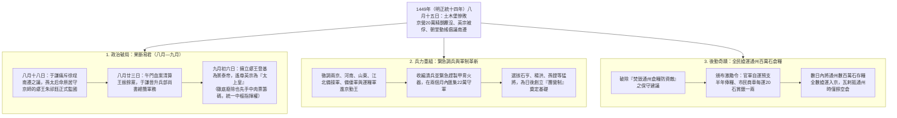
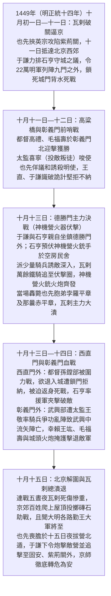
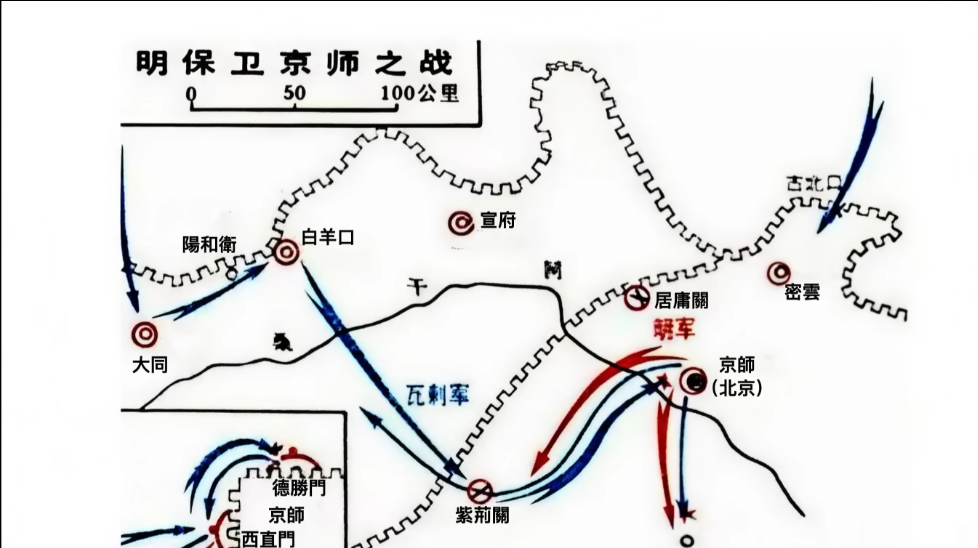
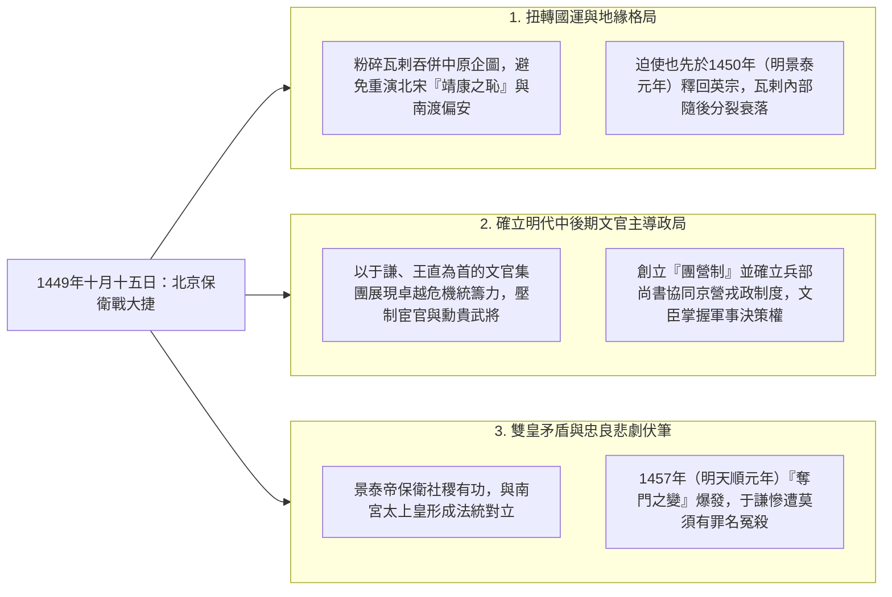

# 北京保衛戰（1449年，明正統十四年/景泰元年）

## 歷史背景：社稷危如累卵

1449年（明正統十四年）八月十五日[土木堡之變](./土木堡之變.md)後，明朝[三大營](../../制度/軍事/三大營.md)精銳盡喪，明英宗[朱祁鎮](../../皇帝/朱祁鎮.md)被俘[北狩](./英宗北狩.md)。瓦剌首領也先企圖以英宗為籌碼（「奇貨可居」），在邊境要塞（大同、宣府）挟天子以令守軍開門並勒索財物。因大同總兵郭登、宣府守將楊洪等堅守不納，也先耽誤了約50餘天（一度退回塞外休整），為北京贏得了寶貴的整備時間。然而，當八月敗訊初傳及十月瓦剌大軍再度南下逼近時，朝廷內部一度出現翰林院侍講徐珵（後改名徐有貞）倡議的「南遷南京」之議，情勢極其嚴峻。

---

## 核心人物：社稷之臣于謙

于謙（1398年—1457年，明洪武三十一年至天順元年），字廷益，浙江錢塘人。

- **志向與性格**：少有大志，敬仰文天祥，作《石灰吟》（「粉骨碎身全不怕，要留清白在人間」）自勉。巡撫河南、山西十九年（參見[巡撫總督](../../制度/巡撫總督.md)），兩袖清風，深得民心與吏部尚書王直及「[三楊](../../人物/文臣/內閣三楊.md)」器重。
- **痛斥南遷與午門血案（臨危受命）**：八月十八日敗報抵京，于謙在廷議中厲聲喝止徐珵南遷之議：「言南遷者，可斬也！京師天下根本，一動則大事去矣，獨不見宋南渡事乎！」八月二十三日，在「午門血案」中，文官集團徹底壓制了王振閹黨勢力。當時群臣在午門伏地大哭，要求籍沒王振家產並懲辦黨羽，王振心腹[錦衣衛](../../制度/廠衛/錦衣衛.md)指揮馬順竟厲聲叱責百官，觸發眾怒。戶科給事中王竑（參見[言官](../../制度/言官.md)）率先衝上前撕咬馬順之肉，隨後百官一擁而上，將馬順及王振內侍毛貴、王長隨三人在朝堂上當場毆殺。在局面極度混亂、監國郕王[朱祁鈺](../../皇帝/朱祈鈺.md)驚恐欲退之際，兵部侍郎于謙挺身而出扶住郕王，力陳群臣乃「為社稷除害」而非叛亂，請求當場赦免百官無罪，成功穩定政局並隨即升任兵部尚書，正式主導京師防禦。

---

## 核心決策與危機處理

### 1. 政治定力：擁立新君

為了打破也先利用英宗勒索的政治空間，孫太后於八月十八日先將原奉詔「居守」京師的郕王[朱祁鈺](../../皇帝/朱祈鈺.md)職權升級，正式命其「總百官、監國」，並於八月二十日立英宗兩歲長子[朱見深](../../皇帝/朱見深.md)為皇太子。隨後，在于謙、王直等文官集團的強力主導下，為避免「主少國疑」與「敵有所挾則邀求無厭」，決定擁立成年新君。朱祁鈺起初因擔憂亡國責任及倫理尷尬而再三推辭，于謙以「臣等誠憂國家，非為私計」一語定人心，強調此舉乃為社稷而非私利。朱祁鈺最終於1449年（明正統十四年）九月初六日登基（即明代宗景泰帝，明年改元景泰），遙尊英宗為「太上皇」。孫太后雖同意此舉，但保留了英宗之子朱見深的皇太子地位，為日後景泰朝易儲與[奪門之變](./奪門之變.md)埋下伏筆。此決策使英宗瞬間失去政治籌碼價值，穩定了內部政局並統一了保衛戰的最高指揮權。

### 2. 軍事動員與兵力整補

- **拼湊大軍**：在京師精銳全滅、僅餘老弱殘兵不到十萬的情況下，于謙緊急從南北直隸、河南、山東等地調集「備操軍」、「備倭軍」與漕運「運糧軍」，並號召各地勤王、收編土木堡潰散殘部，在短短五十餘天內重新組建起22萬人的守軍。
- **改革軍制**：拔擢石亨為武清伯總領京營，整頓各自為政、號令不一的舊三大營弊端，並於戰後1452年（明景泰三年）正式創立「[團營](../../制度/軍事/團營制.md)」，實現兵將相習與統一指揮。

### 3. 後勤奇蹟：全民搶運通州糧

京東通州糧倉儲存數百萬石漕糧，當時有人建議直接焚毀以防資敵，于謙斷然拒絕（「國之命脈，民之膏血，奈何棄之」），祭出「誰運歸誰、官民並運」的全民搶運方案：

- **官兵獎勵**：入城守軍與官吏凡前往通州運糧進城者，准予預支半年俸糧，多運者歸己。
- **百姓商運**：動員京師周邊車馬商民協助，每車運20石糧進京即賞白銀一兩。
  此舉在瓦剌抵達前，奇蹟般將數百萬石存糧全數移入北京城內，既充實了守城軍民口糧，又徹底斷絕了瓦剌「因糧於敵」的企圖。

---

## 戰鬥過程：九門外的決死戰

1449年（明正統十四年）十月初，也先挾持太上皇英宗再度南下，攻破紫荊關與白羊口，於十月十一日直抵北京城下。于謙堅決反對石亨「收兵入城、閉門堅守」的消極建議，主張「背水一戰」，將22萬大軍列陣於北京城九門之外，並**下令將九座城門全數鎖死**，立下軍令狀：「大軍出城之後，凡將士不戰而退者，立斬；守城者若開門納退兵者，亦斬！」徹底斷絕全軍退路。

- **德勝門之戰（主力對決，十月十三日）**：于謙與石亨親自披甲坐鎮最危險的北面德勝門。于謙與石亨事先令城外居民遷入城內，將「神機營」（參見[火炮科技興衰](../../制度/軍事/火炮科技興衰.md)）火器手秘密埋伏於德勝門外的空房民舍中，僅派少量精騎出戰迎敵並佯裝敗退。也先胞弟孛羅平章率萬餘瓦剌精騎不明就裡、縱馬狂追；待敵騎進入街道伏擊圈，伏兵四起、火銃與火炮萬雷齊發，石亨率鐵騎兩翼包抄。孛羅平章與重臣那曩赤平章當場中炮斃命，瓦剌主力遭受毀滅性重創。
- **西直門之戰（十月十三日）**：都督孫鏜率軍於西直門外迎擊瓦剌，斬其前鋒；後瓦剌增兵合圍，孫鏜力戰不支欲退入城，但守門給事中程信嚴守于謙軍令拒不開門，僅在城頭發箭炮助戰。孫鏜軍在退路斷絕下爆發出死戰決心，返身肉搏，配合石亨分兵馳援，成功擊潰敵軍。
- **彰義門之戰（十月十四日）**：都督武興於西南彰義門外與瓦剌交戰，初戰告捷，卻因監軍[太監](../../制度/廠衛/太監.md)王敬等率百餘名內侍騎兵爭功搶前，遭瓦剌反擊潰退，衝亂明軍步陣，導致武興中流矢陣亡。危急關頭，右僉都御史王竑與都督王通、毛福壽死戰頂住缺口，城外百姓亦紛紛爬上屋頂投擲磚石瓦塊砸向瓦剌騎兵（「喊聲動地」），配合城上火炮轟擊，最終瓦解瓦剌攻勢。

---

## 歷史影響與研究結論

1449年（明正統十四年）十月十五日夜，也先見北京堅不可摧、自身精銳折損慘重，且聞大明各地勤王大軍正四面合圍，驚懼之下拔營由居庸關、紫荊關狼狽北撤，並於次年（1450年，明景泰元年）八月無條件放回太上皇[朱祁鎮](../../皇帝/朱祁鎮.md)。

- **拯救大明**：此戰徹底避免了明朝重演北宋「靖康之恥」或衣冠南渡偏安江南的命運，保住了大明兩百年國祚。
- **政治格局轉向**：文官集團（由于謙、王直等領導）在空前國難中展現了極強的組織動員與軍事統籌能力，從此在明朝政局中徹底壓制了勳貴武將與部分宦官勢力，確立了「以文馭武」的明中後期政治常態。
- **于謙的歷史定位**：于謙以其「兩袖清風」的操守與「鎖門背水」的鐵腕決斷，在帝國最黑暗的時刻隻手撐起大明脊樑。雖日後在1457年（明天順元年）「[奪門之變](./奪門之變.md)」中遭徐有貞、石亨等人以「意欲迎立外藩」莫須有罪名冤殺（抄家時家無餘財，僅正室鎖著景泰帝賜予的蟒袍劍器），但其保衛社稷的不世之功始終為後世萬民景仰（明憲宗成化年間平反，明孝宗弘治年間追諡「忠肅」）。

---

## 參考資料

1. [參考1](https://www.youtube.com/watch?v=keCeQRMLcSo)
2. [參考2](https://www.youtube.com/watch?v=JI0ULqiJxI8)
