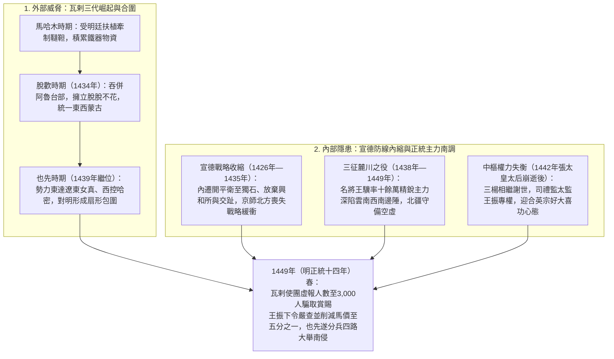
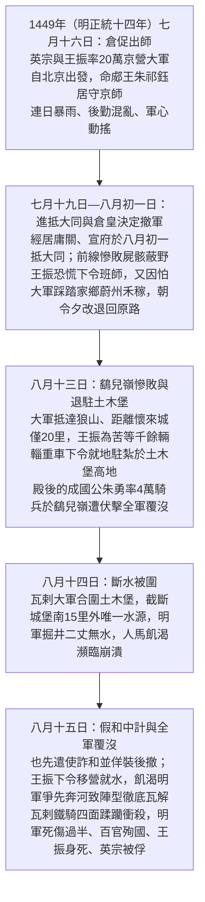
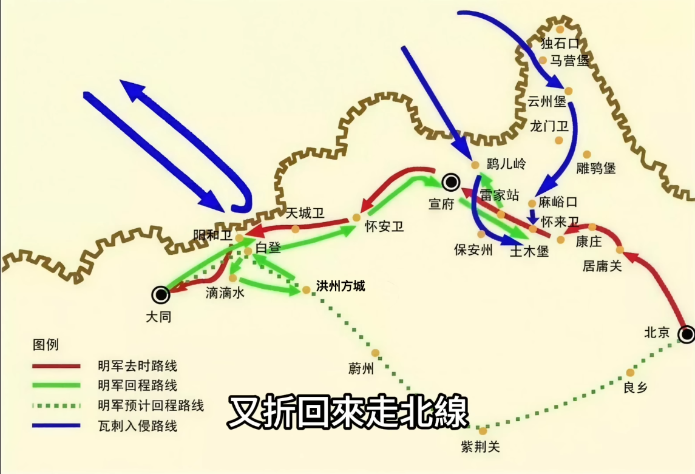
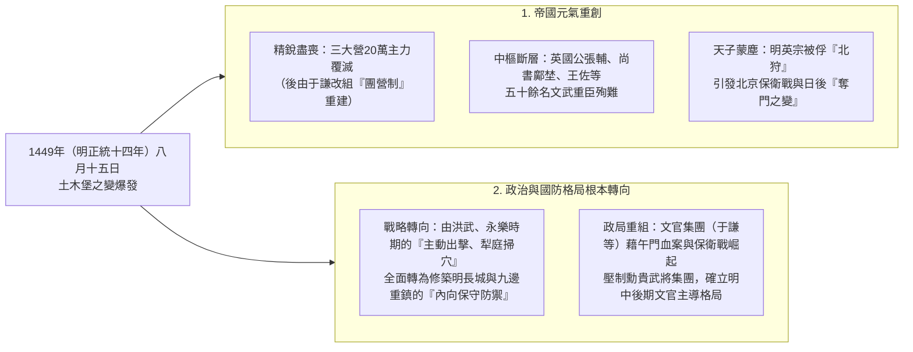

# 土木堡之變（1449年，明正統十四年）

## 歷史背景：內憂外患的交織

土木堡之變是明朝由盛轉衰的關鍵轉折點。此事件並非偶然，而是明宣宗[朱瞻基](../../皇帝/朱瞻基.md)時期戰略收縮的後遺症、西南邊境長期消耗戰，以及內部宦官專權等多重因素共同作用的結果。

### 1. 瓦剌的崛起與威脅

瓦剌（Oirats，西蒙古）的壯大受益於明初明成祖[朱棣](../../皇帝/朱棣.md)「分而治之」的策略：

- **戰略扶植**：永樂年間為牽制東蒙古韃靼（阿魯台等部），明廷冊封並拉攏瓦剌。
- **三代雄主**：
  - **馬哈木時期**：向明稱臣，透過朝貢貿易積累大量物資與鐵器。
  - **脫歡時期**：1434年（明宣德九年）擊殺韃靼太師阿魯台，統一蒙古各部，挾元裔可汗脫脫不花以令諸侯。
  - **也先時期**：1439年（明正統四年）繼任太師，實力達至巔峰，勢力範圍東達遼東女真、西觸中亞哈密，對大明北疆形成巨大的扇形包圍。

### 2. 宣德時期的戰略隱患（仁宣之治的代價）

明宣宗（[朱瞻基](../../皇帝/朱瞻基.md)）在位期間（1426年—1435年，明宣德年間）的休養生息政策，實質上以犧牲長遠國防空間為代價：

- **防線內縮**：1430年（明宣德五年），朝廷主動將塞外重鎮「開平衛」內遷至獨石，並放棄戰略要地「興和所」，退守居庸關、宣府一線，製造了嚴重的邊防漏洞。
- **外交與軍事失策**：坐視韃靼餘部被瓦剌吞併、撤銷奴兒干都司（放鬆對東北女真的控制）、1427年（明宣德二年）放棄交趾（參見[朱棣征安南](../朱棣永樂時期/朱棣征安南.md)）。
- **後果**：當明英宗[朱祁鎮](../../皇帝/朱祁鎮.md)即位時，大明北方已失去外圍預警與戰略緩衝空間。

---

## 核心人物與決策分析

### 1. 王振的崛起與角色

- **權力路徑**：山西蔚州學官出身，自宮後透過明宣宗設立的「內書堂」入宮，侍奉幼年[朱祁鎮](../../皇帝/朱祁鎮.md)，建立深厚的心理依賴關係（被英宗尊稱為「先生」）。
- **執政影響**：1442年（明正統七年）張太皇太后崩逝及「[三楊](../../人物/文臣/內閣三楊.md)」相繼離世後，王振掌管司禮監（參見[內閣制](../../制度/內閣制.md)與[太監](../../制度/廠衛/太監.md)），掌握「批紅」大權並控制[錦衣衛](../../制度/廠衛/錦衣衛.md)，全面把持朝政。
- **歷史評價**：王振常被傳統史觀視為唯一禍首，但其行為實質上是迎合並貫徹英宗個人意志的執行者。

### 2. 御駕親征的動機

- **皇帝意志**：時年23歲的[朱祁鎮](../../皇帝/朱祁鎮.md)渴望效法曾祖[朱元璋](../../皇帝/朱元璋.md)與祖父[朱棣](../../皇帝/朱棣.md)五征漠北的武功，藉親征樹立絕對君威。
- **王振推手**：揣摩上意，力挺親征以壓制文官集團，並懷有邀駕臨幸其家鄉山西蔚州「衣錦還鄉」的私欲。
- **決策草率**：1449年（明正統十四年）七月大同警報傳至京師，不顧兵部尚書鄺埜、吏部尚書王直等百官死諫，僅給予2至4天準備時間即倉促出兵；出征前夕（七月十五日）因長子朱見深年僅兩歲且未立儲，遂命異母弟郕王[朱祁鈺](../../皇帝/朱祈鈺.md)「居守」京師（由王直、高穀、于謙及太監金英等輔佐日常政務）。

---

## 戰略失誤：麓川之役的牽制

明朝當時將國防重心投入西南雲南邊境的「麓川之役」（1438年—1449年，明正統三年至十四年）：

- **兵力空虛**：全國精銳將領（如靖遠伯王驥、定西侯蔣貴）與主力機動部隊（前後調動達十五萬人次）均被牽制於南方，北方僅餘缺乏實戰演練的京營（參見[三大營](../../制度/軍事/三大營.md)）與邊鎮[衛所](../../制度/軍事/衛所制.md)部隊。
- **國力損耗**：長達十年的西南戰事導致大量兵員損耗與財政負擔，也先正是看準此戰略空檔發動全面入侵。

---

## 土木堡潰敗之謎

### 1. 戰爭導火線

- **直接誘因**：朝貢貿易糾紛。瓦剌使團將2,000餘人虛報為3,000人以冒領賞賜，王振下令核實人數並大幅削減回賜馬價，也先遂以「明廷背棄和親、剋扣賞賜」為藉口，於1449年（明正統十四年）七月分兵四路大舉入侵。
- **深層原因**：瓦剌統一蒙古後對中原擴張與爭奪貿易主導權的戰略野心。

### 2. 潰散關鍵因素

- **後勤與指揮崩潰**：20萬大軍僅帶一個月糧草，行軍情報斷絕；王振外行領導內行，屢次羞辱兵部尚書鄺埜與戶部尚書王佐（罰跪草中），路線先是欲往蔚州、後又折返宣府，白白延誤突圍時機。
- **致命水源問題**：八月十三日行至土木堡時，距離有城池水源的懷來城僅20里，王振卻為等待自身千餘輛私財輜重車，強令大軍駐紮於無水源的土木堡高地，南面河道水源點隨即被瓦剌控扼。
- **致命中計**：八月十五日，也先見明軍掘井無水、人馬渴極，遂假意遣使議和並詐退。王振信以為真，下令移營就水；大軍一動即失控狂奔爭水，瓦剌鐵騎趁明軍陣型崩潰之際四面合擊，引發慘烈踩踏與屠殺。

---

## 歷史影響與研究結論

### 1. 國力之巨大損失

- **人才斷層**：英國公張輔（四朝元老、征安南名將）、成國公朱勇、兵部尚書鄺埜、戶部尚書王佐等五十餘名文武重臣陣亡，中樞系統幾近瓦解。
- **精銳盡喪**：靖難之役以來積累的全國最精銳京營部隊（[三大營](../../制度/軍事/三大營.md)）全軍覆沒，迫使兵部尚書于謙於隨後推動[團營制](../../制度/軍事/團營制.md)改革並打贏[北京保衛戰](./北京保衛戰.md)。
- **戰略轉向**：明朝國防戰略由明初的積極塞外進攻，徹底轉為修築邊牆（明長城）的內向保守防禦；同時，英宗被俘[北狩](./英宗北狩.md)與景泰帝即位，更埋下了1457年（明天順元年）[奪門之變](./奪門之變.md)的政治禍根。

### 2. 王振的死因與平反

- **死因爭議**：民間與野史（如《明史紀事本末》）廣傳王振在亂軍中被護衛將軍樊忠以鐵鎚怒砸而死（「吾為天下誅此賊」）；《明英宗實錄》則記載為死於瓦剌亂兵之中。
- **平反意義**：1457年（明天順元年）英宗復辟後，立即下詔為王振平反，用香木雕像招魂下葬並建「智化寺」立祠祭祀。這充分反映出王振實際上是替英宗本人的好大喜功與草率決策背負了歷史罪名。

---

## 參考資料

1. [參考1](https://www.youtube.com/watch?v=-YdsS7ttrzM)
2. [參考2](https://www.youtube.com/watch?v=ET4j_eQDTlY)
