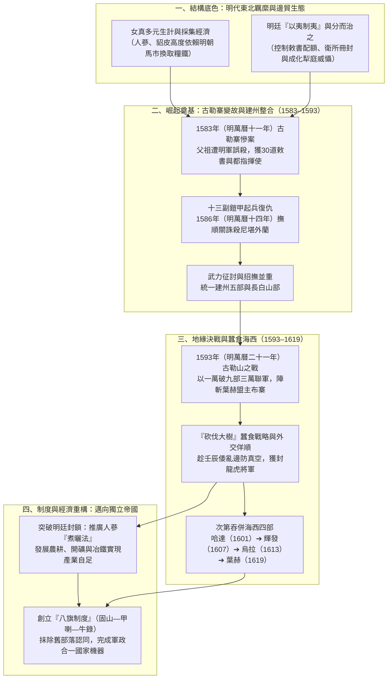
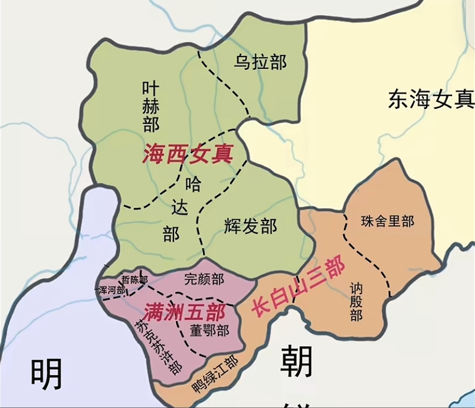
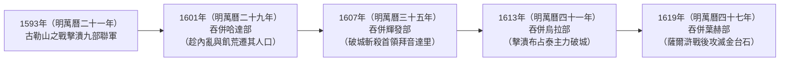
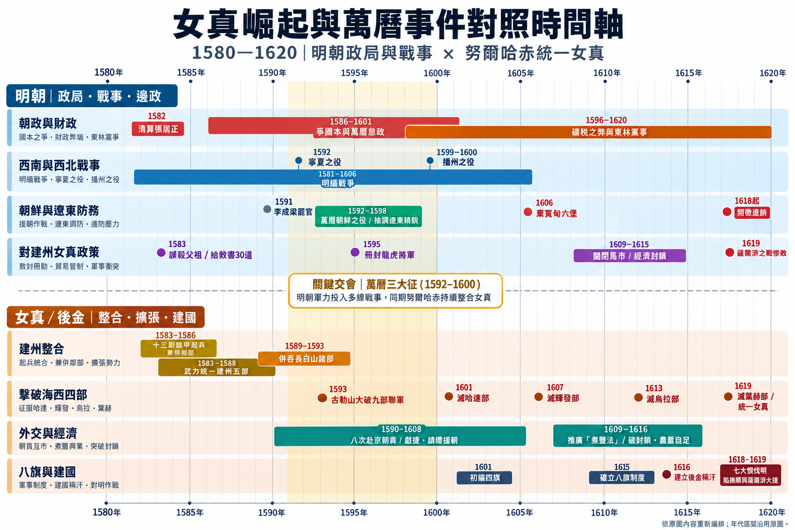
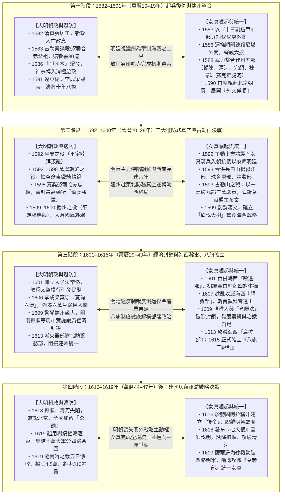

# 女真崛起與統一

## 事件背景

明朝中後期，東北邊疆的地緣政治格局經歷了結構性的劇變。自明初以來，明廷對東北女真各部的治理長期依賴一套結合政治冊封、軍事威懾與邊關貿易控制的「羈縻體系」。然而，女真社會並非靜止封閉的原始魚獵部落，其高度多元化的生計轉型與對明朝邊貿的深度依存，既構成了明廷「以夷制夷」的籌碼，也埋下了日後建州女真努爾哈赤在邊務動盪中崛起、打破部族割據並完成統一的歷史伏筆。

### 1. 女真人的多元生計體系與邊貿依賴

在傳統歷史敘事中，女真人常被簡化為生活於「白山黑水」（長白山脈與黑龍江水系）間的單一魚獵民族。然而到了明代，女真社會已發展出極具韌性且多元化的複合生計體系。除保留傳統捕魚與狩獵外，女真各部廣泛開展農業耕種與畜牧業，並形成規模龐大的山林採集經濟——深入山林採挖人蔘、採摘蘑菇、捕雕及獵取貂皮。

其中，人蔘與貂皮成為女真社會最具價值的核心貿易物資。女真各部將這些高價值特產運往明朝設於邊關的「馬市」（如撫順馬市、開原馬市）進行交易，以換取糧食、布匹、食鹽與鐵器等維持生存與生產的必需品。這種經濟結構使女真社會對明朝邊境貿易產生了強烈的結構性依賴。

| 比較維度       | 傳統刻板印象                 | 明代女真實際生計型態                                     |
| :------------- | :--------------------------- | :------------------------------------------------------- |
| **生計模式**   | 單一魚獵（以捕魚和狩獵為主） | 多元複合生計（狩獵、農業耕種、畜牧、山林採集並重）       |
| **經濟焦點**   | 自給自足的原始掠獲           | 高價值物產採集（人蔘、貂皮、蘑菇、海東青）與邊貿導向     |
| **外部依存度** | 封閉自守，無外部依賴         | 高度依存明朝馬市，換取糧食、布匹、鐵器等生存與生產必需品 |

### 2. 明朝對女真部落的「羈縻」體系與分割策略

自明初至萬曆前期長達兩百餘年間，明廷對東北女真各部實行嚴密的「羈縻體制」。政治上，明廷透過冊封與朝貢體系，授予女真首領官方官職與「敕書」（入關朝貢與馬市貿易的官方許可憑證）；軍事與行政上，則推行[衛所制](../../制度/軍事/衛所制.md)（如建州三衛：建州衛、建州左衛、建州右衛），將女真首領納入明朝邊政管理架構。

明朝東北邊政的核心方針為**「以夷制夷」**與**「分而治之」**。明廷透過控制敕書發放數量、政治冊封、馬市開關調節以及定期軍事威懾，刻意維持女真各部間的割裂與相互牽制，防止任何單一強權興起。1467年（明成化三年）與1479年（明成化十五年），明憲宗[朱見深](../../皇帝/朱見深.md)曾兩度對建州女真發動大規模軍事掃蕩（史稱「成化犁庭」），毀壞數百座村寨並造成毀滅性打擊。此舉雖在表面上維持了百餘年的邊疆羈縻秩序，卻也在建州女真社會深植了對明朝的歷史仇恨。

---

## 發展歷程

### 1. 崛起與奠基：古勒寨變故與建州本部整合（1583年－1593年）

#### （1）努爾哈赤的出身背景與邊務磨練

努爾哈赤出生於建州女真蘇克素虎河部的赫圖阿拉（今遼寧撫順新賓一帶），其家族世襲部落首領並長期擔任明朝冊封官員（六世祖猛哥帖木兒曾受封建州左衛都指揮使）。由於女真社會恪守「幼子繼承」習俗（幼子贍養父母並繼承主要家產，年長諸子成年後僅分得少量家產獨立謀生），身為長子的努爾哈赤十幾歲便分家獨立。

青年時期的努爾哈赤親自入山採蔘、打獵，並頻繁前往撫順馬市交易。在長期商貿歷練中，他不僅展現出洞察市場行情、待價而沽的商業天賦，更在與蒙古人、漢人的密切接觸中熟練掌握蒙古語與漢語，深入了解明蒙漢文化與邊防體制，為日後縱橫於明朝、蒙古與女真三方政局奠定了堅實基礎。

#### （2）古勒寨慘案與初期政治資本累積

1583年（明萬曆十一年），遼東總兵李成梁率明軍圍攻古勒寨（首領阿台為此前反明的王杲之子）。由於阿台之妻為努爾哈赤堂姐（祖父覺昌安之孫女），且覺昌安與父親塔克世皆為效忠明廷的冊封官員，兩人遂入寨勸降阿台並試圖帶出孫女。不料，同屬蘇克素虎河部的圖倫城首領尼堪外蘭為討好明軍，引導李成梁攻破古勒寨，明軍入城後進行無差別屠殺，全城兩千餘人遇害，覺昌安與塔克世亦在亂軍中遭明軍誤殺。

慘案發生後，明廷為安撫悲憤的努爾哈赤並掩蓋誤殺效忠官員的失誤，給予其三項關鍵撫恤，意外成為努爾哈赤崛起的初期資本：

- **三十道敕書**：掌握進入馬市進行官方貿易的合法憑證與鉅額壟斷利益。
- **三十匹戰馬**：直接充實其初期匱乏的騎兵軍事資源。
- **建州左衛都指揮使**：繼承明朝官方認可的合法政治身分，確立在女真諸部中的號召力。

#### （3）十三副鎧甲起兵與建州女真統一

1583年（明萬曆十一年），年僅25歲的努爾哈赤深知自身實力遠不足以抗衡大明，遂將復仇目標精確鎖定於死敵尼堪外蘭，憑藉父祖遺留的「十三副鎧甲」與數十名追隨者正式起兵：

- **追殺尼堪外蘭（1583年－1586年）**：努爾哈赤突襲攻克圖倫城，隨後於甲版城、鵝爾渾城連續追擊。1586年（明萬曆十四年），尼堪外蘭逃入明朝撫順關尋求庇護，努爾哈赤率軍直逼邊關強硬索人；明朝邊將見其勢大且自知理虧，遂允許努爾哈赤派遣部將齋薩率40名精銳入關將尼堪外蘭當場斬殺，歷時三年終報父祖之仇。
- **統一建州本部與長白山部（1588年－1593年）**：誅殺尼堪外蘭後，努爾哈赤聲威大振，採取武力征討與主動招撫並重的策略，至1588年（明萬曆十六年）先後整合哲陳部、渾河部、完顏部、棟鄂部及蘇克素虎河部，完成建州五部統一；隨後向長白山推進，吞併鴨綠江部，並對珠舍里部、訥殷部施加巨大軍事壓力。至1593年（明萬曆二十一年），起兵短短十年間便已基本統一建州女真。

---

### 2. 地緣決戰：古勒山之捷與「砍伐大樹」蠶食策略（1593年－1619年）

#### （1）海西女真的安全困境與九部聯軍來襲

建州女真的迅速統一打破了東北邊疆數百年的均勢，直接衝擊海西女真（葉赫、哈達、烏拉、輝發四部，又稱扈倫四部）的核心利益：

- **地緣包圍壓力**：女真各部原為分散部落互相牽制，建州的高度集中對海西四部形成強大地緣壓迫。
- **經濟命脈截斷**：海西女真長期控制開原南關（哈達部）與北關（鎮北關，葉赫部），壟斷長白山與東海女真特產轉售明朝的中間商暴利。努爾哈赤統一建州後，將大量關外貿易吸引至其控制的撫順關與清河關，嚴重剝奪了海西四部的馬市利益。

1593年（明萬曆二十一年）九月，在葉赫部首領布寨與納林布祿號召下，九個部落組成三萬聯軍大舉進攻建州：

| 聯軍派系                     | 參戰部落                       | 核心地緣與參戰動機                                                                     |
| :--------------------------- | :----------------------------- | :------------------------------------------------------------------------------------- |
| **海西四部（主導力量）**     | 葉赫部、哈達部、烏拉部、輝發部 | 葉赫意圖打壓建州以確立海西及全女真霸權；哈達、烏拉、輝發欲奪回被分流的馬市中間商利益。 |
| **長白山兩部（自保隨行）**   | 珠舍里部、訥殷部               | 與建州地理相鄰，面臨努爾哈赤武力吞併的直接威脅，被迫參戰自保。                         |
| **漠南蒙古（結盟助戰）**     | 科爾沁部（明安、恍惚太）       | 為增強自身實力以抵抗草原強敵察哈爾部，選擇與強鄰葉赫部結盟參戰。                       |
| **松嫩江域兩部（依附出兵）** | 錫伯部、卦爾察部               | 位於嫩江與松花江流域，處於葉赫、烏拉與科爾沁勢力範圍內，屬依附性質隨同出兵。           |

#### （2）古勒山之戰：以少勝多的心理戰與斬首戰術

面對三萬聯軍壓境，建州兵力僅萬餘人，諸將人心惶惶。努爾哈赤精確剖析敵情指出：「九部聯軍雖眾，但部落各異、心志不一且多懷觀望；只要在交戰中斬殺其一兩名核心首領，聯軍必全盤崩潰。」

努爾哈赤隨即依托古勒山險要地形設伏，派大將額亦都率百餘名精騎挑戰聯軍盟主葉赫首領布寨，並以假敗詐退將驕躁衝鋒的布寨引誘至預設伏擊圈。建州伏兵突起，布寨坐騎被絆倒後遭當場斬殺。盟主陣亡瞬間引發九部聯軍骨牌效應，科爾沁部率先潰逃，努爾哈赤親率主力鐵騎全線掩殺。此役建州軍斬首4,000餘級、獲馬3,000餘匹、鎧甲1,000餘副，生擒烏拉部貝勒布占泰。古勒山之捷徹底逆轉了海西壓制建州的歷史格局，海西諸部自此喪失組織大規模聯合進攻的能力。

#### （3）「砍伐大樹」戰略與海西四部的次第覆滅

古勒山大捷後，努爾哈赤並未盲目全面開戰，而是提出著名的**「砍伐大樹」戰略理論**：

> 「欲砍倒大樹，不能一斧折斷，必以斧砍削其枝幹，待樹幹微細，自然倒下。」

在此後二十餘年間，努爾哈赤結合遠交近攻、政治聯姻與武力突襲，將海西四部逐個擊破：

- **滅亡哈達部（1601年，明萬曆二十九年）**：趁哈達內部汗位繼承內耗與嚴重飢荒，施加軍事壓力與經濟控制，最終將其人口全面遷入建州。
- **滅亡輝發部（1607年，明萬曆三十五年）**：趁輝發首領拜音達里深陷內部叛亂、游移於建州與葉赫之間時，果斷揮師破城並斬殺拜音達里，併吞其全境。
- **滅亡烏拉部（1613年，明萬曆四十一年）**：針對烏拉首領布占泰屢次背盟之舉，歷經數次大戰摧毀其主力，最終親率三萬大軍攻破烏拉城，布占泰單騎逃往葉赫，烏拉部滅亡。
- **滅亡葉赫部（1619年，明萬曆四十七年）**：作為海西最強且受明朝庇護的最後對手，努爾哈赤在[薩爾滸之戰](./薩爾滸之戰.md)大敗明軍後，集中兵力圍攻葉赫東西二城，斬殺首領金台石與布揚古，徹底完成女真各部的武力統一。

---

### 3. 戰略偽裝：外交佯順與明廷的邊政失誤

在努爾哈赤長達三十餘年的兼併過程中，明朝政府之所以未能及時發動預防性軍事干預，關鍵在於努爾哈赤高超的外交偽裝，以及明朝遼東邊政的嚴重誤判與防務真空。

#### （1）努爾哈赤的外交佯順與政治套利

為掩護內部擴張，努爾哈赤將父祖之仇深埋心底，對明朝展現出極致的恭順姿態：

1. **頻繁親朝入貢**：自1590年（明萬曆十八年）起，至少八次親自率團赴北京向明神宗[朱翊鈞](../../皇帝/朱翊鈞.md)朝貢，既換取豐厚賞賜，又麻痺明廷中樞戒心。
2. **緝捕叛逆獻捷**：1589年（明萬曆十七年），女真頭目克五十率眾侵擾明朝邊境，努爾哈赤未待明軍出動便主動出兵捉拿克五十並獻首級於明廷，大獲邊臣讚賞。
3. **壬辰倭亂請纓表忠**：1592年（明萬曆二十年）日本豐臣秀吉入侵朝鮮引發[朝鮮戰爭](./朝鮮戰爭.md)，努爾哈赤主動上書請奏，表示願親自挑選女真精騎隨明軍入朝抗倭。

明廷對其「忠順」給予連續破格晉升：自1583年（明萬曆十一年）襲職**建州左衛都指揮使**，1589年（明萬曆十七年）晉升**都督僉事**，至1595年（明萬曆二十三年）更獲加封為**「龍虎將軍」**（明廷授予女真首領的最高榮譽頭銜，此前兩百年僅海西哈達部首領王台曾獲此殊榮）。努爾哈赤精明地將明朝冊封的頭銜與敕書轉化為政治威望，以此合法壓制、脅迫並吞併周邊部落。

#### （2）明朝的戰略誤判與遼東軍事真空

- **「以夷制夷」失算與李成梁的放任**：明廷與遼東總兵李成梁長期將防範重點置於土蠻蒙古騎兵與海西女真（哈達、葉赫），視努爾哈赤為聽話可控、可用於牽制海西與蒙古的「工具人」，對其早期兼併採取放任態度。
- **遼東指揮層動盪**：1591年（明萬曆十九年）李成梁首度去職後，遼東邊防陷入貪腐與內耗，十年間更換八任總兵，邊政毫無連貫性與實質監控力。
- **六年的防務真空期**：1592年至1598年（明萬曆二十年至二十六年）間，明廷深陷「[萬曆三大征的影響](./萬曆三大征的影響.md)」，遼東主力精銳盡數抽調入朝作戰，東北邊防出現長達六年的軍事真空期，給予努爾哈赤千載難逢的擴張窗口。

#### （3）明萬曆朝政戰事與女真崛起雙軌時間序對照

透過將大明帝國的中樞戰事與努爾哈赤統一女真各部的時間線並置比對，可以清晰看見雙方在1583年至1619年（明萬曆十一年至四十七年）間的「戰略錯位」——當明廷深陷爭國本內耗與萬曆三大征泥淖時，努爾哈赤正以「外交佯順」為掩護，逐步完成建州與海西的武力整合及制度革命：

---

### 4. 制度與經濟創新：突破禁運與八旗組織的確立

隨著哈達與輝發相繼被併吞，明廷終於警覺建州女真的巨大威脅，轉而採取停止入貢、關閉撫順等關口馬市的嚴厲經濟制裁。然而，外部封鎖非但未能擊垮建州，反而倒逼努爾哈赤完成技術革新與國家制度重構。

#### （1）破解貿易封鎖：人蔘「煮曬法」與產業自足

由於女真傳統採用「水浸法」（以清水浸泡保鮮）保存鮮蔘，極易腐爛變質。過去明朝商人常利用此弱點故意拖延開市時間，逼迫女真人大幅壓價；當明廷全面關閉馬市實施封鎖後，建州積壓於倉庫的鮮蔘在兩年間腐爛十餘萬斤，同時食鹽、糧食與鐵器嚴重短缺。

面對生存危機，努爾哈赤推行兩大破局舉措：

- **發明並強制推廣「煮曬法」**：努爾哈赤克服內部保守勢力抵制，強行推廣將鮮蔘經水煮後曬乾製成「乾蔘（熟蔘）」的新技術。乾蔘不僅品質穩定且能長期保存，徹底瓦解了明商延遲壓價的伎倆與明廷的貿易封鎖。待馬市重開後，女真人得以握蔘待價而沽，反向獲取巨額白銀紅利。
- **建立自給自足的軍工與農業體系**：大力推行農業屯田、開採金銀礦產，並建立本土冶鐵業以自行鍛造農具、鐵器與精良鎧甲兵器，使建州從依賴邊貿的部落群體質變為獨立運轉的政治實體。

#### （2）八旗制度：部落政治的解構與國家機器塑形

傳統女真部落戰爭往往僅止於掠奪財物、牲畜與人口，戰敗部落的社會結構依然保留，極易死灰復燃並陷入血親復仇循環。努爾哈赤之所以能實現永久統一，核心在於創立了融軍事、行政、生產與司法於一體的**「八旗制度」**。

八旗制度源於女真傳統臨時圍獵組織「牛錄」（滿語意為「大箭」，圍獵時十人一組推舉一人為牛錄額真，獵畢解散）。努爾哈赤於1601年（明萬曆二十九年）起將其常態化與制度化，至1615年（明萬曆四十三年）正式確立「固山—甲喇—牛錄」三級制國家機器：

```mermaid
flowchart TD
  G["固山 / 旗（Gusa）<br>最高軍政單位，由『固山額真』（旗主）統領<br>每旗轄 5 甲喇，計 7,500 名壯丁（男丁）"]
  J["甲喇（Jalan）<br>中層作戰與管理單位，由『甲喇額真』統領<br>每甲喇轄 5 牛錄，計 1,500 名壯丁"]
  N["牛錄（Niru）<br>最基層軍政與生產單位，由『牛錄額真』統領<br>每牛錄編入 300 名壯丁及家眷"]

  G --> J --> N
```

| 比較維度           | 傳統女真部落政治與戰爭                                                       | 八旗制度下的軍政合一國家機器                                                                   |
| :----------------- | :--------------------------------------------------------------------------- | :--------------------------------------------------------------------------------------------- |
| **戰爭目的與處置** | 掠奪財物、牲畜與人口，或僅誅殺敵對首領；敗者部落結構維持完整，極易反叛復仇。 | 徹底摧毀被征服部落的舊有結構，將人口強行拆散並混合編入不同旗、牛錄之中。                       |
| **身分認同核心**   | 血緣與地域導向的「部落認同」（如自稱葉赫人、烏拉人）。                       | 制度與編制導向的「旗籍認同」（轉化為某旗某牛錄人），抹除部落分裂隱患。                         |
| **社會控制維度**   | 鬆散的部族聯盟，首領對基層控制力有限。                                       | 戶籍登記、農業生產、司法審判、賦稅徵收與軍事動員完全歸屬於旗、甲喇、牛錄。                     |
| **人口轉化與擴張** | 戰俘多淪為家奴，難以迅速轉化為國家核心戰力。                                 | 主動歸順者首領可任牛錄額真；武力征服者打散重編，迅速將人口資產化，形成「以戰養戰」滾雪球效應。 |
| **族群包容性**     | 侷限於女真氏族血緣內部。                                                     | 高度包容，大量吸納蒙古人與漢人編入體系（至皇太極時期進一步擴編為滿、蒙、漢八旗）。             |

---

## 影響與意義

### 1. 五大戰略支柱鑄就「以小吞大」的歷史根基

努爾哈赤自1583年（明萬曆十一年）以十三副鎧甲起兵，歷時三十餘年整合東北女真各部，並於1616年（明萬曆四十四年）在赫圖阿拉建立後金政權、1618年（明萬曆四十六年）發布「七大恨」正式伐明。其成功並非單純仰賴戰場勇武，而是五大戰略支柱協同作用的結果：

- **卓越的戰術指揮與心理洞察**：善於在兵力劣勢中捕捉敵方結構弱點（如古勒山之戰看破九部聯軍心志不一），利用地形設伏與斬首戰術實現以少勝多。
- **高超的外交偽裝與戰略忍耐**：在實力弱小期克制父祖血仇，透過八次親朝、獻捷與請纓援朝麻痺明廷，將「龍虎將軍」頭銜與敕書極致轉化為兼併周邊部落的政治保護傘。
- **堅韌的經濟破局與技術革新**：以人蔘「煮曬法」反制明廷貿易封鎖與明商壓價，並推動農耕、採礦與冶鐵自足，完成從邊貿依賴型部落向獨立經濟實體的轉型。
- **劃時代的制度創新與部落解構**：以「八旗制度」取代傳統氏族部落制，用「旗籍認同」抹除數百年的部族隔閡，打造出「出則為兵，入則為民」的高效動員機器，其組織效率遠超明末腐朽的[衛所制](../../制度/軍事/衛所制.md)。
- **廣闊的政治包容與人口資產化**：突破狹隘族群界限，將招撫與征服的女真、蒙古、漢人全面納入八旗編制，使每一次軍事勝利都能直接轉化為國家生產力與兵源，促成軍政實力的指數級膨脹。

### 2. 東北亞地緣格局的永久翻轉

女真的崛起與統一，徹底終結了明朝自永樂、成化以來在東北邊疆維持兩百餘年的羈縻衛所秩序。當後金完成內部制度整合與經濟自足後，明廷傳統的「分而治之」與「經濟封鎖」手段全面失效，雙方矛盾最終在1619年（明萬曆四十七年）的[薩爾滸之戰](./薩爾滸之戰.md)中迎來總爆發。此後明朝在關外由戰略進攻轉為全面崩潰，開啟了明清易代的歷史序幕。

---

## 研究結論

明代萬曆年間女真的崛起與統一，是中國邊疆史與制度演化史上極具代表性的結構轉型案例。努爾哈赤充分利用了明朝邊疆「羈縻與馬市體系」的制度縫隙，在明廷深陷「萬曆三大征」與遼東邊政失能的戰略窗口期，以合法的明朝官職與敕書為掩護，逐步完成了從復仇小部落到區域霸權的原始積累。

更為深遠的是，面對海西諸部的軍事反撲與明朝的經濟封鎖，努爾哈赤並未停留在傳統游牧或漁獵部落的掠奪模式，而是透過人蔘「煮曬法」的商業技術革新與「八旗制度」的社會組織革命，徹底解構了女真舊有的部落政治。正是這套具備高度擴展性、多民族包容性與極致動員力的八旗國家機器，使僅有數萬兵力的女真族群得以創造歷史上罕見的「以小吞大」奇蹟——自1618年（明萬曆四十六年）誓師伐明起，僅歷時26年便於1644年（明崇禎十七年／清順治元年）入主中原，取代擁有數千萬人口的大明帝國。

---

## 參考資料

1. [參考1](https://www.youtube.com/watch?v=zop2NFYRYfY)
