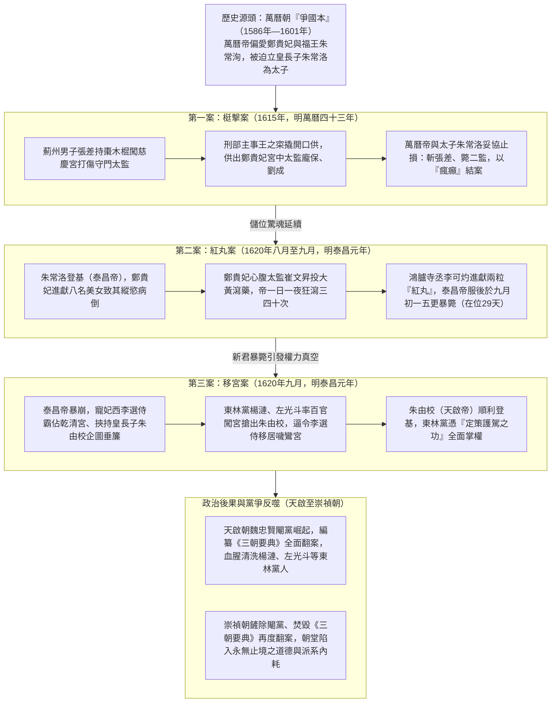
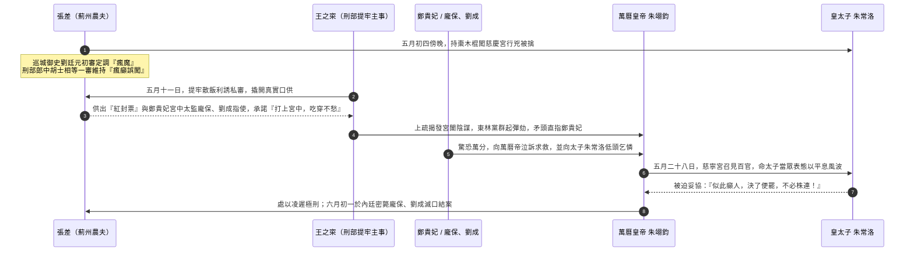
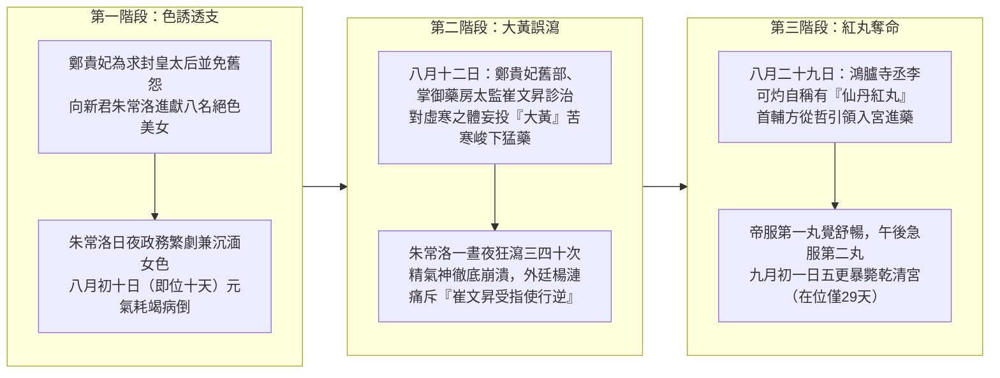
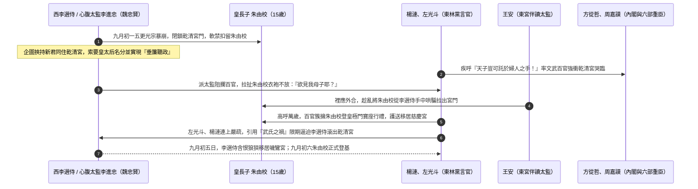

# 明末三大案（梃擊、紅丸、移宮）

## 事件背景

明朝萬曆末年至泰昌、天啟初年（1615年－1620年），紫禁城內接連爆發了三起震動朝野的宮廷政治懸案——**「梃擊案」**、**「紅丸案」**與**「移宮案」**，史稱**「明末三大案」**（或「晚明三案」）。這三起案件表面上分別是皇室門禁治安事件、宮廷御醫用藥事故與內廷宮殿居住權糾紛，實質上卻是萬曆朝長達十五年「[爭國本](./爭國本.md)」政治裂痕的全面總爆發。

在[明神宗朱翊鈞](../../皇帝/朱翊鈞.md)長達數十年的「[萬曆怠政](./萬歷怠政.md)」背景下，圍繞皇太子[朱常洛](../../皇帝/朱常洛.md)（明光宗）與皇長孫朱由校（明熹宗）的皇位繼承安全，外廷東林黨人與齊、楚、浙諸黨，以及內廷鄭貴妃、李選侍與司禮監[太監](../../制度/廠衛/太監.md)勢力展開了殊死搏殺。三大案不僅決定了萬曆、泰昌、天啟三朝皇權交替的走向，更淪為晚明黨爭反覆翻案、互相血腥清算的政治修羅場。

### 1. 「爭國本」的遺毒與儲位裂痕

1586年（明萬曆十四年），萬曆帝專寵的鄭貴妃誕下皇三子朱常洵（福王），萬曆帝意圖打破《皇明祖訓》「無嫡立長」之鐵律，廢黜宮女王氏所生的皇長子[朱常洛](../../皇帝/朱常洛.md)。在內閣與外廷科道[言官](../../制度/言官.md)長達十五年的死諫抗爭下，萬曆帝雖於1601年（明萬曆二十九年）無奈冊立朱常洛為皇太子、封朱常洵為福王，但鄭貴妃與萬曆帝仍以各種藉口將福王留京長達十三年，直至1614年（明萬曆四十二年）方赴洛陽就藩。長期的儲位拉鋸，使皇太子朱常洛始終處於孤立無援與被害恐懼之中，外廷朝臣亦對鄭貴妃勢力保持高度戒備。

### 2. 護儲屏障的消失與東宮空虛

1614年（明萬曆四十二年）二月，長期在深宮中堅定庇護皇太子朱常洛的慈聖皇太后李氏（萬曆帝生母）崩逝。李太后的去世使朱常洛失去了宮中最強大的政治保護傘；與此同時，太子朱常洛遷居紫禁城東側的慈慶宮，但宮門防衛極度鬆弛，僅有少數年老體衰的太監看守，為宮闈刺殺與治安突發事件埋下了致命隱患。

### 3. 東林黨與三黨的派系對壘

萬曆中後期，因「癸巳京察」被削籍的吏部郎中顧憲成等人重修無錫東林書院，講學議政，形成以「清流道德、捍衛正統」自居的**東林黨**；而朝中則分化出依附內閣或地方利益的**齊黨**（山東籍，以方從哲等為代表）、**楚黨**（湖廣籍）、**浙黨**（浙江籍，以沈一貫、姚宗文等為代表）。東林黨堅定擁護太子朱常洛，將鄭貴妃及依附后妃的勢力視為亂政根源；而齊、楚、浙三黨則往往在宮廷爭議中採取調停、庇護內廷或打擊東林黨的立場，雙方在朝堂上水火不容。

---

## 發展歷程

### 1. 梃擊案：棗木棍驚魂與深宮刺儲疑雲（1615年，明萬曆四十三年）

1615年（明萬曆四十三年）五月初四日酉時（傍晚），一名手持棗木棍（即「梃」）的陌生男子，自東華門一路暢通無阻直闖皇太子[朱常洛](../../皇帝/朱常洛.md)居住的慈慶宮，重擊打傷守門太監李鑑，一路殺至前殿簷下，最終被聞訊趕來的內侍韓本用率眾合圍擒獲。

- **初審定調「瘋癲」**：男子被移交法司後，查明其名為**張差**，係京東薊州井兒峪農民。浙江籍巡城御史劉廷元率先上疏，稱張差言語顛倒、形似「風魔」（瘋子）；刑部山東司郎中胡士相、岳駿聲等官員深怕案件牽連宮闈鄭貴妃勢力，遂順水推舟，於初審中將張差定性為「因賣地柴草被燒、氣憤發瘋誤闖禁宮討說法」的瘋癲狂人。
- **王之寀提牢翻供與驚天黑幕**：五月十一日，傾向東林黨的刑部提牢主事**王之寀**（負責管理監獄膳食與囚犯）趁巡視監牢散飯之機，以飯菜引誘並單獨提審張差：「實招與飯，不招餓死！」張差隨即吐露驚人實情：他受薊州本地人馬三道、李守才、孔道（皆屬白蓮教外圍組織「紅封教」）引薦，跟隨宮中兩名大太監前往京師一處大宅院。太監賜予其酒飯與一條棗木棍，指使他闖入慈慶宮「見人就打，打死一個我們就救得你」，並許諾事成後賞賜幾十畝地及「紅封票」（白蓮教憑證）。
- **直指鄭貴妃與朝堂風暴**：經三法司會審核實，張差口中的大宅院正是**鄭貴妃**名下負責營造鐵瓦殿的太監**劉成**之私宅，而兩名主使太監正是鄭貴妃宮中最受寵信的心腹**龐保**與**劉成**。王之寀上疏揭發後，朝野震動，侍郎張問達、給事中何士晉、御史陸大受等東林黨人群起激憤，公開指控鄭貴妃眼見福王就藩、奪儲無望，竟勾結邪教刺殺皇太子。
- **慈寧宮和稀泥與滅口終局**：面對外廷沸騰的輿論，鄭貴妃驚恐萬分，在萬曆帝面前哭泣求救，萬曆帝遂命鄭貴妃親自向太子朱常洛低頭賠罪。由於若查實鄭貴妃謀害皇儲，按律當廢處死，福王亦難逃株連，萬曆帝與孤立無援的太子皆無力承擔皇室骨肉相殘的政治海嘯。五月二十八日，長年不見群臣的萬曆帝罕見地於慈寧宮召見文武百官，緊握太子朱常洛的手，反覆強調父子慈愛，並當場逼問太子態度。朱常洛深知父皇用意，只得含淚順從表態：「張差實係瘋癲，決了便罷，萬勿株連！」隨後，張差於次日被處以凌遲極刑（臨死前哀嘆：「同謀做事，事敗獨死！」），馬三道等人流放；六月初一，萬曆帝在內廷將龐保、劉成秘密杖斃滅口，全案強行畫下句號。

---

### 2. 紅丸案：大黃瀉藥與仙丹奪命之泰昌暴崩（1620年，明泰昌元年）

1620年（明萬曆四十八年）七月二十一日，統治長達四十八年的萬曆帝駕崩。八月初一日，苦熬三十八年的皇太子[朱常洛](../../皇帝/朱常洛.md)正式即皇帝位，詔以次年為**泰昌**元年，是為明光宗。光宗即位後立即推行「泰昌新政」：廢除禍國殃民的[礦稅](../../制度/礦稅.md)、大開內帑發銀二百萬兩犒賞遼東邊軍（支持[熊廷弼](../../人物/文臣/熊廷弼.md)守遼）、大舉起用東林遺賢填補官缺，朝野歡欣鼓舞。然而，短短二十九天後，一場離奇的宮廷醫療慘案徹底葬送了這場中興幻影。

- **鄭貴妃獻美與縱慾病倒**：萬曆帝臨終前曾留下遺言，命封鄭貴妃為皇太后。鄭貴妃深怕新君朱常洛清算當年「爭國本」與「梃擊案」的舊帳，並急欲促成封后大典，遂投其所好，向朱常洛進獻了八名絕色宮女。朱常洛前半生在深宮壓抑驚恐中度過，登基後一朝大權在握，白日高強度批閱奏章、接見群臣，夜間則沉湎於女色之中，身體迅速虧空，於八月初十日（即位僅十天）便一病不起。
- **崔文昇進大黃瀉藥風波**：八月十二日，掌管御藥房的司禮監秉筆太監**崔文昇**（原為鄭貴妃宮中得力內官）入宮為光宗診治。光宗本屬縱慾過度、中氣虛損衰竭之症，理應溫補；崔文昇卻反其道而行，妄診為「內熱鬱結」，開具含有**大黃、芒硝**等虎狼寒涼之性的猛烈瀉藥。光宗服藥後，「一晝夜如廁三四十次」，腹瀉不止，直接陷入休克垂危狀態。外廷[言官](../../制度/言官.md)兵科給事中**楊漣**等人聞訊大驚，上疏嚴詞彈劾崔文昇「假醫術行逆謀」，強烈懷疑鄭貴妃指使崔文昇在背後蓄意毒殺皇帝。
- **李可灼進奉「紅丸」與暴崩**：至八月二十九日，光宗自知病入膏肓，召見內閣首輔**方從哲**、英國公張惟賢、吏部尚書周嘉謨、兵科給事中楊漣等人交代後事。此時，並非醫官出身的鴻臚寺丞**李可灼**突然上疏，宣稱自己擁有早年在峨嵋山所得之仙方「紅丸」（實為晚明道教盛行的房中術春藥與催命補劑，主要由處女初潮經血提煉之「紅鉛」、童男童女尿液結晶之「秋石」、人乳、辰砂及人參等煉製而成），保證能起死回生。
- **連服兩丸與五更猝逝**：首輔方從哲起初不敢擔責，但在光宗反覆催促與病急亂投醫之下，方從哲未經太醫院嚴格核驗，便默許引領李可灼入乾清宮進藥。光宗服下第一粒紅丸後，因藥物中重金屬與激素的短暫興奮作用，頓覺四肢回暖、精神舒暢，並進食少許粥水，連聲讚嘆李可灼為「忠臣」。當日申時（下午三至五點），光宗不顧御醫「藥力猛烈、不可再進」的警告，急令李可灼再進第二粒紅丸。服下第二丸後，光宗當夜氣息急促、翻騰不止，最終於**1620年（明泰昌元年）九月初一日五更**暴斃於乾清宮，享年三十八歲，在位僅二十九天，史稱「一月天子」。
- **紅丸案的朝堂論戰**：光宗暴崩後，首輔方從哲竟按照光宗生前口諭，賞賜李可灼白銀五十兩、錦緞二表裏，而對崔文昇僅罰退南京閒住。此舉引爆東林黨與清流大臣的雷霆震怒：禮部尚書**孫慎行**、左都御史**鄒元標**、御史**王安舜**等人連番上疏，將此案比作春秋時期「許世子止進藥弒君」之典故，痛斥李可灼進獻邪藥「實同弒逆」，崔文昇「蓄意謀害」，而首輔方從哲身為顧命大臣，非但不討賊，反賞賜弒君兇手，實屬「縱逆無君」。在強大輿論壓力下，方從哲被迫致仕，李可灼最終被改判遣戍邊疆，崔文昇發遣南京充軍。

---

### 3. 移宮案：乾清宮奪儲與東林黨護駕（1620年九月，明泰昌元年）

明光宗朱常洛九月初一五更猝逝後，紫禁城瞬間陷入權力真空。光宗長子**朱由校**（即後來的明熹宗天啟帝）年僅十五歲（虛歲十六），生母王才人早已在萬曆年間被光宗寵妃**李選侍**（人稱「西李」）凌虐殴打致死，朱由校遂由西李選侍撫養。光宗屍骨未寒，乾清宮內隨即爆發了一場驚心動魄的奪宮與護儲大戰。

- **西李選侍扣留新君與垂簾野心**：西李選侍性情潑辣專橫，早與鄭貴妃結成政治同盟（光宗生前曾被迫考慮同時封鄭貴妃為皇太后、封李選侍為皇貴妃），其宮中更有一名極受寵信的心腹太監**李進忠**（即日後的九千歲**魏忠賢**）。光宗斷氣後，李選侍立即下令封鎖乾清宮大門，將皇長子朱由校扣留在內殿，禁止外廷大臣入內哭臨，並要求朝臣必須先尊封她為皇太后、且一切奏章須先經她過目（形同垂簾聽政），方肯交出皇長子。
- **楊漣率百官闖宮搶儲**：當日清晨，兵科給事中**楊漣**、御史**左光斗**與禮部侍郎孫如游、吏部尚書周嘉謨等大臣趕至乾清宮外，遭李選侍手下太監持挺阻攔。楊漣怒目圓睜，厲聲喝斥守門太監：「皇帝駕崩，皇長子年少，你們竟敢閉門拒納群臣，意欲何為！」百官一擁而入哭臨光宗遺體，隨即高喊請見新主朱由校。李選侍在內殿死死拉住朱由校的衣袍不放，太監李進忠（魏忠賢）亦再三喝令拉回。此時，一直效忠於東林黨與先帝的司禮監伴讀太監**王安**挺身而出，在內殿哄騙李選侍說「不過讓皇長子出去見百官一面即回」，趁機一把抱住朱由校向外猛推；楊漣與英國公張惟賢在殿外立刻接應，將朱由校搶入懷中，簇擁上轎直奔文華殿行嵩呼禮，隨後護送至東宮慈慶宮安置。
- **左光斗「武氏之疏」與逼迫移宮**：朱由校雖被搶出，但李選侍依然霸佔皇帝專屬的正寢**乾清宮**不肯搬離，並揚言要將朱由校接回同住。朝臣定於九月初六日舉行新皇登基大典，依照禮制，新君登基後必須入住乾清宮，絕無與非嫡非生母之先朝嬪妃同室而居之理。九月初二日，御史**左光斗**呈上一道雷霆萬鈞的奏疏，嚴厲指出：「內廷之有乾清宮，猶外廷之有皇極殿，惟皇帝與皇后得居之……今選侍既非嫡母，又非生母，儼然尊居正宮，而殿下乃居慈慶，不得守几筵行大禮，名分倒置！若不早移宮，恐將來借撫養之名行專制之實，**武氏之禍（武則天篡唐）將再現於今日！**」
- **李選侍憤恨移宮與東林全勝**：李選侍見疏暴跳如雷，揚言要召左光斗入宮嚴辦，甚至威脅要抱親生幼女（皇八女）跳井自盡以要挾朱由校。楊漣毫不退讓，於乾清宮門外破口大罵太監，痛陳李選侍生前毆死朱由校生母王才人、專橫霸道之劣跡，並向首輔方從哲施壓：「今日不移宮，我輩死不退朝！」在楊漣、左光斗、周嘉謨與太監王安的內外夾擊下，朱由校正式下達諭旨，限令李選侍即刻搬遷。九月初五日，李選侍被迫含淚帶著行李與幼女，狼狽搬出乾清宮，移居仁壽殿後方的**噦鸞宮**；九月初六日，朱由校於皇極殿正式登基，改元**天啟**。

---

## 關鍵爭議與深度剖析

### 1. 三大案核心爭點與兩派政治立場對比

在明末三大案中，東林黨與非東林黨（齊、楚、浙三黨及後來的閹黨）針對每一案的定性展開了截然相反的政治解讀與輿論攻防：

| 案件名稱   | 核心歷史謎團                               | 東林黨立場（王之寀、孫慎行、楊漣、左光斗）                                                                           | 反東林黨 / 閹黨立場（劉廷元、方從哲、魏忠賢）                                                                          |
| :--------- | :----------------------------------------- | :------------------------------------------------------------------------------------------------------------------- | :--------------------------------------------------------------------------------------------------------------------- |
| **梃擊案** | 張差闖宮是否為鄭貴妃謀害太子之組織性刺殺？ | **主謀刺儲論**：張差絕非瘋癲，龐保、劉成即為鐵證，鄭貴妃包藏禍心謀害國本，初審官員故意掩蓋真相、縱容逆賊。           | **瘋癲誤闖論**：張差純屬農夫發瘋誤闖，王之寀為博取功名私自利誘逼供、捏造大獄，企圖離間萬曆帝與太子天倫骨肉。           |
| **紅丸案** | 崔文昇與李可灼進藥是否為蓄意毒殺泰昌帝？   | **巫醫弒君論**：崔文昇受鄭貴妃指使以大黃催命，李可灼進春藥紅丸形同弒君，首輔方從哲賞銀包庇，犯下「縱逆不討賊」大罪。 | **忠愛誤治論**：泰昌帝病危，崔文昇、李可灼進藥皆出於臣子救君之忠愛本心，藥石無效乃天命使然，東林黨借題發揮構陷老臣。   |
| **移宮案** | 楊漣、左光斗強逼李選侍移出乾清宮是否正當？ | **護駕定策論**：西李選侍毆死新帝生母，又企圖挾持幼主垂簾聽政，強逼移宮乃捍衛祖制、挽救大明社稷之不世奇功。           | **逼迫庶母論**：李選侍撫養新帝有恩，並無垂簾野心；楊漣、左光斗貪圖擁立定策之功，咆哮禁宮、凌虐先帝遺孀，違背孝道倫常。 |

### 2. 《三朝要典》：閹黨的反撲與歷史話語權篡改

東林黨人憑藉在「移宮案」中擁立天啟帝的「定策大功」，在天啟初年徹底擊潰齊、楚、浙三黨，將趙南星、高攀龍、鄒元標、楊漣、左光斗等東林領袖推上吏部、都察院等中樞要職，實現了「眾正盈朝」的政治巔峰。

然而，他們在逼迫李選侍移宮的過程中，徹底得罪了李選侍宮中的太監**魏忠賢**（原名李進忠），且對天啟帝乳母客氏與魏忠賢的勾結極度輕視。當魏忠賢害死東林黨內廷盟友太監王安、掌控司禮監與東廠大權後，失勢的齊、楚、浙三黨政客（如顧秉謙、魏廣微、霍維華、崔呈秀等）紛紛投靠魏忠賢，結成龐大的**「閹黨」**集團。

1626年（明天啟六年），閹黨為徹底摧毀東林黨的政治合法性與道德光環，由大學士顧秉謙、黃立極、馮銓主持，官方正式纂修頒布了二十四卷的**《三朝要典》**：

- **政治定性翻轉**：該書專門針對萬曆、泰昌、天啟三朝的「梃擊、紅丸、移宮」三大案進行官方翻案。書中將「梃擊案」的王之寀定性為「開釁骨肉」；將「紅丸案」的孫慎行定性為「借端誣陷」；將「移宮案」的楊漣、左光斗定性為「邀功咆哮、離間君親」。
- **血腥肉體消滅**：伴隨《三朝要典》的修纂，魏忠賢利用[錦衣衛](../../制度/廠衛/錦衣衛.md)鎮撫司獄（許顯純掌理）與東廠番子，結合遼東[熊廷弼](../../人物/文臣/熊廷弼.md)案，發動了慘絕人寰的「乙丑、丙寅大獄」。王之寀被逮捕入獄活活餓死；孫慎行被削籍遣戍；而「移宮案」功臣**楊漣**（被土囊壓身、鐵釘貫耳慘死）、**左光斗**（面目炮烙糜爛、全身筋骨盡斷慘死）等「東林六君子」與「後七君子」相繼在詔獄中受盡酷刑折磨致死。
- **崇禎朝再度翻案**：1627年（明天啟七年）八月天啟帝駕崩，信王朱由檢（崇禎帝）即位並誅滅魏忠賢閹黨。1628年（明崇禎元年），在東林餘脈與清流官員要求下，崇禎帝下詔全面焚毀《三朝要典》書版，為楊漣、左光斗、王之寀等人平反昭雪並追贈諡號。然而，圍繞三大案與《三朝要典》的站隊紀錄，依然在整個崇禎朝乃至南明弘光政權中成為官員互相攻訐、拒絕合作的死結。

---

## 影響與意義

### 1. 君臣與內外廷信任機制的徹底崩解

明末三大案將明代中樞「皇權—內閣—言官—宦官」（參見[三權分立](../../制度/三權分立.md)）的動態制衡機制徹底撕裂。外廷文官深信內廷后妃與太監隨時在進行刺殺、下毒與篡權陰謀；而皇帝與內廷則視外廷文官為結黨營私、咆哮禁宮、挾持君父的權臣集團。這種深度的被害妄想與制度性猜忌，使天啟帝寧可盲目信任不識字的太監魏忠賢，而崇禎帝則在「東林與閹黨皆不可信」的極端多疑中頻繁撤換與處死大臣（如[袁崇煥](../../人物/文臣/袁崇煥.md)案）。

### 2. 政策議題「泛道德化」與行政機能窒息

三大案的長期爭論，使晚明朝堂政治徹底偏離了「治國理政」的實務軌道，陷入了極端的**「泛道德化」**與**「立場先行」**泥淖。官員的升遷與罷黜，不再取決於其理財、治水或統兵的實幹能力，而是取決於其在「張差是否瘋癲、紅丸是否毒藥、李選侍是否該移宮」這三個歷史問題上的表態立場。凡立場不同者，必欲除之而後快，導致大量具備實務才幹的官員（如經略遼東的[熊廷弼](../../人物/文臣/熊廷弼.md)）被捲入三案與黨爭的漩渦中慘遭絞殺。

### 3. 戰略窗口期的錯失與帝國加速覆亡

三大案爆發與發酵的1615年至1626年（萬曆四十三年至天啟六年），恰逢關外建州女真努爾哈赤建立後金（1616年）、取得[薩爾滸之戰](./薩爾滸之戰.md)大捷（1619年）、攻陷瀋陽與遼陽（1621年）並進逼廣寧的關鍵十餘年（詳見[遼東邊政與失控](../../遼東邊政與失控.md)）。當關外邊防將士浴血苦戰、八旗鐵騎席捲遼東之際，北京紫禁城內的皇帝與滿朝文武卻將全部政治精力與國家資源耗費在「棗木棍、紅藥丸與搬宮殿」的無休止內鬥之中。正如《明史》所痛嘆：**「三案構爭，黨禍益熾，國事日非，而明遂亡矣！」**

---

## 研究結論

「明末三大案」（梃擊案、紅丸案、移宮案）絕非三起孤立的宮廷偶發奇案，而是明代君主專制制度在經歷[萬曆怠政](./萬歷怠政.md)與[爭國本](./爭國本.md)長期扭曲後，在皇權交接脆弱期所引發的系統性政治崩潰。

從歷史真相審視，張差之棍或許確有后妃內侍的僥倖圖謀，崔文昇與李可灼之藥更多源於晚明宮廷荒誕的丹藥迷信與醫療失誤，而西李選侍之留宮則是深宮婦人對權力安全感的本能攫取。然而，在高度極化的黨爭生態下，這三樁案件被東林黨與反東林黨（及閹黨）無限放大為「忠奸善惡」的終極政治圖騰。東林黨人雖在三案中展現了捍衛法統與剛直敢言的士大夫氣節，卻也因其非黑即白的道德潔癖與政治清算，將反對派逼向與皇權特務（魏忠賢閹黨）合流的絕路，最終招致《三朝要典》與詔獄屠殺的毀滅性反噬。明末三大案猶如三記沉重的喪鐘，在紫禁城的刀光劍影與口誅筆伐中，徹底耗盡了大明帝國最後的政治元氣與自救契機。

---

## 參考資料

1. [參考1](https://www.youtube.com/watch?v=EK7pqmags2E&list=WL&index=17)
