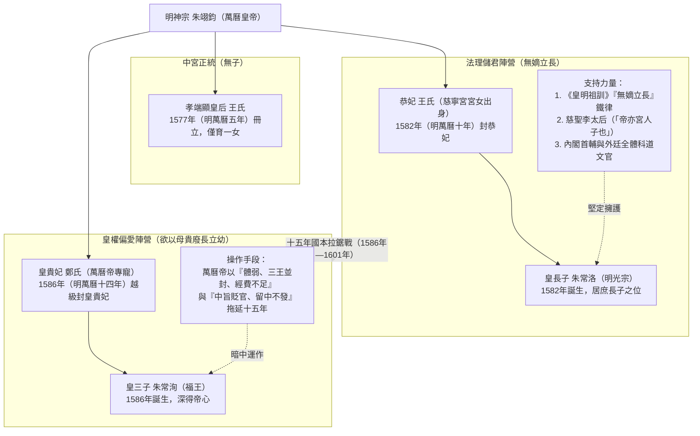
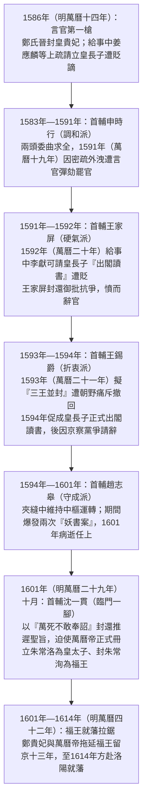
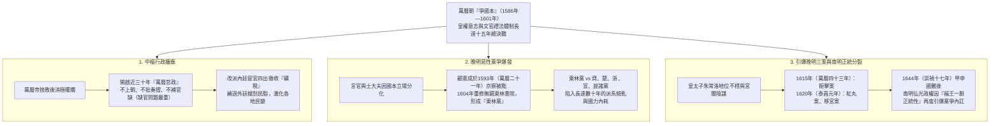

# 爭國本

## 事件背景

明朝萬曆年間發生的「國本之爭」，是指[明神宗萬曆皇帝朱翊鈞](../../皇帝/朱翊鈞.md)與[內閣](../../制度/內閣制.md)及朝臣文官集團之間，圍繞皇位繼承人（皇太子）冊立問題所爆發的大規模政治爭端。這場爭端自1586年（明萬曆十四年）鄭貴妃誕下皇三子朱常洵並獲封「皇貴妃」起，至1601年（明萬曆二十九年）正式冊立皇長子[朱常洛](../../皇帝/朱常洛.md)為皇太子止，前後歷時長達十五年，牽涉五任內閣首輔與數百位朝臣，是明朝中後期皇權與文官官僚體系對抗的最重大事件。

### 1. 偶然的皇長子誕生與嫡庶結構

1581年（明萬曆九年），年僅十八歲的萬曆皇帝偶然臨幸慈寧宮宮女王氏。王氏隨後懷孕，萬曆帝起初因出身微賤與羞愧心理不敢承認。李太后（本身亦為宮女出身）翻閱《內起居注》冊簿核對，並以「母以子貴」勸導。1582年（明萬曆十年），王氏獲封「恭妃」，並於同年誕下皇長子[朱常洛](../../皇帝/朱常洛.md)（即日後的明光宗）。

### 2. 鄭貴妃盛寵與「以母貴」疑慮

同於1582年（明萬曆十年），朝廷舉行「選九嬪」，北京大興女子鄭氏入宮，受封為德妃，次年晉封為貴妃。鄭貴妃機敏活潑，深受萬曆帝獨寵。1586年（明萬曆十四年），鄭貴妃誕下皇三子朱常洵（後封福王）。萬曆帝極為歡喜，隨即打破例規，將鄭氏越級超封為「皇貴妃」。

在皇長子朱常洛之母王恭妃僅為一般妃嬪的情況下，皇帝將皇三子之母鄭氏提拔為僅次於皇后的皇貴妃，釋放了極具風險的政治訊號。文官集團敏銳察覺萬曆帝有意實行「以母貴」，意圖繞過[朱元璋](../../皇帝/朱元璋.md)在《皇明祖訓》中訂立的「嫡長子繼承制」（無嫡立長），廢長立幼。

### 3. 禮法依據與「皇明祖訓」

朝臣堅持立皇長子朱常洛為太子的法理依據，源於明太祖[朱元璋](../../皇帝/朱元璋.md)頒布的《皇明祖訓》：「凡朝廷無皇子，必兄終弟及，須立嫡母所生者。庶子府分先後，年長者當立。」在孝端顯皇后王氏無育有皇子（僅育有一女）的前提下，身為庶長子的朱常洛即為法理上的第一順位繼承人。

---

## 發展歷程

國本之爭歷經十五年拉鋸，文官集團以死諫、集體上疏、封還御旨等方式對抗皇帝的拖延與[中旨](../../制度/中旨.md)操作，導致[內閣](../../制度/內閣制.md)首輔頻繁更替。

### 1. 朝臣死諫與言官第一槍（1586年，明萬曆十四年）

鄭貴妃獲封皇貴妃後，戶科給事中姜應麟率先上疏直言抗議，主張「若冊封鄭氏為皇貴妃，必須先封王恭妃，且應早立皇長子為皇太子」。萬曆帝大怒，將姜應麟遠貶山西。隨後，吏部員外郎沈璟、刑部主事孫如法、禮部尚書沈鯉等相繼上疏死諫，皆遭萬曆帝駁回或貶謫，但朝臣的集體抗爭並未止息。

### 2. 五任內閣首輔的政治困境與命運

國本之爭成為考驗內閣首輔政治智慧與立場的試金石，先後有五任首輔在此議題中交鋒或被迫離職：

- **申時行（調和派，1583年－1591年任首輔）**：採柔性溫和態度勸諫皇帝早定國本。1591年（明萬曆十九年），申時行私下向萬曆帝遞呈密疏安慰皇帝，密件內容意外外洩，遭[言官](../../制度/言官.md)指責為「雙面人、包藏禍心」，被迫罷官離朝。
- **王家屏（硬氣派，1591年－1592年任首輔）**：1592年（明萬曆二十年），吏部給事中李獻可上疏請求讓皇長子「出閣讀書」（即以太子規格接受教育）。李獻可因奏疏錯字遭萬曆帝下令貶官，王家屏硬氣執行「封還御旨」，與萬曆帝徹底破裂，僅任首輔數月即憤而辭官。
- **王錫爵（折衷派，1593年－1594年任首輔）**：1593年（明萬曆二十一年），萬曆帝提出「三王並封」方案，即將皇長子朱常洛、皇三子朱常洵、皇五子朱常浩同時冊封為親王，暫不立太子。此舉引發朝野強烈譴責，王錫爵被迫撤回方案。隨後王錫爵轉而推動皇長子於1594年（明萬曆二十二年）正式「出閣讀書」，取得繼承地位的實質突破。後因「京察」黨爭遭彈劾請辭。
- **趙志皋（守成派，1594年－1601年任首輔）**：兩度出任首輔，在皇帝與文官夾縫中疲於奔命，力主維持中樞運作，1601年（明萬曆二十九年）病逝於任上。
- **沈一貫（臨門一腳，1601年－1606年任首輔）**：1601年（明萬曆二十九年），萬曆帝在冊立前夕仍欲尋找藉口推遲旨意。沈一貫態度極為堅決，回覆**「萬死不敢奉詔」**，並封還旨意，最終促成冊立。

### 3. 終局與妥協（1601年，明萬曆二十九年）

1601年（明萬曆二十九年）十月，在李太后的嚴厲質詢（「帝亦宮人子也」）、內閣與全體文官的頑強堅守，以及萬曆帝自身重病後的政治妥協下，萬曆帝正式下詔：

- **冊立皇長子[朱常洛](../../皇帝/朱常洛.md)為皇太子**。
- **冊封皇三子朱常洵為福王**。
- 長達十五年的「國本之爭」在名義上落幕。然而福王就藩問題仍被拖延至1614年（明萬曆四十二年）才正式赴洛陽就藩。

---

## 關鍵爭議與深度剖析

### 1. 廢后疑雲與孝端顯皇后之地位

後世常疑問萬曆帝為何不直接「廢后」並立鄭貴妃為皇后，使朱常洵成為「嫡子」。歷史實情為萬曆帝根本不具備廢后的理據與意願：

- **正統性與尊長喜愛**：孝端顯皇后王氏於1577年（明萬曆五年）經全國選秀冊立為后，深受陳太后與李太后兩宮太后讚賞。
- **後宮治理與賢德**：王皇后主持後宮長達四十二年（中國歷史上在位最長之皇后），性情溫和賢淑，常勸諫萬曆帝寬恕直臣，並節省宮內開支賑濟災民與充實軍餉。萬曆帝對王皇后始終保持敬重，絕非「厭惡皇后」。

### 2. 萬曆帝與文官集團死磕之根源

萬曆帝之所以在冊立議題上與文官集團僵持十五年，背後具有複雜的政治心理與皇權對決因素：

- **擺脫張居正與太后陰影**：萬曆帝幼年即位，長期生活在[張居正](../../人物/文臣/張居正.md)與李太后的嚴格管教下。親政後，他企圖仿效祖父[朱厚熜](../../皇帝/朱厚熜.md)（嘉靖皇帝）當年發動「[大禮議](../嘉靖時期/大禮儀.md)」的策略，藉由重大禮制議題打破文官集團的言路控制，樹立絕對皇權。
- **戰略失誤與法理孤立**：嘉靖帝的「大禮議」係為生父爭取封號，具有《皇明祖訓》「兄終弟及」的法理依據；而萬曆帝的「國本之爭」則是破壞「嫡長子繼承制」，完全站在祖制、禮法、太后、皇后及朝野輿論的對立面，導致其在政治對決中陷入孤立。

---

## 影響與意義

國本之爭不僅是明代禮制與皇權演變的關鍵樞紐，更對明朝中後期的政治格局產生了深遠的破壞性影響。

### 1. 皇權與文官體系的雙輸

國本之爭展現了明代文官官僚體系的強大制度韌性與禮法約束力，即便是至高無上的皇帝亦無法任意違背祖制。然而，萬曆帝在挫敗後產生極大的無力感與政治厭倦，採取消極抗爭。

### 2. 開啟近三十年「怠政躺平」時代

國本之爭落幕後，萬曆帝徹底放棄與文官集團合作，開啟了長達近三十年不上朝、不批奏折、不補官缺的[萬曆怠政](./萬歷怠政.md)局面，並派太監四出徵收[礦稅](../../制度/礦稅.md)以繞過外廷戶部，嚴重侵蝕大明國本。

### 3. 東林黨爭與明末三案之源頭

國本之爭促成了文官集團內部的派系分化與結黨。以顧憲成（於1593年明萬曆二十一年「癸巳京察」中因爭國本與內閣決裂被削籍）、高攀龍為首的士大夫於1604年（明萬曆三十二年）在無錫東林書院講學評政，形成「東林黨」，與齊黨、楚黨、浙黨展開激烈的黨爭。此外，國本之爭直接引發了萬曆末年至1620年（明泰昌元年）間的「明末三案」（梃擊案、紅丸案、移宮案，參見[朱常洛](../../皇帝/朱常洛.md)），政治動態更延伸至1644年（明崇禎十七年）後的南明時期，南明諸臣甚至因「福王朱由崧（朱常洵之子）繼位正統性」繼續內耗，加速了明朝的滅亡。

---

## 研究結論

萬曆朝的「國本之爭」，本質上是明代君主專制皇權與以《皇明祖訓》為核心的文官官僚體制之間的一次總決戰。萬曆皇帝試圖藉由意志凌駕祖制以確立至高無上的皇權，卻遭到了文官集團以禮法傳統與集體官僚力量的頑強抵抗。這場歷時十五年的政治內耗，雖然保全了嫡長子繼承制的制度傳統，卻也付出了皇帝全面怠政、黨爭全面爆發、朝政中樞癱瘓的慘痛代價，成為明朝由盛轉衰的重大轉折點。

---

## 參考資料

1. [參考1](https://www.youtube.com/watch?v=Jg-g8TC_sTE&list=WL&index=2&t=4s)
2. [參考2](https://www.youtube.com/watch?v=7PtjTx9QI7I&list=WL&index=3&t=1s)
