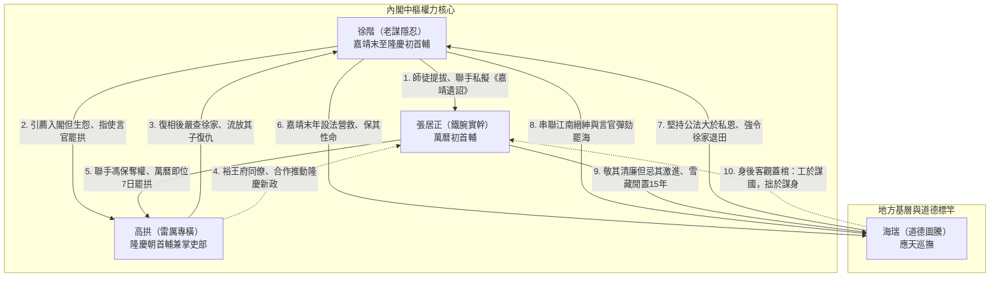
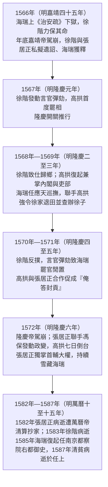
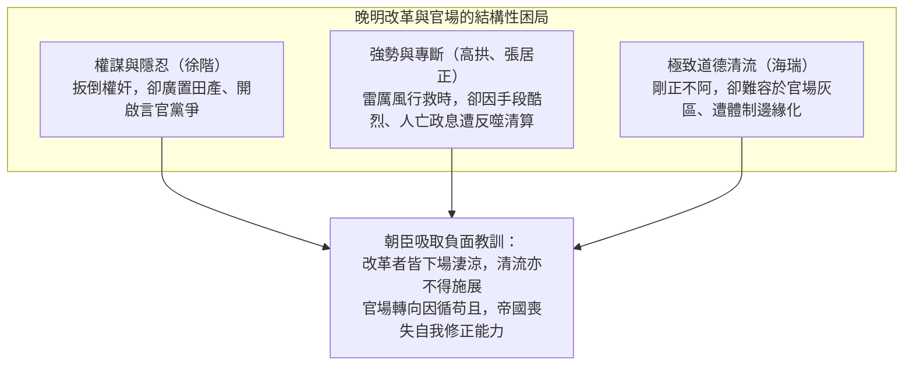

# 徐高張海關係研究

## 歷史背景

明朝嘉靖中後期至萬曆初期，大明帝國正面臨深刻的體制轉型與「中年危機」。在政治上，[內閣制](../../制度/內閣制.md)權力膨脹，首輔更迭伴隨著殘酷的黨爭與派系鬥爭（如[嚴嵩](./嚴嵩.md)專政、徐高之爭）；在經濟上，土地兼併嚴重，民生凋敝，國庫空虛；在軍事上，「北虜南倭」危機不斷。

在這一時期，[徐階](./徐階.md)、[高拱](./高拱.md)、[張居正](./張居正.md)與[海瑞](./海瑞.md)四人先後登上了歷史舞台，他們或身處內閣中樞掌控政局，或在地方基層推行法治。他們的關係糾葛，不僅是個人恩怨與權力鬥爭，更是大明帝國「救時」改革的路線與道德之爭。

---

## 核心關係網絡與互動糾葛

這四位明代巨擘的互動，交織出師徒、盟友、政敵與道德對決等多重面向：

### 1. 徐階與張居正：師徒傳承與默契運作

- **政治盟友與提拔**：[徐階](./徐階.md)是[張居正](./張居正.md)的政治導師與引路人。張居正稱徐階為師，在徐階主持內閣期間，張居正被招入翰林院並協助編纂《興都志》，深得徐階信任，為其日後接掌首輔鋪平了道路。
- **政治手段的學習**：張居正冷眼旁觀徐階如何以「極度隱忍」的演技，與[嚴嵩](./嚴嵩.md)虛與委蛇十餘年，最終發動致命一擊將其扳倒。張居正日後與馮保結盟、對[萬曆帝](../../皇帝/朱翊鈞.md)實行心理壓制的作風，深具徐階之遺風。
- **政權的平穩過渡**：1566年（明嘉靖四十五年），[嘉靖帝](../../皇帝/朱厚熜.md)駕崩，徐階與張居正聯手私擬《嘉靖遺詔》，平反大批冤獄，實現了嘉隆之際的撥亂反正。

### 2. 徐階與高拱：恩怨對立與政治復仇

- **拉攏與抗衡**：[徐階](./徐階.md)對[高拱](./高拱.md)有引薦入閣之恩，期盼高拱能順從作其附庸。然而高拱生性極其驕傲，不甘居於人下，入閣後在政策上屢屢與徐階針鋒相對，雙方因此公開決裂。
- **遺詔結怨與高拱罷官**：1566年（明嘉靖四十五年）嘉靖帝駕崩時，徐階繞過高拱私下起草《嘉靖遺詔》，令高拱極為憤怒，指責其獨攬大功且刻薄先皇。1567年（明隆慶元年）[隆慶帝](../../皇帝/朱載垕.md)即位後，徐階指使科道[言官](../../制度/言官.md)大肆彈劾高拱「專橫跋扈」，迫使高拱首度落敗，罷官回鄉。
- **東山再起與查抄徐家**：高拱於1569年（明隆慶三年）被隆慶帝重召回朝，兼掌內閣與吏部。此時，適逢[海瑞](./海瑞.md)出任[應天巡撫](../../制度/巡撫總督.md)並大力清查江南土地兼併。高拱藉此政治契機，嚴厲查抄退隱的徐階家族，將徐階的二子流放充軍，徹底完成了政治上的復仇。

### 3. 高拱與張居正：志同道合到裂痕決裂

- **前期的改革盟友**：[高拱](./高拱.md)與[張居正](./張居正.md)同在裕王府伴讀，對[隆慶帝](../../皇帝/朱載垕.md)有極深的情誼。在隆慶新政期間，高拱為首輔，張居正居其次，兩人精誠合作，大刀闊斧推行整頓吏治、促成1571年（明隆慶五年）「[俺答封貢](../../事件/隆慶時期/隆慶議和.md)」與1567年（明隆慶元年）「[隆慶開關](../../事件/隆慶時期/隆慶開關.md)」等，為日後的萬曆中興打下了基礎。
- **性格與權力之裂痕**：高拱性格剛直、專橫跋扈，而張居正深沉內斂、以救時自許。隨著高拱專權，張居正為了掌握真正的改革大權，與司禮監掌印[太監](../../制度/廠衛/太監.md)馮保結盟。
- **七日倒台的悲劇**：1572年（明隆慶六年），隆慶帝駕崩，年僅十歲的[萬曆帝](../../皇帝/朱翊鈞.md)即位。馮保與張居正聯手，將高拱在內閣中嘆息的「十歲太子如何治天下」扭曲為「十歲孩子如何做人主」，誣指其意圖篡位。萬曆即位第七天，高拱被即刻奪職逐回，張居正隨後接任首輔，兩人關係徹底破裂。

### 4. 徐階與海瑞：私恩救命與公法退田的道德對決

- **救命之恩**：1566年（明嘉靖四十五年），[海瑞](./海瑞.md)呈遞《治安疏》痛罵[嘉靖帝](../../皇帝/朱厚熜.md)，嘉靖帝將其下獄。當時身為首輔的[徐階](./徐階.md)深知海瑞為民直言，從中百般斡旋，用計營救海瑞，保住了其性命。
- **公法大於私恩的衝突**：1569年（明隆慶三年），海瑞出任應天巡撫，大力打擊土地兼併。海瑞堅持「公法大於私恩」，將打擊重點指向曾營救過他的恩人徐階，清查徐家強佔的巨額隱性田產。徐階以太極手段退田萬畝，但海瑞執法不阿，要求徐階清退所有非法強佔田產並將其犯法的兒子收監判刑。
- **徐階的反彈與海瑞之罷**：求情未果的徐階串聯江南豪強，指使[言官](../../制度/言官.md)戴鳳翔彈劾海瑞辦事激進、「魚肉縉紳」，導致海瑞在任僅八個月便於1570年（明隆慶四年）被罷免辭官。此案成為明代「私恩」與「公法」對決的經典案例。

### 5. 張居正與海瑞：務實改革與極致道德的觀照

- **「工於謀國」與「極致清廉」的兩極**：[張居正](./張居正.md)推行[張居正經濟改革](../../經濟/張居正經濟改革.md)講求務實、權謀與妥協，不拘小節；而[海瑞](./海瑞.md)一生追求極致的道德實踐，拒絕任何政治灰色地帶與妥協。
- **張居正對海瑞的邊緣化**：張居正掌權的十年期間（1572年—1582年，明萬曆元年至十年），雖然敬重海瑞的操守，但認為海瑞「缺乏行政靈活性、不適合複雜實務」，且其激進的退田政策會嚴重破壞地方經濟與秩序，因而拒絕起用海瑞，將其邊緣化在老家長達十五年之久。
- **海瑞的評價**：海瑞雖被邊緣化，但在1582年（明萬曆十年）張居正逝世遭清算後，海瑞評價張居正為「工於謀國，拙於謀身」，展現了對其功業的客觀認同。

---

## 嘉隆萬政局演進與四人命運時序

---

## 歷史影響與後世評價

這四人互動的核心，本質上是大明帝國中後期**「道德、實幹與權力」**的三角衝突：

- **政爭與內耗**：[徐階](./徐階.md)與[高拱](./高拱.md)、[高拱](./高拱.md)與[張居正](./張居正.md)的內閣鬥爭，雖然伴隨著優秀的政策出台（如隆慶新政、萬曆新政），但也極大破壞了官場體制，開啟了晚明利用言官打擊異己的惡性黨爭先河。
- **改革路線的折損**：[海瑞](./海瑞.md)激進的道德實踐雖然大快人心，但因缺乏制度配套而未能持久；[張居正](./張居正.md)鐵腕務實的改革雖成就了萬曆中興，但因手段過於殘酷、缺乏容錯空間，在其身後迅速瓦解（人亡政息）。
- **帝國自我修正能力的喪失**：朝臣們從這四人的命運中吸取教訓，發現隱忍如徐階、實幹如高拱、鞠躬盡瘁如張居正，晚年皆落得悲慘清算或家道中落的下場；而清廉如海瑞卻一生被邊緣化、窮困安息。這使得後繼官員紛紛走向因循守舊、混日子的虛無主義，帝國最終失去改革與自救的能力。

---

## 研究結論

徐階、高拱、張居正與海瑞這四位明代巨擘的政治糾葛，是大明帝國走向衰亡過程中一次悲壯的體制與道德嘗試。[徐階](./徐階.md)代表了老謀深算的儒家「隱忍與雙標」；[高拱](./高拱.md)展現了「雷厲風行、恃才傲物」的能臣風骨；[張居正](./張居正.md)體現了「鐵腕救時、拙於謀身」的實幹家精神；[海瑞](./海瑞.md)則是不妥協的「儒家道德圖騰」。他們在朝堂上的合作、分裂與對決，揭示了明代官僚體制在缺乏漸進式改革與容錯機制的情況下，個人再大的才華與操守，也難以挽救體制性腐敗與帝國走向黃昏的歷史宿命。

---

## 參考資料

1. [參考1](https://www.youtube.com/watch?v=zuOv6a7USz4&start=0)
2. [參考2](https://www.youtube.com/watch?v=oSNDn2ocn8g&start=0)
