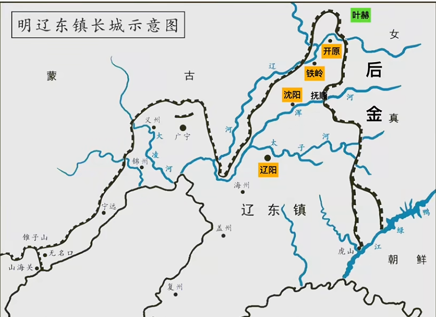
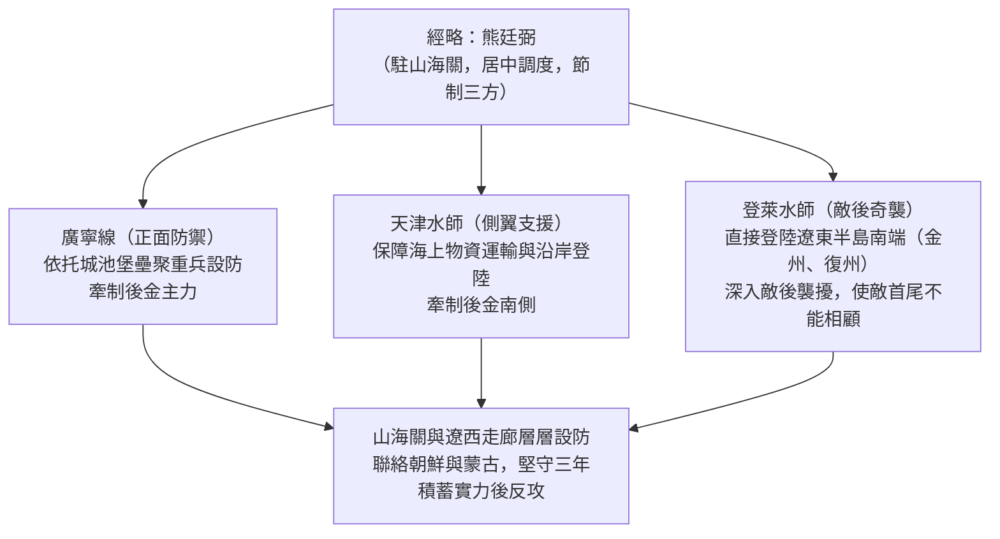
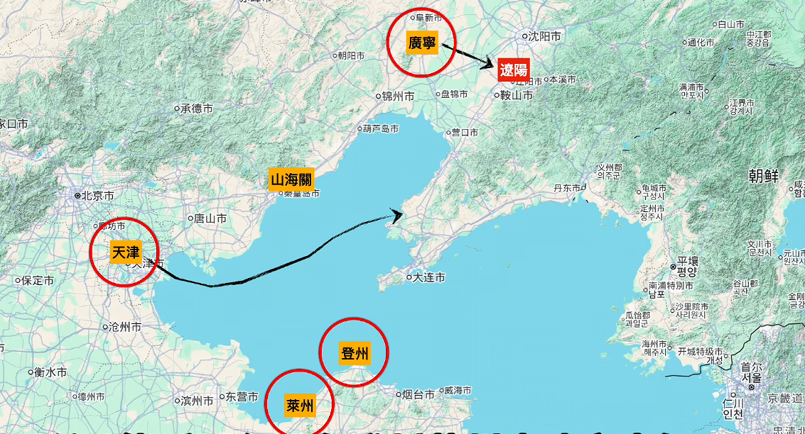
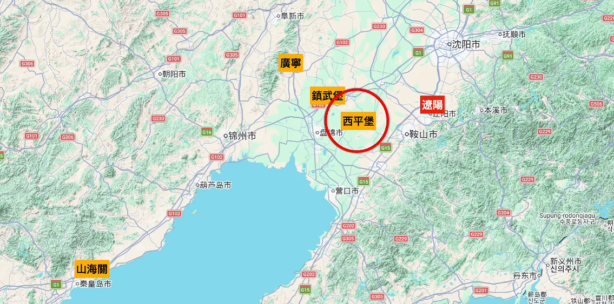
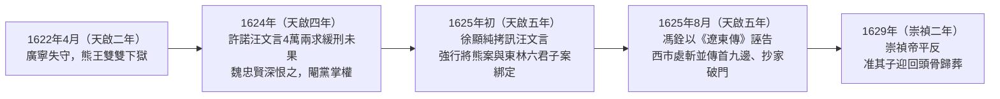

# 熊廷弼

## 歷史背景

萬曆晚期至天啟年間，大明帝國在東北邊陲維持數百年的戰略平衡，隨著建州女真努爾哈赤的崛起與後金政權的建立而全面瓦解。1619年（明萬曆四十七年）[薩爾滸之戰](../../事件/萬曆時期/薩爾滸之戰.md)的慘敗，不僅使明軍喪失四萬五千餘名精銳與三百一十餘名文武將領，更讓明帝國在遼東的軍事主導權徹底崩解。戰後開原、鐵嶺相繼失守，葉赫部亦遭吞併，北部戰略屏障全毀，瀋陽與遼陽直接暴露於敵前，遼東防線陷入大規模潰敗的真空狀態。

與此同時，晚明朝堂內部的政治生態極度惡化。歷經[萬歷怠政](../../事件/萬曆時期/萬歷怠政.md)與[爭國本](../../事件/萬曆時期/爭國本.md)之爭後，東林黨與浙黨、齊黨、楚黨等派系相互攻訐，[言官](../../制度/言官.md)集團常以道德清議與速勝期待強加於前線軍事決策；而在地方督撫體制上，[巡撫與總督](../../制度/巡撫總督.md)（含戰時特設之經略）事權重疊、互相掣肘的制度缺陷，更使邊疆戰略淪為朝堂權力博弈與閹黨亂政下的犧牲品。在這樣內憂外患的危局中，以兵部右侍郎兼遼東經略臨危受命的熊廷弼，展開了力挽狂瀾卻最終殞命於廟堂的悲劇歷程。

| 比較項目           | 薩爾滸戰前明軍部署                                 | 戰後遼東防禦真空狀態                                           |
| :----------------- | :------------------------------------------------- | :------------------------------------------------------------- |
| **戰略主導權**     | 掌握遼東軍事主動權，集結11萬大軍兵分四路主動出擊。 | 徹底喪失戰略主動權，退守遼陽、瀋陽，處於完全被動防禦。         |
| **北部戰略屏障**   | 開原、鐵嶺、葉赫部環繞，形成多層緩衝屏障。         | 開原、鐵嶺相繼失守，葉赫部被吞併，北部緩衝屏障全毀。           |
| **軍隊士氣與兵力** | 集中宣府、大同、四川、浙江等全國精銳，士氣尚可。   | 喪失4.5萬精銳與310餘名文武將領，潰兵逃逸，士氣崩潰極度恐慌。   |
| **戰略重鎮局勢**   | 撫順雖失，但瀋陽、遼陽為穩固之後方腹地與指揮中心。 | 瀋陽直接推至最前線，瀋陽與行政中心遼陽人心惶惶，居民大量逃亡。 |

---

## 核心生平與事蹟

### 1. 首次經略遼東與「以守為戰」之鐵血整肅

早在1608年（明萬曆三十六年）至1611年（明萬曆三十九年）巡按遼東期間，熊廷弼便深刻洞察邊務，指出東路女真「圖我土地人口」的野心遠比僅圖財物的蒙古更具威脅，惟當時未獲朝廷重視。1619年（明萬曆四十七年）[薩爾滸之戰](../../事件/萬曆時期/薩爾滸之戰.md)慘敗後，正以大理寺丞身份在河南賑災的熊廷弼奉召即刻進京。

- **平台對策與戰略確立**：明神宗[朱翊鈞](../../皇帝/朱翊鈞.md)（萬曆帝）於平台召見熊廷弼。面對朝堂恐慌，熊廷弼冷靜剖析局勢，提出**「以守為戰，以守待變」**的核心戰略，主張明軍在戰力、後勤與士氣均處劣勢下，必須先修築堅城、恢復實力、穩定民心，防守穩固後方可圖謀反攻。萬曆帝高度認可，破格提拔其為兵部右侍郎兼遼東經略，賜尚方寶劍，賦予便宜行事之最高軍事指揮權，並在生命最後一年全力調撥糧餉支持。
- **鐵血治軍與重整防線**：1619年（明萬曆四十七年）七月，熊廷弼出關赴任，面對沿途村落破敗、兵無軍紀的亂象，到任三天即展開鐵血整頓：
  - **嚴肅軍紀與整肅兵額**：於遼陽大刑場當眾斬殺劉傑、王傑、王文鼎等3名臨陣脫逃的參將及13名逃兵；處死貪污將領陳淪；上書彈劾罷免棄守鐵嶺的總兵官李如楨，提拔敢戰將領李懷信，使軍紀大振。
  - **重構堡壘與火器體系**：親自勘察地形，加固遼陽、瀋陽、廣寧城垣並深挖三道護城河；督造戰車5,000餘輛、大砲上千門、三眼銃與鳥銃7,000餘支（結合明代[火炮科技](../../制度/軍事/火炮科技興衰.md)優勢）；構築遼陽、清河、撫順、三叉兒、鎮江等地的聯防體系，實現「小敵各自據守，大敵相互支援」。
  - **籌措糧餉與推行軍屯**：針對十萬駐軍的糧荒危機，一方面請撥軍餉赴直隸、山東採購糧食，另一方面在遼河兩岸組織軍事[屯田](../../制度/屯田制.md)，招撫逃散流民數十萬人，給予口糧與田地，使遼東民心大定、商業秩序逐步恢復。
- **正面逼退後金**：1619年（明萬曆四十七年）年底，努爾哈赤親率大軍試探性進攻蒲河，熊廷弼親率主力馳援，後金軍見防禦嚴密無隙可乘遂主動撤退。這是薩爾滸慘敗以來明軍首次在正面戰場逼退後金，至1620年（明萬曆四十八年）中，後金暫時放棄進攻遼陽，邊境局勢大為好轉。

### 2. 朝堂黨爭圍剿與首次罷官

前線防線雖漸趨穩固，但熊廷弼剛直不阿、脾氣火爆且不善官場周旋的性格，加上在遼東大刀闊斧清查冒領軍餉，極大觸怒了地方利益集團與朝中言官。

- **派系孤立與利益衝突**：熊廷弼嚴查招募不合格新兵冒領軍餉的遼東官員劉國晉，並峻拒赴遼東巡視企圖牟取私利的吏科給事中姚宗文。利益受損者遂在京師結盟散佈謠言，誣稱其「專權跋扈、虛報軍功、糜餉勞師、畏敵不戰」。熊廷弼雖籍貫湖廣（被視為楚黨），但曾與東林黨交游，後又因與楚黨郭正域聯姻而遭東林黨反感，在朝堂陷於孤立。面對圍剿，熊廷弼上疏痛斥：「臣在遼東，日與虜戰，夜與虜謀，寢不解甲，食不甘味。朝中諸臣坐而論道，豈知邊事之艱難！臣但知有遼東，不知有身家。」此言更激化了清流[言官](../../制度/言官.md)的敵意。
- **帝王更迭與失去靠山**：1620年（明萬曆四十八年）七月，全力支持熊廷弼的萬曆帝[朱翊鈞](../../皇帝/朱翊鈞.md)駕崩，繼位的明光宗[朱常洛](../../皇帝/朱常洛.md)在位僅一月暴斃，年僅16歲的明熹宗天啟帝（朱由校）即位。「數月三易帝位」使熊廷弼失去唯一政治靠山，御史馮三元、顧慥、張修德等人連番猛烈彈劾。
- **憤而去職与袁應泰接任**：1620年（明萬曆四十八年）十月，馮三元彈劾熊廷弼「無謀欺君」，甚至誣稱其危害「深於建州」。面對三次加派遼餉（達520餘萬兩）的財政焦慮，文官集團無法容忍其長期固守戰略。熊廷弼憤而繳回尚方寶劍，五次上書自辯請辭並要求實地調查。儘管朝廷派出的朱童蒙實地調查後完全肯定其守遼之功，天啟朝廷仍於1620年底批准熊廷弼罷職，改由主張主動出擊、善於理財的袁應泰接任遼東經略。

### 3. 遼沈淪陷與二度出山：「三方布置」與「經撫不和」

袁應泰接任後徹底改弦更張，規劃三路出兵收復失地，並於1621年（明天啟元年）初大開城門收容上萬蒙古飢民與前線瀋陽、遼陽居民混居，導致大量後金間諜潛入城內。

- **遼沈七十餘城淪陷**：1621年（明天啟元年）三月十二日，努爾哈赤率八旗精銳猛攻瀋陽。守將賀世賢輕敵出城中計，城內潛伏間諜發難砍斷吊橋、縱火開門，賀世賢戰死、瀋陽淪陷。馳援的四川石砫兵（秦邦屏、周敦吉率領）與浙江兵（戚金、陳策率領，承襲[戚繼光](../武將/戚繼光.md)戚家軍戰術）共萬餘人在渾河背水結陣血戰竟日，斬敵數千後因彈盡糧絕幾乎全軍陣亡（渾河血戰）。三月二十一日，後金攻破城外營陣並藉城內間諜裡應外合攻陷遼陽，總兵朱萬良、梁仲善等戰死，袁應泰自縊殉國。十天內遼河以東70餘城盡失，防線被迫退縮至廣寧與遼西走廊。
- **二度受命與「三方布置」戰略**：遼沈慘敗震動京師，天啟帝於1621年（明天啟元年）六月初三下旨重新啟用熊廷弼，加兵部尚書兼右副都御史銜，賜蟒玉、尚方寶劍，駐紮山海關。熊廷弼於八月到任後，提出極具戰略眼光的**「三方布置」**構想：

- **經撫雙頭體制與戰略對立**：朝廷在啟用熊廷弼前已先提拔王化貞為遼東巡撫。王化貞坐鎮廣寧掌握14萬大軍，而身為最高長官的經略熊廷弼駐山海關，直接兵力竟不足5,000人，形成致命的「經撫不和」：

| 比較維度             | 經略：熊廷弼                                                       | 巡撫：王化貞                                                                 |
| :------------------- | :----------------------------------------------------------------- | :--------------------------------------------------------------------------- |
| **駐紮地點與實權**   | 駐山海關，僅直接統領不足5,000兵力，權力被架空。                    | 坐鎮最前線廣寧，直接掌控14萬大軍與物資。                                     |
| **戰略核心構想**     | 「三方布置」持久固守：穩紮穩打，先守後攻，主張至少需三年積蓄力量。 | 速戰速勝：聲稱只需6萬精兵，三個月內一舉蕩平後金（「三月平遼」）。            |
| **外部力量評估**     | 深知蒙古各部不可靠，認清後金實力，嚴防敵偽降與間諜。               | 輕信蒙古察哈爾林丹汗出兵40萬（實為索要賞銀）；輕信後金降將李永芳偽降。       |
| **朝堂支持勢力**     | 僅獲少數了解邊務的老臣支持；與朝官關係緊張。                       | 獲內閣首輔葉向高（其座主）、兵部尚書張鶴鳴傾力支持，張下令王可不受經略節制。 |
| **對毛文龍夜襲看法** | 認為毛文龍襲擊鎮江過早暴露部署、引致後金屠殺百姓，是「奇禍」。     | 視毛文龍夜襲鎮江成功為後金內部脆弱之鐵證，大受鼓舞並大肆宣揚。               |

由於兵部尚書張鶴鳴與內閣首輔葉向高偏袒王化貞，滿朝文官盲目迷信「速勝論」，熊廷弼的「三方布置」流於空談。1621年（明天啟元年）十二月，熊廷弼上疏哀求朝廷明確事權，朝廷僅批復模稜兩可的「經撫各任其事，同心共濟」，熊廷弼長嘆：「廣寧必失，大勢已去矣！」

### 4. 廣寧慘敗與撤退入關

1622年（明天啟二年）正月，努爾哈赤利用明軍經撫內耗、廣寧空虛之機，率6萬八旗主力渡過遼河發起廣寧之役。

- **西平堡血戰與平陽橋倒戈**：後金軍首先圍攻廣寧門戶西平堡，守將羅一貫率3,000守軍利用火砲弓箭血戰數日，至正月二十二日彈盡糧絕，羅一貫向北京跪拜後自刎殉國，全軍戰死。期間王化貞派總兵劉渠、祁秉忠與參將孫得功（孫德恭）率3萬主力馳援，於平陽橋激戰時，早已暗通李永芳投降後金的叛將孫得功突然率先撤退並高喊「兵敗了！」製造恐慌，明軍陣腳大亂全軍覆沒，劉渠、祁秉忠力戰身亡，祖大壽退往覺華島（菊花島）。
- **廣寧不戰而潰與大凌河會師**：正月二十三日，孫得功逃回廣寧封鎖火藥庫與銀庫、控制城門並散佈謠言，準備獻城。王化貞聞訊倉皇逃出，廣寧不戰而潰。王化貞逃至大凌河畔遇見率5,000兵東進接應的熊廷弼，失聲痛哭道：「悔不聽公言，以至於此！」熊廷弼冷笑回應：「六萬眾一舉蕩平，竟何如？」
- **焚毀糧草與雙雙下獄**：面對主力盡喪的既成事實，熊廷弼評估關外已無可靠兵力防守寧遠、前屯，遂將所部5,000兵交由王化貞殿後，護衛數十萬遼西難民渡過大、小凌河撤入山海關，並焚毀沿途無法帶走的糧草設施，主動放棄遼西走廊據點。戰敗傳至北京，兵部尚書張鶴鳴為推卸偏袒王化貞之責，將罪責全推給熊廷弼，誣其通敵逃跑。1622年（明天啟二年）四月，熊廷弼與王化貞雙雙被革職逮捕下獄。

### 5. 閹黨冤獄與「傳首九邊」之慘烈終局

下獄後的熊廷弼，在暗無天日的三年牢獄中，淪為閹黨（[太監](../../制度/廠衛/太監.md)魏忠賢集團）與東林黨慘烈權力博弈下的政治工具。

- **獄中掙扎與魏忠賢之恨**：熊廷弼曾託汪文言向內廷許諾四萬兩白銀以求緩刑保命，但因其自幼家貧、為官清廉，根本無力籌措巨款而未能兌現。當時已掌控內廷的魏忠賢認受戲弄，對其恨之入骨，誓置於死地。
- **強行綁定東林黨獄**：1624年至1625年（明天啟四年至五年），魏忠賢發動針對東林黨人的大獄。因熊廷弼二次出山曾獲鄒元標、趙南星、楊漣、左光斗等東林黨人支持，閹黨遂利用熊案打擊東林：
  - **汪文言案逼供**：[錦衣衛](../../制度/廠衛/錦衣衛.md)指揮使徐顯純嚴刑拷打汪文言，強行逼供誣指熊廷弼以重金向楊漣、左光斗等人行賄求庇護，將熊案與「東林六君子案」強行綁定，羅織「貪腐通敵」罪名。
  - **《遼東傳》構陷**：閹黨爪牙馮銓在經筵講學時，拿出市面刊印記載熊廷弼守遼事蹟的《遼東傳》，向天啟帝誣陷該書係熊廷弼所作且言語諷刺皇帝，徹底激怒天啟帝。
- **西市處斬與傳首九邊**：1625年（明天啟五年）八月二十八日，57歲的熊廷弼於北京西市處斬，臨刑前寫下絕命詞，痛嘆「一腔熱血，竟灑何地」。魏忠賢下令將其首級**「傳首九邊」**，自北京出發依次巡迴展示於山海關、薊州、宣府、大同、山西、延綏、寧夏、固原、甘肅等九個邊防重鎮。據《明季北略》記載，當首級傳至遼東時，無數曾隨其作戰的邊防老兵跪地痛哭。
- **破家慘劇與身後平反**：熊廷弼死後，御史梁夢環誣其侵盜軍資17萬兩，御史劉徽妄稱其家資百萬應抄沒充餉。魏忠賢下令嚴追抄家，江夏知縣王爾玉酷刑勒索，逼得熊廷弼長子熊兆珪自刎身亡，落得家破人亡；反觀罪魁禍首王化貞因投靠閹黨並獲葉向高庇護，遲至1632年（明崇禎五年）才被處斬。直至1629年（明崇禎二年），崇禎帝正式為熊廷弼平反，准許其子迎回頭骨歸鄉安葬。

---

## 歷史影響與後世評價

### 1. 戰略喘息與邊防思想的延續

熊廷弼首次經略遼東，在薩爾滸戰後全軍崩潰、國家財政加派遼餉引發民怨的極端危局下，憑一己之力於短短一年多內重建軍隊指揮體系與物資防禦鏈。「以守為戰」是唯一符合當時明軍裝備劣勢（缺乏精銳野戰騎兵）與財政邊界的客觀規律，成功阻絕後金兵鋒直逼山海關的威脅，為大明王朝爭取了極其寶貴的戰略喘息時間。他死後不到半年，孫承宗踏上出關之路，正是接續其憑城固守、步步為營的戰略思想重築關寧錦防線。

### 2. 「經撫雙頭制」與言官干政的體制檢討

熊廷弼兩度經略遼東的挫敗，深刻暴露出晚明邊防體制的兩大結構性死結：

- **外行文官干預專業將領**：朝廷[言官](../../制度/言官.md)「坐而論道」，以道德高標與速勝幻想強加於軍事決策，將財政壓力簡單歸咎於前線的持久堅守。
- **督撫事權重疊與倒置**：在[巡撫與總督](../../制度/巡撫總督.md)體制下，經略（主管戰略指揮）與巡撫（掌握實兵與地方行政）事權重疊。當內閣與兵部出於黨爭或急功近利偏袒巡撫王化貞時，經略必然被徹底架空，使廣寧潰敗與關外戰略縱深的喪失成為制度性必然。

### 3. 「邊臣寒心效應」與大明覆滅的連鎖反應

熊廷弼遭冤殺並「傳首九邊」，對晚明邊防產生了毀滅性的**「邊臣寒心效應」**，徹底摧毀了邊疆大吏的擔當意志。此後如袁崇煥、洪承疇、孫傳庭等邊臣，在政治生存與戰場決策之間皆陷入極度扭曲的兩難——明知不應浪戰，卻因畏懼言官彈劾與皇權猜忌而不敢恪守長期軍事規律（如1643年孫傳庭被迫出潼關決戰而死，次年1644年北京陷落、明朝覆滅）。後世史家與清代乾隆皇帝審視此段歷史時，均高度肯定熊廷弼「深謀遠慮、審機處制」，指出其死於昏君奸臣與腐敗體制，誠所謂「自毀棟樑之日，即為王朝覆滅之始」。

---

## 研究結論

熊廷弼是晚明罕見兼具宏觀戰略眼光與鐵血執行力的軍事統帥與實幹派文臣。他在[薩爾滸之戰](../../事件/萬曆時期/薩爾滸之戰.md)後的廢墟上重建遼東防線，又在遼沈淪陷後提出高瞻遠矚的「三方布置」方略，展現了挽狂瀾於既倒的卓越才幹。然而，他剛烈孤傲、不善權謀妥協的性格（對比嘉靖朝同樣經略邊防卻選擇依附權貴以換取資源的[胡宗憲](./胡宗憲.md)，以及萬曆初年結盟內廷以推行改革的[張居正](./張居正.md)），使其在黨爭極化、言官清議氾濫與閹黨亂政的晚明政治修羅場中孤立無援。

熊廷弼的悲劇，絕非個人性格或單一戰役的失利，而是晚明帝國體制性腐敗與政治極化的終極縮影。當一個王朝將黨派立場置於國家安危之上、以莫須有罪名戮殺邊防棟樑並傳首九邊時，國家機器已徹底喪失自我修正能力，明帝國邊防的全面崩塌與最終覆亡，亦自此成為不可逆轉的歷史宿命。

---

## 參考資料

1. [參考1](https://www.youtube.com/watch?v=8b80qXL0xSg)
2. [參考2](https://www.youtube.com/watch?v=FiSz5Bu5VWo)
3. [參考3](https://www.youtube.com/watch?v=sFZsZw0MF-s)
4. [參考4](https://www.youtube.com/watch?v=cKY5jcC6h2k)
5. [參考5](https://www.youtube.com/watch?v=Sv3tM0tKJqg)
