# 袁崇煥

## 歷史背景

1619年（明萬曆四十七年）[薩爾滸之戰](../../事件/萬曆時期/薩爾滸之戰.md)慘敗後，明朝在東北的戰略優勢徹底逆轉，由主動進攻轉為全面被動防禦（詳見[遼東邊政與失控](../../遼東邊政與失控.md)）。1621年（明天啟元年）遼陽、瀋陽相繼淪陷；至1622年（明天啟二年），由於遼東經略[熊廷弼](./熊廷弼.md)與巡撫王化貞爆發嚴重的「經撫不和」，明軍於廣寧之役再度慘敗，被迫率領剩餘官兵與數十萬百姓退入山海關。後金大汗努爾哈赤拆毀了包括廣寧在內的遼西四十餘座城池，將數十萬漢民強行東遷至遼東，致使山海關以東至遼河以西的遼西走廊淪為一片廣袤的無人真空區。

面對關外防線全線崩潰的危局，天啟朝廷內部陷入嚴峻的戰略路線爭議：究竟是退守山海關，還是向前推進防線？與此同時，晚明朝堂正值[太監](../../制度/廠衛/太監.md)魏忠賢閹黨勢力崛起並與東林黨展開慘烈整肅、[言官](../../制度/言官.md)集團清議氾濫，以及國家財政瀕臨破產的結構性困局。在這樣的歷史轉折點上，文官進士出身卻酷愛兵法、曾單槍匹馬出關考察地形並豪言「予我軍馬錢穀，我一人足守此」的袁崇煥異軍突起。他從一名小小的寧前兵備道逐步崛起為執掌關內外大權的「薊遼督師」，在築防寧遠、創立關寧鐵騎與抵禦皇太極入關的戰役中力挽狂瀾，卻最終在明思宗崇禎帝（朱由檢）的極端猜忌、朝堂黨爭傾軋與市民集體狂熱中，迎來「西市凌遲、爭啖其肉」的慘烈終局。

| 戰略路線與代表人物                      | 核心主張與防禦戰術                                                                                                                                                         | 戰略影響綜合評析                                                                                                                               |
| :-------------------------------------- | :------------------------------------------------------------------------------------------------------------------------------------------------------------------------- | :--------------------------------------------------------------------------------------------------------------------------------------------- |
| **消極防衛論** （遼東經略 王在晉）   | 主張**「劃關自守」**：認為寧遠距山海關過遠，救援與補給極度困難，建議完全放棄寧遠與遼西走廊，退守山海關，並在山海關外八里處耗巨資興建「重城」作為補充防線。                 | 實質上完全放棄遼西走廊的戰略縱深與緩衝區，將後金軍隊直接引至山海關城下，使山海關處於極度被動的正面衝擊之下，徹底喪失恢復遼東元氣的可能性。     |
| **積極防衛論** （寧前兵備道 袁崇煥） | 主張**「立足寧遠、向前推進」**：提出「兵法有進無退」，應向東推進二百里至寧遠，進而推進四百里至錦州；利用後金擅長野戰、拙於攻城的弱點，多建城堡，以堅城與西洋火器消耗敵軍。 | 成功將山海關轉化為大後方的堅固屏障。即便前線堡壘遭突破，敵軍抵達關下時亦已疲憊不堪；同時為明朝積蓄力量、日後反攻遼東保留了關鍵基地與戰略縱深。 |

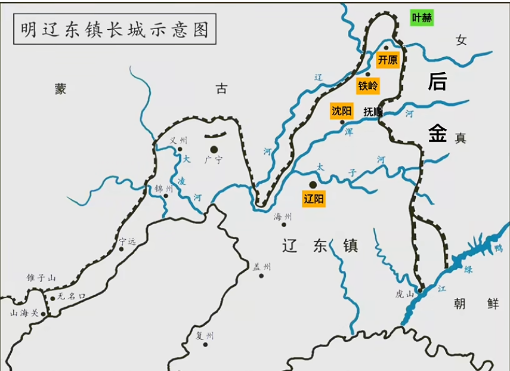

---

## 核心生平與事蹟

### 1. 關寧錦防線之構築與寧遠、寧錦大捷

1622年（明天啟二年），天啟帝的老師、[內閣](../../制度/內閣制.md)大學士兼兵部尚書孫承宗親自出關考察，否定了王在晉「劃關自守」的消極方案，採納袁崇煥的積極防衛主張，並獲賜尚方寶劍出任「薊遼督師」（政治地位與威望遠高於普通經略，全權節制薊州、遼東、天津、登萊四鎮軍政）。在孫承宗與袁崇煥的密切配合下，明軍展開了系統性的關外防線重建：

- **孫承宗與袁崇煥的戰略體系構建（1622年－1625年，明天啟二年至五年）**：
  - **堡壘防線東推**：先後修復寧遠、前屯、松山、錦州、大凌河、小凌河等9座大城與45座堡壘，將明朝防線向東推進400里，並將寧遠城打造為關外第一軍事重鎮。
  - **「以遼人守遼土，以遼土養遼人」**：改變過往從全國調兵的高昂成本與水土不服問題，招募並安置十多萬流亡關外的遼東難民進行軍事[屯田](../../制度/屯田制.md)自給，組建起保家衛國的精銳部隊——**「關寧軍」**（關寧鐵騎之前身，繼承漢唐「良家子」重榮譽、尚武勇猛之遺風，一改明中後期[衛所制](../../制度/軍事/衛所制.md)兵農不分、戰力敗壞之積弊）。
  - **軍備革新與海陸犄角**：整頓訓練11萬精銳，大力製造甲仗，並首次將西洋引進的前膛「紅衣大砲」（詳見[火炮科技興衰](../../制度/軍事/火炮科技興衰.md)）大規模部署於寧遠等城牆上；同時在寧遠東南的海上覺華島經營糧草中心與水師基地，形成海陸互為犄角之勢。惟此防線極度依賴朝廷持續的巨額財政投入，短期內屯田產出尚無法完全自足。

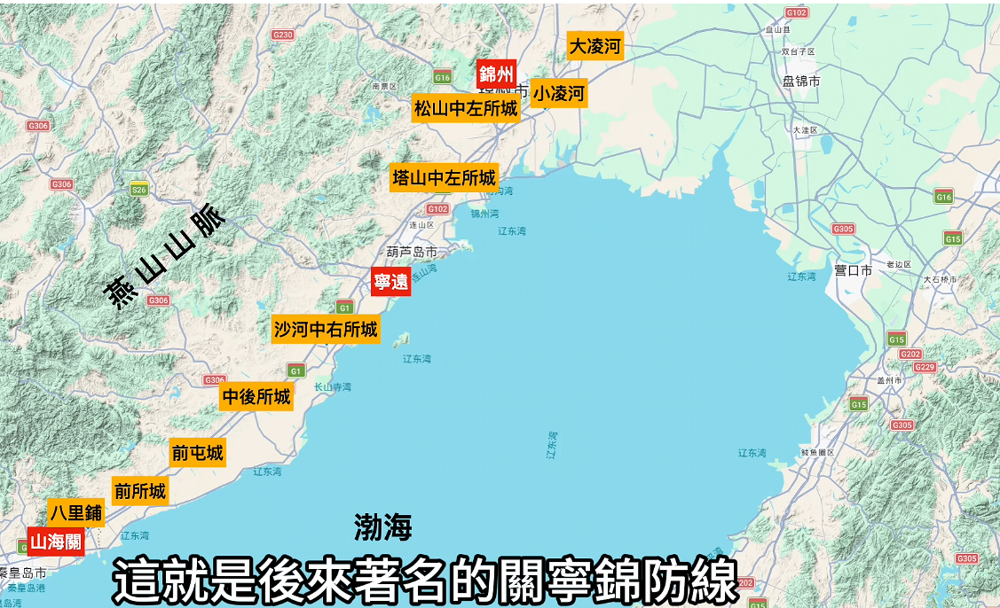
_▲ 關寧錦防線縱深部署圖：自山海關外八里鋪、前所城、前屯城、中後所城、沙河中右所城至核心重鎮寧遠，再向東北推進經塔山、松山至錦州與大、小凌河，依托燕山山脈與渤海灣構成縱深達四百里的堅固堡壘群。_

- **高第強令撤防與孤城死守（1625年，明天啟五年）**：魏忠賢閹黨全面控制朝政後，因忌憚手握十餘萬重兵且親近東林黨的孫承宗，遂利用山海關總兵馬世龍（馬士龍）輕信假情報偷襲受挫的小敗仗大肆彈劾，逼退孫承宗。接任經略的閹黨官員高第毫無軍事經驗，出於對後金騎兵的恐懼、否定前任政績以迎合魏忠賢，以及削減遼東開支的政治動機，下令強行撤空關外所有城堡與居民退守山海關。撤退過程中，官軍強行驅趕居民，導致關外十多萬石糧食與大批武器被焚毀棄置。時任寧前兵備道的袁崇煥獨排眾議，堅決違抗撤退命令，刺血為書誓與寧遠共存亡；滿桂、祖大壽等核心將領選擇追隨袁崇煥，最終關外堡壘盡撤，唯餘袁崇煥率領不到2萬守軍堅守寧遠孤城。
- **寧遠大捷與努爾哈赤之死（1626年，明天啟六年）**：正月十四日，努爾哈赤趁明朝換帥撤防的混亂期，親率號稱20萬（實際約6萬至10萬）後金主力直撲寧遠。

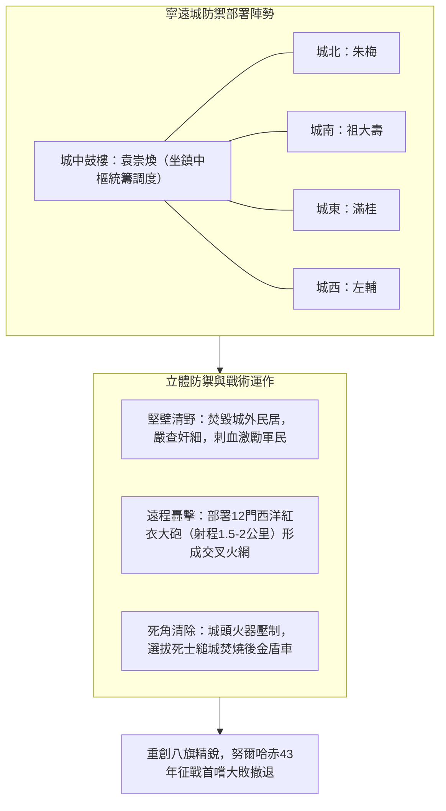

- **西洋紅衣大砲的戰術優勢**：寧遠城牆部署了12門單門重達1,000至3,000餘斤的前膛紅衣大砲，配有準星與照門，射程達1.5至2公里，遠超八旗騎兵弓箭（約百步射程）。正月二十三日，明軍操砲轟擊後金城北大營，一砲擊斃上百名敵兵，迫使努爾哈赤後撤大營；二十四日與二十五日總攻中，紅衣大砲交織成交叉火網，配合縋城死士焚毀攻城戰車，連續兩天擊退後金強攻。正月二十六日，努爾哈赤見攻城無果，轉而趁嚴冬海面結冰，派騎兵踩冰突破未築堅城的覺華島，焚掠島上糧草船隻後撤軍。
- **努爾哈赤死因客觀辨析**：此役打破了努爾哈赤自25歲以十三副鎧甲起兵以來43年幾無敗績的神話。後世傳聞稱努爾哈赤在寧遠被紅衣大砲擊中重傷、回師七個月後身亡；然考諸史實，明清雙方官方史料均無砲傷記載（若擊中後金大汗，明軍必大肆上報請功），且寧遠戰後努爾哈赤仍能親率大軍征討蒙古喀爾喀五部並取勝，證實其未當場重傷癱瘓。後金官方檔案記載其死於背疽（毒瘡）等疾病，故努爾哈赤應係因68歲高齡、寧遠挫敗導致精神憤懣交加，誘發體內疾病惡化而亡。
- **寧錦大捷與辭官歸鄉（1627年，明天啟七年）**：五月，新即位的皇太極率後金主力圍攻錦州，明將趙率教（趙帥教）、左輔、朱梅等憑藉火砲固守錦州18天。皇太極久攻不下轉攻寧遠，袁崇煥坐鎮城中，滿桂等將領出城野戰，配合城頭紅衣大砲再次擊退後金。戰役期間，袁崇煥精準研判錦州城堅糧足，未盲目派主力出城以免落入後金「圍點打援」圈套。然而戰後論功行賞時，魏忠賢及其黨羽將戰功據為己有、紛紛加官晉爵，首功之臣袁崇煥僅獲官升一級，閹黨[言官](../../制度/言官.md)更誣陷其「暮氣難鼓、畏敵怯戰」（指未及時救錦州）。剛直自負的袁崇煥憤而上疏辭官，隱退廣東老家。

### 2. 平台召對、「五年復遼」與帝王戰略思維對比

1627年（明天啟七年）八月天啟帝駕崩，明思宗崇禎帝即位後迅速鏟除魏忠賢閹黨，急於扭轉遼東頹勢。1628年（明崇禎元年），朝廷破格起用袁崇煥為兵部尚書兼右副都御史、督師薊遼。在明代官場，大臣獲任命按慣例須「三辭三讓」以示謙遜，但急於求成的崇禎帝直接下詔命其「不必玩弄虛套，趕緊進京赴任」。

- **第一次平台召對與「五年復遼」豪言**：1628年（明崇禎元年）七月，崇禎帝於北京宮內平台親自召見袁崇煥，內閣閣臣與各部尚書悉數在場。面對皇帝對平遼方略的焦慮詢問，性格易受情緒激發、愛說大話的袁崇煥當場跨下海口：**「承蒙陛下特眷，許臣便宜行事，五年全遼可復。」**崇禎帝聞言大喜，承諾成功後不吝封侯之賞。

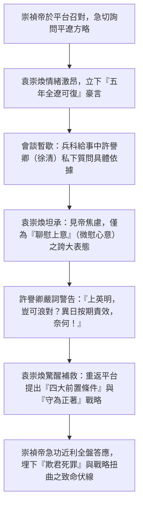

- **四大前置條件與內在戰略矛盾**：經兵科給事中許譽卿（部分口述史料作徐清）警告「皇上極其認真（英明），豈可浪對」後，袁崇煥驚出一身冷汗，意識到話說太滿，遂在召對後半段提出四項極為苛刻的前提條件以作補救與兜底：
  1. **財權全力支持（戶部足額發餉）**：戶部必須按時足額發放遼東軍餉，不得有任何拖欠。
  2. **軍備精良保障（工部精良武器）**：工部製造並提供給遼東的武器裝備必須質量精良。
  3. **兵權與人事權絕對自主（吏兵二部聽調）**：吏部與兵部派往關外的人員與將領，必須全權聽從督師統一調度。
  4. **帝王絕對信任（約束言官不予干擾）**：請求皇上「任而勿貳，信而勿疑」，約束朝中言官輿論，不得隨意彈劾干擾戰略部署。
     袁崇煥本以為苛刻條件能讓皇帝知難而退或放寬期限，不料急功近利的崇禎帝當場召來四部尚書下令照辦，並採納了袁崇煥**「守為正著，攻為奇著（負著），和為旁著（輔著）」**的核心方針。然而，這場博弈存在致命的邏輯矛盾：自薩爾滸之戰後明守金攻已成定局，「以守為正」完全符合軍事現實；但將「五年」設為硬性期限，僅憑防守絕無可能消滅後金（除非草原發生大災或敵酋猝死內亂）。1628年（明崇禎元年／後金天聰二年）草原雖逢大旱，後金反而加速向外掠奪求生。「五年之約」猶如懸在袁崇煥頭頂的達摩克利斯之劍，逼使其不得不採取偏離穩健防守的激進集權舉動。
- **帝王戰略思維對比（天啟帝 vs. 崇禎帝）**：平台召對深刻暴露了崇禎帝在政治與軍事洞察力上的嚴重短板。對比1626年（明天啟六年）袁崇煥上奏天啟帝的奏疏，當時袁崇煥主張依靠關外修城屯田即可讓後金「不戰而下」，並稱「奴未必祥，必為臣成秦意」。天啟帝接奏後並未輕信大話，而是在御批中展現出極其冷靜務實的洞察力：

| 對比維度                 | 明熹宗 天啟帝（朱由校）                                                                                                                                                                              | 明思宗 崇禎帝（朱由檢）                                                                                                      |
| :----------------------- | :--------------------------------------------------------------------------------------------------------------------------------------------------------------------------------------------------- | :--------------------------------------------------------------------------------------------------------------------------- |
| **面對臣下豪言之態度**   | **冷靜質疑、拒絕清談**：御批直言「這本內說『奴子不祥，必定成諸臣之功』，朕不樂聞。以朕觀之，奴未必祥，想不足信；奴必可勝，聖無清談。」                                                               | **盲目輕信、急於求成**：對「五年復遼」毫無戰略可行性評估便大喜過望，將帝國命運全數押注於單一承諾之上。                       |
| **軍事與政務細節洞察**   | **條分縷析、實事求是**：連續追問六大具體執行機制（「作何給受軍民不相妨？作何分撥使農戰不偏廢？作何演練使農隙戒兵？作何翻看使營務皆農？作何疆理足以限戎馬？作何城堡不至資盜糧？一切該撫細心區處」）。 | **缺乏專業判斷、流於表面**：未深究「以守為正」與「五年平遼」的時間邏輯衝突，僅以行政命令強壓四部尚書配合。                   |
| **期望落空後之政治心理** | **容忍試錯、維持大局**：雖受閹黨干擾，但在位期間對邊將防務仍保持基本務實認知（證明天啟絕非僅迷戀木工、不理朝政之昏君）。                                                                             | **極端猜忌、報復心切**：一旦戰局不如預期，便由「絕對信任」瞬間崩塌為「遭受欺騙的震怒」，將戰略失誤認定為欺罔天子與通敵死罪。 |

### 3. 雙島斬殺毛文龍：海外軍閥化與後方屏障的瓦解

立下「五年復遼」軍令狀後，袁崇煥急於統一關內外軍權、核實兵額與整合軍餉分配，這使其與孤懸海外、長年擁兵自重的東江鎮總兵**毛文龍**爆發了不可調和的衝突。

- **毛文龍與東江鎮的崛起及生存機制**：1621年（明天啟元年），毛文龍率領不到200人奇襲鎮江（今遼寧丹東），後退入鴨綠江口的皮島開創「東江鎮」，收容了二十餘萬遼東難民（前後中轉至山東登萊、天津等地的漢人難民逾百萬），組建起約2.8萬至3.6萬人的軍隊。東江鎮依賴四大經濟來源維持生存：
  1. **海外屯田**：跨界占用朝鮮鐵山、龍川等沿海地區進行農業屯田（朝鮮懾於明朝宗主國地位被迫默認）。
  2. **海上貿易與馬市抽稅**：利用皮島介於遼東半島、朝鮮與山東登萊之間的樞紐位置開設馬市，交易後金的人參、貂皮，內地的絲綢、鐵器，朝鮮的白銀及日本商品，抽取豐厚商稅。
  3. **虛報兵額索餉**：向明朝戶部長期虛報兵額達15萬至20萬人以索要巨額軍餉。
  4. **索要「毛糧」**：以宗主國代表身分向朝鮮政府強制索要或低價收購糧食。
     在戰略上，東江鎮**「滅敵則不足，牽敵則有餘」**。《滿文老檔》記載努爾哈赤與皇太極最為頭疼毛文龍（毛亦曾向袁吹噓「給足糧餉就能擊敗後金，猶如烈火燎豬毛」）；每當後金欲西進，均須留重兵駐守瀋陽與遼陽以防背刺，同時東江鎮亦承擔監視朝鮮、防止其倒向後金的政治職能。

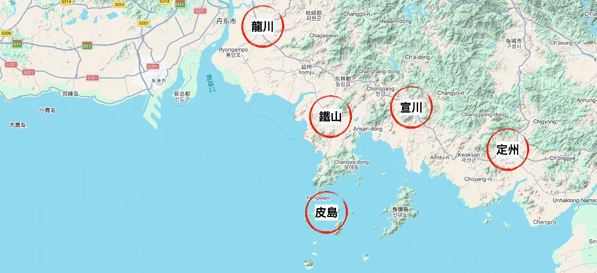
_▲ 毛文龍與東江鎮核心經營範圍：以鴨綠江口外的「皮島」為大本營，跨海延伸至朝鮮平安道沿海的龍川、鐵山、宣川、定州等地進行跨界屯田與徵集「毛糧」，直接威脅後金腹地。_

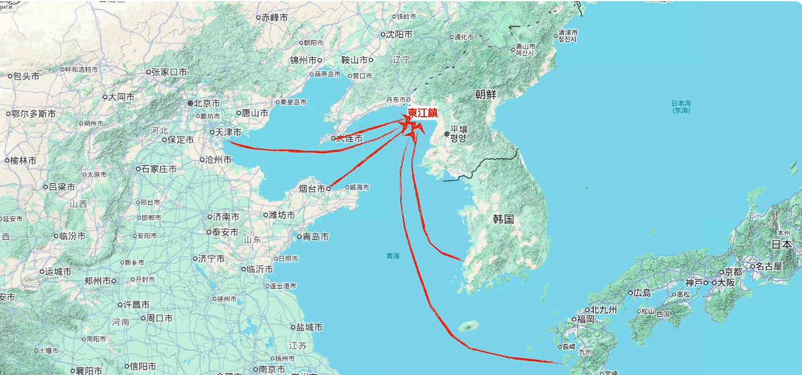
_▲ 東江鎮地緣戰略與海上貿易樞紐圖：孤懸敵後的東江鎮向西連結天津、山東登萊（煙台）與旅順（大連），向東、向南輻射朝鮮半島與日本九州，兼具牽制後金後方、中轉百萬遼東難民與跨國海上馬市貿易的多重功能。_

- **袁毛矛盾激化與海上經濟封鎖**：隨著勢力擴張，毛文龍呈現鮮明的「軍閥化」特徵（詳見[軍閥問題比較](../../制度/軍事/軍閥問題比較.md)）：虛報冒餉、私自開市、與後金私通書信，且堅決拒絕朝廷文官監軍與核查名冊。袁崇煥為逼其就範，對東江鎮實施嚴厲的**海上經濟封鎖**——下令山東登萊方向的所有物資與商船，一律強制繞道山海關或寧遠、覺華島接受檢查，徹底掐斷東江鎮的經濟命脈，逼使毛文龍出面談判。
- **雙島會面與先斬後奏（1629年，明崇禎二年五月－六月）**：五月底，袁崇煥約毛文龍於大連旅順附近的雙島會面。談判三天中，袁崇煥提出「派遣文官設治監軍、提供真實兵額名冊、餉銀改由寧遠轉發」三項要求，毛文龍悉數強硬拒絕，亦不願告老還鄉交出兵權。六月五日，袁崇煥預先部署伏兵當場扣押毛文龍，向北京方向叩頭後宣讀毛文龍「十二條大罪」（含私通外藩、冒領軍餉、剝削難民等；其中指控毛「取南京如反掌」實為山東總兵楊國棟、山東巡撫在其帶兵逼近登萊索餉時的誇大彈劾，指控其「攀附魏忠賢立生祠」亦屬牽強，因天啟年間包括袁崇煥自己在寧遠均曾迫於形勢為魏忠賢建生祠）。袁崇煥請出崇禎帝賜予的尚方寶劍，強行將同樣持有天啟帝所賜尚方寶劍的毛文龍斬首。事後袁崇煥上疏「先斬後奏」請罪，崇禎帝震驚之餘，因復遼仍需倚重袁崇煥，表面下詔嘉獎，內心卻記下了對其擅權跋扈的致命猜忌。

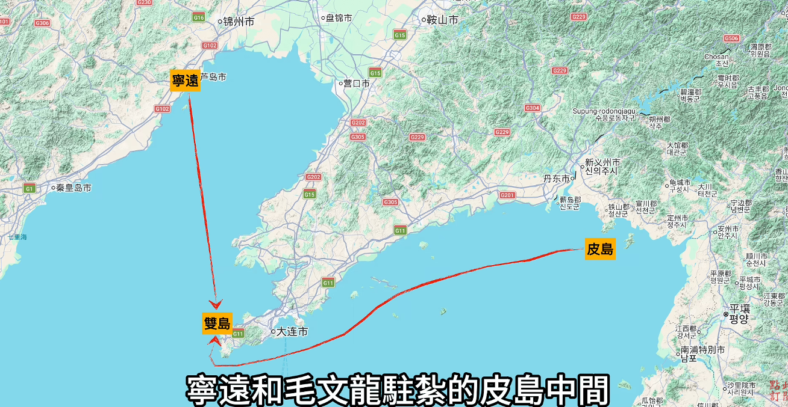
_▲ 雙島會面地理位置示意圖：位於遼東半島南端（旅順大連附近）的「雙島」，恰處於袁崇煥駐守的「寧遠」與毛文龍駐紮的「皮島」兩大海路航線交會處。袁崇煥藉海上經濟封鎖逼迫毛文龍至此會談，並預伏重兵將其先斬後奏。_

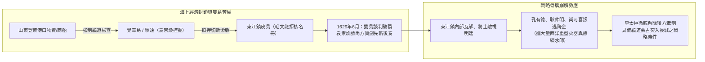

- **斬殺毛文龍的戰略災難**：袁崇煥雖短暫統一了事權，卻缺乏平穩接管東江鎮的配套方案。毛文龍死後，東江鎮迅速陷入內訌瓦解，其麾下核心將領孔有德、耿仲明、尚可喜等人對明朝文官體制徹底絕望，隨後率領大批精銳水師並攜帶明軍核心的重型火器叛逃投降後金（詳見[火炮科技興衰](../../制度/軍事/火炮科技興衰.md)）。這不僅使後金獲得夢寐以求的火器與水師技術，更徹底解除了皇太極後方的最大牽制，直接誘發了四個月後的「己巳之變」。

### 4. 己巳之變：邊防權責真相、京師恐慌與廣渠門血戰

1629年（明崇禎二年）十月，後金因連年大旱與明朝關閉馬市陷入嚴重饑荒與經濟危機。由於關寧錦防線固若金湯，而東江鎮後方威脅已除，皇太極決定採取「以戰求和」的大迂迴戰略：借道已結盟的漠南蒙古部落（林丹汗西逃後，科爾沁、喀拉沁等東部蒙古紛紛附金），避開山海關，直撲明朝年久失修的薊鎮長城防線，爆發震動天下的**「己巳之變」**。

- **邊防權責劃分與喜峰口（西峰口）失陷真相**：十月，皇太極親率八旗與蒙古聯軍十萬自瀋陽出發，以科爾沁、喀拉沁部為嚮導，兵分三路從中蒙邊境長城突破：左翼破龍井關、中路破洪山口（紅山口）、右翼破大安口（統稱喜峰口／西峰口防線方向），隨後擊敗馳援的4,000騎兵（總兵趙率教陣亡）並攻陷遵化，繞過薊州（今天津薊州區）直撲北京。戰事爆發後，朝野流言紛指袁崇煥縱敵入關；然釐清明代[巡撫與總督](../../制度/巡撫總督.md)邊防官制，即可還原真實權責：
  - **薊遼督師（袁崇煥）**：職級雖高，但實際直接管轄防區為**山海關以東至錦州一線**的遼東防線，核心任務為固守關外城池。
  - **薊遼總督（劉策）**：與督師無直接隸屬關係，獨立負責**山海關以西至中蒙邊境**的薊鎮長城防線。當時薊鎮因朝廷長期欠餉而年久失修，敵軍壓境時守將甚至仍在宴飲。
    史實證明，後金突破的龍井關、大安口全屬劉策轄區。袁崇煥此前曾三次上疏提醒崇禎帝中蒙邊界防線空虛，建議加固城牆、增派兵員，惜未獲採納（若屬袁崇煥轄區，以其「便宜行事」之權與性格早已自行修繕，無須三次請旨）。袁崇煥回援途中上疏請罪時，崇禎帝亦曾批覆**「責有分守」**，明確承認破關非袁之責，並下旨逮捕懲處了薊遼總督劉策。

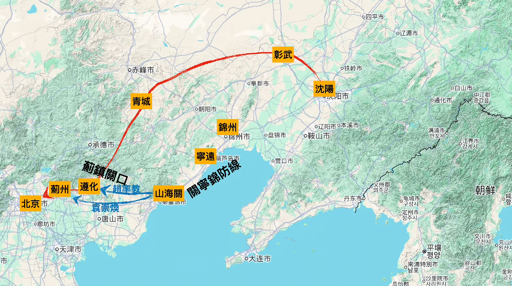
_▲ 己巳之變皇太極大迂迴與明軍馳援路線圖：皇太極（紅線）避開固若金湯的「關寧錦防線」，自瀋陽北上經彰武、青城借道蒙古，從薊鎮長城關口突入並攻陷遵化，越過薊州直撲北京；袁崇煥與趙率教（藍線）則自關外經山海關分路緊急入關馳援。_

- **皇太極繞道戰術與北京城的恐慌政治生態**：皇太極為免攻打堅城拖垮後勤並遭前後夾擊，採取「走一路、搶一路」以戰養戰策略。袁崇煥率軍趕至薊州試圖堵截，不料皇太極僅派少數兵力牽制薊州，主力繞過薊州直奔北京。袁崇煥於十一月二日果斷分兵4,000往救遵化，親率精銳關寧鐵騎（核心先頭部隊5,000騎，會同後續部隊共約9,000至15,000人）清車減行、晝夜兼程，在兩天內狂奔700餘里，於十一月十七日趕在後金主力前抵達北京城下。然而，這項正確的軍事行動卻撞上了北京城內極度恐慌的政治生態：
  1. **早宣戒嚴的災難**：崇禎帝得知敵情當天（距後金軍抵京尚有半個月）便倉促宣布北京全面戒嚴，導致城外大量糧草與百姓未能撤入城內，百姓或凍死或遭屠戮，遺留糧草反成後金補給。
  2. **連續撤換四名尚書**：帝王恐慌轉化為不理性的政治清洗——刑部大牢逃跑200多名犯人，撤職刑部尚書；發現城牆不堅，撤辦工部尚書；因敵軍入關，將兵部尚書王洽（王恰）下獄（後死於獄中），接任者亦迅速落馬。敵軍未至而中樞連換四尚書，不僅使國防指揮喪失連續性，更促使崇禎急於尋找最終的「戰略替罪羊」。
  3. **權貴利益集團的怨恨轉嫁**：北京城外京東地區遍布皇親國戚、朝廷大員與太監的私人莊園田產。眼見家園莊田遭後金燒殺搶掠，權貴們不敢歸咎於敵軍或皇帝，遂將滿腔怨恨全數傾倒在「未能於薊州堵住敵軍」且「在城外按兵休整」的袁崇煥身上。
- **廣渠門與德勝門大戰（1629年，明崇禎二年十一月二十日）**：後金大軍抵京後，京郊兩大戰場同時爆發慘烈決戰：

| 戰場區域         | 參戰部隊與指揮官                                                                                                  | 戰術部署與戰況過程                                                                                                                                   | 戰役結果與影響評析                                                                                                                                                                                                                                 |
| :--------------- | :---------------------------------------------------------------------------------------------------------------- | :--------------------------------------------------------------------------------------------------------------------------------------------------- | :------------------------------------------------------------------------------------------------------------------------------------------------------------------------------------------------------------------------------------------------- |
| **德勝門戰場**   | **明軍**：大同總兵滿桂、宣府總兵侯世祿（宣大騎兵） **後金軍**：貝勒岳託率領之八旗及蒙古騎兵                    | 宣大騎兵正面迎戰八旗騎兵，後金佔據野戰戰術優勢，明軍陷入苦戰潰敗。                                                                                   | **明軍大敗與誤傷慘劇**：北京城頭的京營（[三大營](../../制度/軍事/三大營.md)）守軍長期養尊處優、缺乏訓練，操砲準頭奇差，竟將砲彈直接打入滿桂陣營，炸傷大批明軍及滿桂本人，殘部被迫撤入德勝門甕城。                                                  |
| **廣渠門主戰場** | **明軍**：督師袁崇煥、祖大壽、王承胤（關寧鐵騎約9,000－15,000人） **後金軍**：皇太極親率之八旗主力（數萬大軍） | 明軍採取**「背靠城牆」**戰術，布下互為犄角之**「品字陣型」**（袁崇煥中軍、祖大壽、王承胤各領一隊），既封鎖後方被包抄風險，又結合城牆高度與火砲優勢。 | **廣渠門大捷（野戰以少勝多）**：後金先攻祖大壽、王承胤均遭擊退，遂集中主力猛攻袁崇煥中軍。袁崇煥身先士卒披甲上陣，身中密箭如「刺蝟」（幸賴重甲防護未穿肉體），激發全軍血性。明軍頂住數輪衝鋒後全線反擊，追擊至通惠河邊，逼使皇太極退往南海子躲避。 |

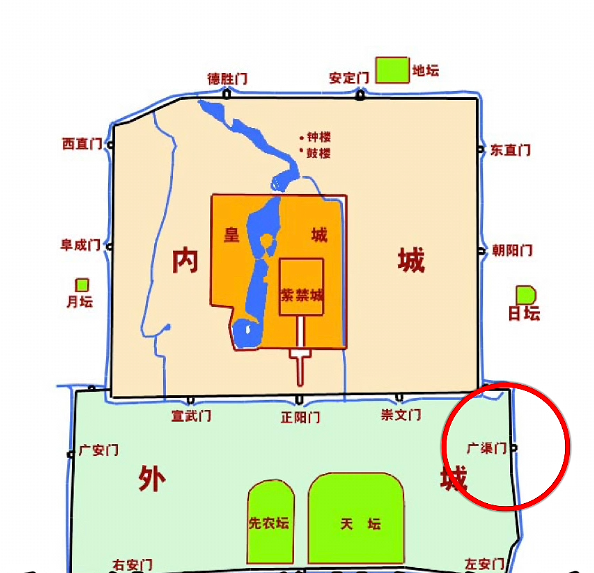
_▲ 己巳之變北京城防與兩大決戰位置圖：滿桂率宣大軍於內城北側的「德勝門」外迎戰貝勒岳託卻遭城頭京營砲火誤傷潰敗；袁崇煥則親率關寧鐵騎於外城東側的「廣渠門」（紅圈處）背靠城牆布下品字陣，以少勝多擊潰皇太極八旗主力。_

- **戰術理性與政治溝通的致命失配**：廣渠門大捷後，袁崇煥並未盲目追擊至南海子打野戰，其考量極具軍事理性：一是關寧軍經700里急行軍與慘烈血戰，人馬極度疲憊且傷亡不小；二是關寧軍為唯一能抗衡後金的機動主力，一旦孤注一擲戰敗，北京立時失陷；三是袁崇煥已於沿途永平、遷安、玉田、薊州部署兵力切斷敵軍退路，主張背城堅守，待全國勤王大軍會集後實施聚剿。
  戰後，崇禎帝於平台進行**第二次召對**，表面上對袁崇煥勤王之功大加讚賞，親手解下身上的「御賜貂裘（雕裘）」披在袁崇煥身上；然而，當袁崇煥兩次請求准許極度疲憊的關寧鐵騎進入北京城內（或甕城）休整時，崇禎帝卻斬釘截鐵地予以拒絕。按明朝祖制，外鎮勤王軍隊絕不許入城；在城內通敵流言四起之際，此舉徹底觸犯了帝王大忌，崇禎內心深處開始懷疑這支大軍究竟是來「勤王」還是來「騙城」裡應外合。在朝臣與權貴「故意縱敵搶掠」的瘋狂彈劾壓力下，崇禎逼迫袁崇煥派500人敢死隊夜襲南海子，雖獲小勝，卻無法阻止後金轉向劫掠永平、遵化等地。

### 5. 權謀陷阱、平台逮問與八個月獄中黨爭角力

城外軍事危機暫緩，城內的輿論戰、反間計與黨爭卻已將袁崇煥推向絕路。

- **城內流言催化與「反間計」公案辨析**：皇太極在進軍途中便刻意散佈「袁崇煥與後金有密約」的流言。流言傳入北京後，推波助瀾最力者竟是京城[三大營](../../制度/軍事/三大營.md)的官兵——三營士兵長期養尊處優、未經戰陣，出於對關寧鐵騎卓越戰力的嫉妒與自卑，極力散播袁崇煥通敵謠言以掩飾自身無能，甚至從城牆上扔石塊砸死城下休整的關寧軍士兵。
  與此同時，發生了史學界長期爭論的**「反間計」事件**：兩名被後金俘獲的明宮[太監](../../制度/廠衛/太監.md)（楊春、王成德）自敵營「逃回」，向崇禎密報稱在敵營隔牆親耳聽到後金將領（高鴻中、鮑承先）私下議論袁崇煥與皇太極早有密約、準備獻城。
  - **史料多重互證與定性**：部分學者曾因明朝官方史料無載、且情節酷似《三國演義》「蔣幹盜書」而懷疑反間計係清代編修《清太宗實錄》與《明史》時為皇太極邀功所虛構；然而，該事件同時記載於《朝鮮王朝實錄》及明人野史中（朝鮮與明人並無為清朝祖先貼金之必要），證實反間計確實存在。但從決策邏輯剖析，反間計僅是壓垮駱駝的「催化劑」，崇禎帝決定逮捕袁崇煥的根本主因，在於長期累積的**四大核心疑忌**（五年復遼破滅、私斬毛文龍招禍、私下與皇太極12封書信和談未完全明報、兩次請求勤王軍入城觸犯祖制）。
- **第三次平台召對與當場逮捕（1629年，明崇禎二年十二月初一日）**：崇禎帝暗中部署八天後，以商議軍務為名突召袁崇煥入宮進行第三次平台召對。面對風塵僕僕的袁崇煥，崇禎帝突然翻臉，發出致命的連番喝問：
  1. **「你為何擅殺平遼總兵毛文龍？」**（在帝王邏輯中，此舉被視為撤除後金後方牽制）
  2. **「你為何擅自賣糧食給蒙古人資敵（且與後金私通書信）？」**（被視為經濟資敵與暗中通敵）
  3. **「為何今日本部閉門不出戰？且滿桂將軍身上所中之箭，帶有你袁崇煥部隊（關寧軍）的編號？」**（德勝門混戰中滿桂實為城頭京營砲火及亂箭誤傷，卻被崇禎解讀為袁崇煥意圖陣前暗算朝廷忠將、清除異己）
     面對崇禎連珠炮般的質問，袁崇煥一時震驚錯愕、無法當場條理作答。崇禎帝根本不給其辯解機會，當即揮手命[錦衣衛](../../制度/廠衛/錦衣衛.md)擁上，將袁崇煥當場剝去官服、戴上枷鎖下獄，並賜尚方寶劍命與關寧軍素有嫌隙的大同總兵滿桂接管關寧軍。
- **祖大壽潰走、獄中手書與「軍隊姓袁不姓朱」的終極逆鱗**：袁崇煥被捕消息傳至城外，加之城內「關寧軍係漢奸兵」流言四起，親眼目睹統帥被抓的副將祖大壽極度恐懼與憤怒，認定朝廷將對關寧軍兔死狗烹，遂率領全部關寧鐵騎憤然撤離北京，直奔山海關而去。北京城外防線瞬間空虛，後金軍去而復返再度逼近，滿桂出戰陣亡，京師危在旦夕。
  崇禎帝大驚失色，連發數道急召聖旨命祖大壽回援，祖大壽皆置之不理。無奈之下，崇禎不願親自下詔認錯，只得派內閣大學士與兵部左侍郎余大成（餘大成）輪番入獄求助於袁崇煥。余大成以家國大義勸說：「袁大人，你一生早已許國，天下皆知你的忠心。今日若不寫信，國家大局將陷入慘劇，請以國事為重！」袁崇煥克制冤屈，在獄中揮毫寫下誠懇手書，力勸祖大壽「萬不可背叛朝廷，當以國家大局為重，殺敵立功回救京師（並為督師贖罪）」。祖大壽讀信後伏地大哭，全軍痛哭，在其母嚴詞規勸下折返前線，在重新啟用的老督師孫承宗協調指揮下大舉反攻，連續收復了後金大貝勒阿敏留守的**永平四城**（永平、遵化、遷安、灤州；此役背後亦含皇太極借刀殺人之政爭計算，皇太極故意讓桀驁不馴的阿敏孤軍留守，待阿敏棄城逃回瀋陽後，順勢以「私自棄城」罪名將其圈禁，消除了內部政治對手）。
  然而，永平四城的收復非但未能救袁崇煥一命，反而徹底注定了他的死刑——崇禎帝驚恐地發現：**天子親發的多道聖旨形同廢紙，而獄中囚徒的一封私信卻能立時調動天下最精銳的強軍**。在皇權專制體制下，這種「部隊只認大帥不認皇帝」、**「軍隊姓袁不姓朱」**的私兵化依附現象，徹底觸犯了極權君主決不能容忍的終極逆鱗。
- **八個月獄中黨爭與「加等處刑」凌遲終局（1630年，明崇禎三年）**：袁崇煥下獄後長達八個半月未決，捲入了慘烈的朝堂黨爭。魏忠賢閹黨餘孽溫體仁（溫體人，毛文龍之浙江老鄉，後入《明史·奸臣傳》）、王永光、高捷等人，企圖利用袁崇煥擅殺毛文龍及私下和談一案，一舉扳倒東林黨籍的當朝[內閣](../../制度/內閣制.md)首輔錢龍錫（袁崇煥出關前曾與錢龍錫探討邊事）。溫體仁等人在朝堂發動猛烈攻擊，指控錢龍錫密許並指使袁崇煥殺毛文龍、通謀謀逆；獄中的袁崇煥展現擔當，將責任全數攬在自己身上，堅稱純屬自己「便宜行事」，與錢龍錫無關。
  然而，溫體仁精準洞悉了崇禎的多疑心理，持續灌輸**「朝中首輔勾結邊關大帥」**的政治暗示。對疑心病極重的崇禎而言，「內閣首輔串通手握重兵之邊將」所引發的內外勾結、廢立篡位恐懼，遠比後金叩關可怕百倍。1630年9月22日（明崇禎三年八月十六日），在永平四城收復、外部威脅解除後，崇禎帝正式下旨定案：

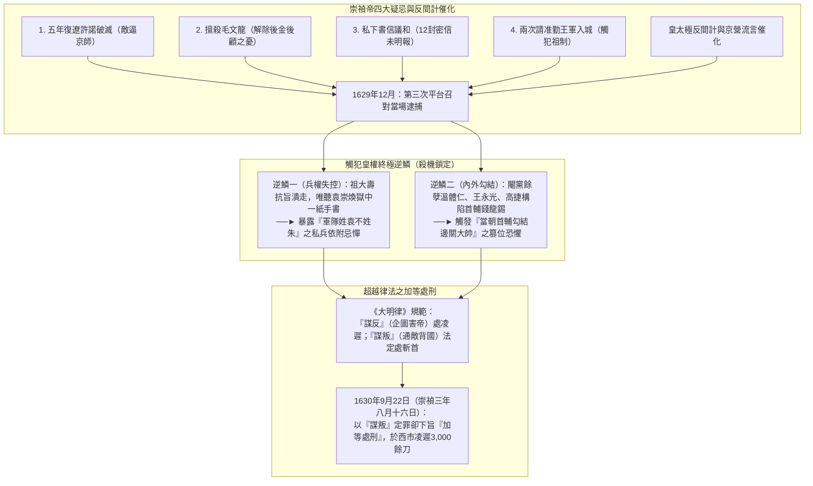

- **《大明律》規範與「加等處刑」**：在大明律法中，刑罰有嚴格邊界——**「謀反」**（以下犯上、企圖謀害皇帝本人）法定處以最高極刑「凌遲」（磔刑，原意為山坡緩慢變化，引申為寸磔割肉）；**「謀叛」**（裏通外國、通敵叛國）法定刑罰應為「斬首」。崇禎帝給袁崇煥定的罪名實為「謀叛」（依律應斬首），卻因極度憤怒與被背叛的報復欲，悍然下達**「加等處刑」**旨意，硬生生將刑罰提升一級改判「凌遲」；家屬雖表面獲「網開一面」免死（按律16歲以上親眷應處斬）、改流放二千里，但其妻在流放途中仍悲憤自盡身亡。
- **西市凌遲與市民「爭啖其肉」的群盲狂熱**：行刑當日下午三時，北京西市刑場人聲鼎沸。劊子手在袁崇煥身上割了三千多刀，骨肉盡露，袁崇煥哀莫大於心死，全程一聲不吭。圍觀的數萬北京市民呈現出駭人的集體狂熱——百姓爭相掏出積攢的銅錢，向行刑官購買從袁崇煥身上割下的鮮血淋漓的肉塊，當場生吞活剝，邊吃邊發出惡毒咒罵，直至全身骨肉被分搶殆盡，僅餘一顆頭顱梟首示眾。從社會心理學剖析，此乃典型的**「群盲」現象**與**社會心理轉嫁**：在資訊管道被朝廷完全壟斷與封閉的環境下，痛失家園親人的百姓不懂軍事戰略與邊防權責，全盤聽信官方將袁崇煥定性為「引敵入關之賣國漢奸」，在「法不責眾」的集體盲從情緒下，將對戰爭浩劫的滿腔怨恨全數轉嫁並宣洩於這位替朝廷背負罪責的統帥身上。

---

## 歷史影響與後世評價

### 1. 歷史功過的多維度客觀審視

縱觀袁崇煥一生，其性格剛強果決、熱情如火、極具膽略與擔當，卻也伴隨著自負專斷、輕率急躁、情緒亢奮時愛說大話的致命缺陷。對其歷史功過應剝離情緒，進行客觀的多維評析：

| 評析維度                       | 具體事蹟與歷史表現                                                                                                                                        | 戰略與歷史影響評估                                                                                     |
| :----------------------------- | :-------------------------------------------------------------------------------------------------------------------------------------------------------- | :----------------------------------------------------------------------------------------------------- |
| **三大歷史功績** _(Merits)_ | **1. 構築關寧錦防線**：在廣寧潰敗後力排「劃關自守」眾議，配合孫承宗將防線東推400里，死守寧遠孤城。                                                        | 成功將山海關轉化為大後方，打造出後金數年無法正面突破的堅固屏障，遏制了努爾哈赤與皇太極的正面擴張。     |
|                                | **2. 創立關寧鐵騎**：落實「以遼人守遼土」，訓練出裝備精良、重榮譽尚武的精銳騎兵。                                                                         | 打造出明末唯一一支能在野戰中正面抗衡並擊敗後金八旗騎兵的鐵軍（如廣渠門大捷）。                         |
|                                | **3. 戰術與火器革新**：率先將西洋紅衣大砲大規模應用於城防與野戰協同，取得寧遠、寧錦大捷。                                                                 | 打破努爾哈赤43年不敗神話，極大振奮明朝朝野軍心，為明廷爭取了寶貴的戰略喘息期。                         |
| **三大戰略過失** _(Faults)_ | **1. 平台召對狂言**：為一時寬慰崇禎帝焦慮，未經深思誇下「五年復遼」海口。                                                                                 | 將自身置於「以守為正」與「五年限期」的邏輯死局中，埋下日後被控「欺君罔上」的信任崩潰伏線。             |
|                                | **2. 擅殺東江總兵毛文龍**：未經朝廷程序於雙島先斬後奏，且缺乏平穩接管東江鎮的後續方案。                                                                   | 導致東江鎮迅速瓦解，孔有德、耿仲明、尚可喜攜重型火器與水師叛降後金，徹底解除皇太極繞道入關的後顧之憂。 |
|                                | **3. 戰略疏漏與溝通失配**：資源過度集中遼西而忽略薊鎮長城隱患（雖曾上疏但未力爭）；私下與皇太極12封書信議和未向多疑的崇禎充分報備；戰後兩次請准大軍入城。 | 嚴重低估皇權專制下的帝王猜忌心理與朝堂言官、權貴的輿論反撲能力，最終引爆君臣信任危機。                 |

### 2. 澄清「乾隆平反神話」的歷史誤解

當代網路輿論中常流行一種觀點，聲稱袁崇煥是清朝乾隆皇帝出於統戰與政治需要才一手「平反」塑造的神話，甚至衍生出「清朝誇獎過誰，誰就是漢奸賣國賊」的極端指控。考諸史料，此說法純屬嚴重的歷史誤解與邏輯謬誤：

- **南明政權早已正式平反並追諡**：早在清軍入關之前的南明弘光政權時期，朝廷便已正式為袁崇煥平反，並追賜其諡號為**「襄愍」**。按大明諡法，「襄」代表「甲冑有勞、有功安民」（如唐代凌煙閣功臣多帶襄字），高度肯定其遼東抗金軍功；「愍」代表「在國逢難、使民悲傷」，表達出明廷對其慘遭冤殺的深切政治同情與悔恨。
- **乾隆皇帝的真實態度與邏輯拆解**：乾隆帝僅是在修史時評價袁崇煥「雖與我朝為難，但尚算忠於所事（忠於職守）」，並未為其追加任何諡號；相反地，乾隆曾明確為[熊廷弼](./熊廷弼.md)、孫承宗等明朝將領追加諡號，更下旨編纂《欽定勝朝殉節諸臣錄》（清定盛朝殉節忠臣錄），高度褒揚了史可法、劉宗周等明末抗清殉國烈士。若按「被乾隆誇獎即為漢奸」的荒謬邏輯推導，難道抗清殉國的史可法、熊廷弼亦成了賣國賊？嚴謹的歷史學界從無任何熟讀史料的學者會得出「袁崇煥是賣國賊」的結論，網路上的賣國指控實源於對史料的割裂與誤讀。

### 3. 「自毀長城」與明朝覆滅的倒計時

繼天啟年間冤殺[熊廷弼](./熊廷弼.md)並「傳首九邊」後，崇禎帝以凌遲極刑處決袁崇煥，真正造成了**「殺一人而冷萬軍之心」**的毀滅性後果。此舉不僅徹底摧毀了明朝最後的戰略統帥與君臣信任紐帶，更宣告了關寧錦防線精神核心的瓦解——此後關寧軍將領（如祖大壽、吳三桂等）對明廷中央產生了根深蒂固的防備與疏離感，在「保家保命」與「效忠皇權」之間日益傾向於保存實力。自毀遼東柱石之後，明朝在軍事與政治上陷入不可逆轉的雙重崩潰，為十四年後（1644年，明崇禎十七年）的甲申之變與帝國終局劃下了不可挽回的伏筆。

---

## 研究結論

袁崇煥曾在上奏天啟帝的奏疏中，深刻剖析了自己的行事哲學與命運預感：**「勇猛圖敵，奮迅必招嫉；任勞則必召怨，蒙罪始可有功……罪不大則功不成。」**這段自白精準道出了他在晚明腐朽官僚體制下的生存悖論：在推諉塞責成風、軍政敗壞的絕境中，唯有具備豪氣、敢於獨斷專行與任勞任怨之人方能建立奇功；然而，這種猶如雙刃劍的剛烈性格與集權手段（如誇言五年復遼、擅殺毛文龍），在面對皇權專制與黨爭漩渦時，亦必然招致滅頂之災。

從結構史學的視角審視，袁崇煥凌遲案絕非單純的軍事失利或皇太極「反間計」的勝利，而是一場由三重結構性矛盾交織而成的**帝國系統性悲劇**：

1. **個人性格的悲劇**：一位滿腔熱血卻自負輕率、缺乏政治精算與權謀防禦意識的實幹統帥，在「五年復遼」的自我枷鎖下步步走入戰略與政治的死胡同。
2. **帝王政治心理的悲劇**：一位急功近利、戰略認知淺薄卻又極度多疑自負的君主（崇禎帝），在「絕對授權」與「極端猜忌」的兩極間劇烈擺盪；當面對「軍隊只認統帥手書不認聖旨」的兵權旁落恐懼時，皇權安全本能瞬間壓倒了國防大局。
3. **晚明體制腐化的帝國悲劇**：閹黨餘孽與東林黨爭將邊防決策異化為打擊政敵（首輔錢龍錫）的工具，京城權貴與京營腐兵為掩飾無能與私利而煽動輿論，最終裹挾受蒙蔽的京城百姓完成了一場「自毀長城」的集體狂歡。當西市刑場上的皮肉被爭啖殆盡、頭顱高懸城頭之時，大明王朝賴以抵禦後金的最堅固盾牌已被親手砸碎，帝國覆亡的倒計時亦在西市的喧囂聲中正式開啟。

---

## 參考資料

1. [參考1](https://www.youtube.com/watch?v=MQ467J0ulDE)
2. [參考2](https://www.youtube.com/watch?v=Cv30bOgzo8A)
3. [參考3](https://www.youtube.com/watch?v=C2k5neLXlHk)
4. [參考4](https://www.youtube.com/watch?v=63RNtLQZCoQ)
5. [參考5](https://www.youtube.com/watch?v=BuHpO-F2UlE)
