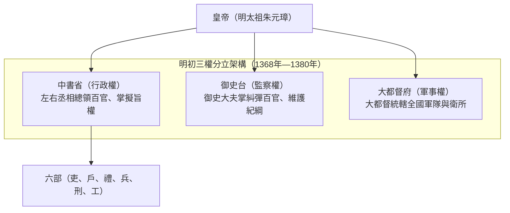
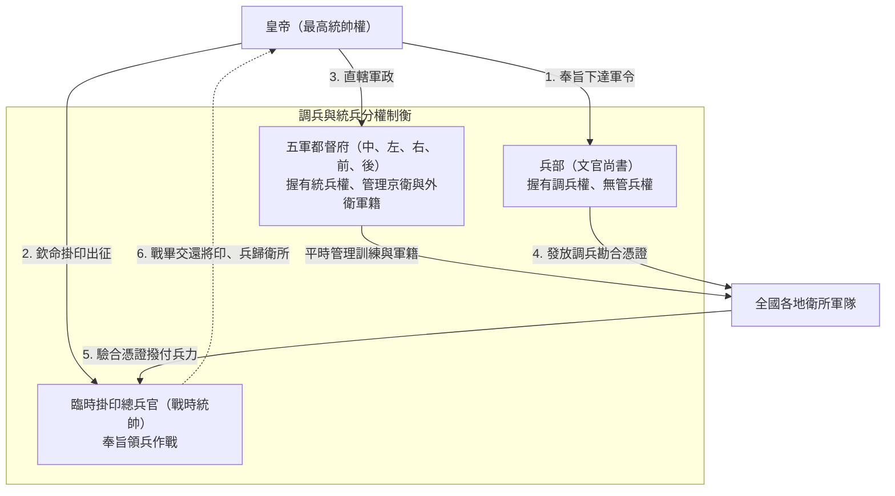
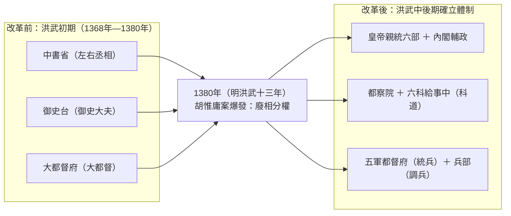

# 明朝初期中央權力架構：三權分立

在明太祖[朱元璋](../皇帝/朱元璋.md)於1368年（明洪武元年）建國之初，基本沿襲元朝制度，形成了一個**「軍、政、監」三權分立**的鼎足態勢。

---

### 1. 中書省：總天下之文治（行政權）

- **職能**：最高行政機構，負責協助皇帝處理全國政務。
- **首長**：中書令（常空缺）及左右丞相（即一般所稱的「宰相」）。
- **地位**：權力中樞，總領文官體系。由於丞相擁有「擬旨」權，權力極大。
- **演變**：1380年（明洪武十三年）[胡惟庸案](../事件/洪武時期/胡惟庸案.md)後，[朱元璋](../皇帝/朱元璋.md)廢除中書省與丞相，權力收歸皇帝，後演變為「[內閣制](./內閣制.md)」。

### 2. 御史台：鎮朝廷之紀綱（監察權）

- **職能**：負責監督百官、糾彈非法、肅清紀律、維護朝廷綱紀。
- **重要性**：被稱為皇帝的「耳目」，確保文武官員不會貪贓枉法或結黨營私。
- **演變**：1382年（明洪武十五年）改組為**「[都察院](./言官.md)」**，並與六科給事中合稱「科道」，賦予更大的巡察與封駁職權。

### 3. 都督府：統天下之兵權（軍事權）

- **職能**：全國最高軍事領導機構，負責統領全軍。
- **首長**：大都督。
- **演變**：[朱元璋](../皇帝/朱元璋.md)為防止軍權過於集中，於1380年（明洪武十三年）將「大都督府」拆分為**「五軍都督府」**（中、左、右、前、後），達成「兵不識將，將不專兵」的制衡效果。

#### 五軍都督府（全國軍務中樞）

- **由來**：1380年（明洪武十三年）[胡惟庸案](../事件/洪武時期/胡惟庸案.md)，[朱元璋](../皇帝/朱元璋.md)將原本大權獨攬的「大都督府」一分為五（中軍、左軍、右軍、前軍、後軍）。
- **運作機制**：它是明代全國軍隊的最高管理機關，負責管理各地的「[衛所](./軍事/衛所制.md)」。但為了防範武將擁兵自重，[朱元璋](../皇帝/朱元璋.md)設計了**「將不專兵」**的制度。**五軍都督府有統兵權（平時管理軍隊）但沒有調兵權**；「兵部」擁有調兵權卻不直接管轄軍隊。打仗時，皇帝指派將領，兵部下達調兵令，再由都督府撥出軍隊。

> [!NOTE]
> **補充澄清：五軍都督府 vs. 五城兵馬司**
> 雖兩者名稱相似，但在國家體系中扮演截然不同的角色：
>
> - **五軍都督府**：**中央全國性最高軍事管理機構**（分中、左、右、前、後五軍），負責管理全國[衛所](./軍事/衛所制.md)士兵、軍籍與訓練。其與「兵部」相互制衡（兵部有調兵權，都督府有統兵權）。
> - **五城兵馬司**：**地方首都性治安機構**（分東、西、南、北、中五城），專責京師（南京/北京）的治安巡邏、緝捕盜賊、防火及市容管理，性質相當於現代的**首都警察局與消防隊**，非屬中央軍事三權架構。

---

### 總結與制度演變

1380年（明洪武十三年）前後，中央權力架構經歷了從「三權鼎立」到「皇權高度獨攬」的根本性轉折：

1. **重心在丞相（1380年以前）**：行政、軍事、監察各有所屬，但中書省總領六部，影響力最大。
2. **歷史轉折**：1380年（明洪武十三年）「[胡惟庸案](../事件/洪武時期/胡惟庸案.md)」爆發，[朱元璋](../皇帝/朱元璋.md)廢除中書省與丞相制。
3. **最終形態**：皇帝直接領導「六部」（吏、戶、禮、兵、刑、工），政務參謀權轉移至由皇帝親自掌控的**[內閣](./內閣制.md)**，監察權擴編為**[都察院與六科](./言官.md)**，軍權則拆解為相互制衡的**五軍都督府與兵部**。
