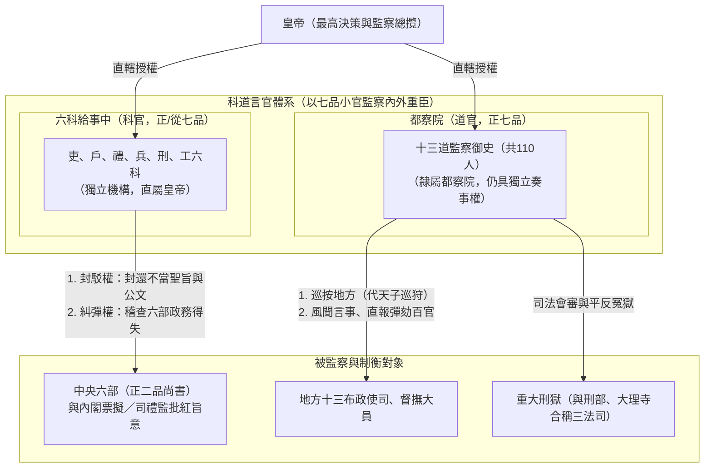
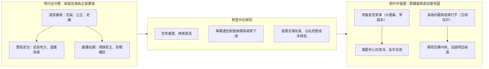

# 明朝言官制度：都察院與六科給事中的權力與演變

## 歷史背景

明太祖[朱元璋](../皇帝/朱元璋.md)當初設計這套權力極大、編制遠超歷代的言官制度，其初衷並非為了束縛自身權力，而是將其視為**鞏固皇權與加強帝國控制的政治工具**。這一制度的建立主要基於以下核心考量：

1. **防範大臣專權與造反**：1380年（明洪武十三年），[朱元璋](../皇帝/朱元璋.md)藉由[胡惟庸案](../事件/洪武時期/胡惟庸案.md)廢除中書省與丞相職位，將權力收歸皇帝並分設六部（參見[三權分立](./三權分立.md)）。為了緊盯並監察六部的運作，防止大臣專權與勾結造反，朱元璋於1382年（明洪武十五年）改組設立了「都察院」並完善「六科給事中」來進行嚴密牽制。
2. **防止皇帝被架空**：即使廢除丞相，地方與中央的高官依然握有重權。朱元璋需要利用品級低、但有彈劾與封駁權的言官來監督高官，避免高官聯手架空皇權。
3. **充當耳目以杜絕貪腐**：朱元璋深知元朝末年吏治敗壞的教訓，急需一群忠誠、剛直的言官充當其「耳目」，替皇帝緊盯龐大的官僚體系，以遏制腐敗。
4. **廣開言路輔助決策**：皇帝一人精力有限，透過言官的諫諍，可在朝廷大政方針上聽取不同的聲音與意見，防止施政出現重大盲點。

在明朝初期，言官與皇帝配合默契，既有效擴大了監督範圍，又強化了皇權的絕對權威。

## 制度架構與核心內容

明朝言官主要由**都察院御史**與**六科給事中**組成，兩者在官制上合稱為「科道」。明朝言官編制高達209人，規模遠超漢、宋、清等朝代，形成了一張「以卑臨尊」的嚴密監察大網。

### 1. 六科給事中（科官）

六科給事中專職監察中央六部（吏、戶、禮、兵、刑、工），官秩雖僅為正七品或從七品，卻擁有極大的行政監察權：

- **封駁權**：皇帝下達的命令（聖旨）及各部院的公文，都必須經過六科給事中審查，若認為不妥，他們有權將其駁回（封還御批），使旨意無法執行（參見[內閣制](./內閣制.md)）。
- **糾彈權**：負責對六部的政務得失進行隨時的稽查與彈劾。

### 2. 十三道監察御史（道官）

都察院為明代最高監察機構，下設「十三道監察御史」共110人，分屬十三個監察道（對應明代地方的十三個承宣布政使司）。監察御史官階為正七品，其核心功能與職責主要包括：

- **察糾百官與風聞言事**：御史負責糾彈內外百官的貪贓枉法或失職行為。他們擁有「直報權」，可以直接向皇帝呈遞奏摺，且擁有「風聞言事」的特權（即無須確鑿證據，可根據社會傳言進行彈劾與諫言）。
- **司法監察與糾正刑獄**：負責清查兩京（北京、南京）的監獄與訟案，糾正地方刑獄的拖延與冤錯。在涉及重大案件時，御史會參與「三法司會審」（與刑部、大理寺共同審理）。
- **出巡稽查（巡按御史）**：御史平時駐紮京師，但常奉命持印出巡地方或特定領域，稱為「巡按御史」（代天子巡狩），負責監察地方官吏、清軍、漕運、海防、鹽政、[屯田](./屯田制.md)等重要政務，權力極重，地方[督撫](./巡撫總督.md)亦須對其禮讓三分。
- **監察與主持考試**：負責監督鄉試、會試以及武舉考試，確保朝廷選才的公平性與規範性，杜絕科場舞弊。
- **稽查京城與內廷**：巡視京城（五城兵馬司轄區）、軍營、皇城門禁、倉庫以及內庫，防止軍隊廢弛與庫藏物資流失。

## 歷史影響與崩潰原因

### 1. 歷史影響：早期政治清流的實效

在明代初期與中期，言官選拔標準極高，要求必須具備「忠誠、能幹、公正、老練」的特質。

- **整飭吏治**：早期的言官如監察御史陶鎔等，不畏權貴，敢於彈劾高官；巡歷地方時能使貪官無所遁形。
- **制衡皇權與維護紀綱**：在皇帝決策失誤或行事不合禮制時，言官能挺身諫阻。例如明初監察御史周觀政曾攔阻奉旨入宮的女樂，甚至逼得太祖[朱元璋](../皇帝/朱元璋.md)親自出面認錯解釋，展現了早期言官維護朝廷綱紀的正面作用。

### 2. 崩潰原因：制度設計缺陷與群體變質

到了明代中後期，言官制度的缺陷逐漸顯現，並在政治鬥爭中徹底變質：

- **高風險與低回報的矛盾**：言官品級低（僅為正七品）、俸祿微薄，但所擔負政治責任極高，且操守要求極苛刻。這種「錢少事多」的處境，導致中後期合格人才斷層，甚至出現言官私下向[內閣](./內閣制.md)學士行賄等品德敗壞的行徑。
- **「連坐」推薦制度的負面效應**：明廷規定，若被推薦的言官犯錯，推薦人須連帶受罰。這使得官員不敢輕易薦賢，導致言官崗位長期空缺，素質進一步下降。
- **為搏直名而與皇帝死磕**：後期言官極度熱衷於干涉皇室家事（如1521年—1524年明嘉靖時期的[大禮儀](../事件/嘉靖時期/大禮儀.md)與1586年—1601年明萬曆時期的「[爭國本](../事件/萬曆時期/爭國本.md)」）。他們為了搏取「直言敢諫」的清名，結夥與皇帝對立。即使面對廷杖、罷官或停發俸祿的處罰亦前仆後繼，最終導致明神宗（[萬曆帝朱翊鈞](../皇帝/朱翊鈞.md)）心灰意冷，引發長年[萬曆怠政](../事件/萬曆時期/萬歷怠政.md)，國家機器運轉陷於癱瘓。
- **淪為黨爭工具與「職場槓精」**：晚期的言官徹底失去客觀中立的監察功能，淪為官僚集團派系鬥爭的急先鋒（如嘉隆萬時期的[徐階](../人物/文臣/徐階.md)、[高拱](../人物/文臣/高拱.md)之爭，參見[徐高張海關係研究](../人物/文臣/徐高張海關係研究.md)）。在1621年至1627年（明天啟年間）魏忠賢編寫的《東林點將錄》中，108名東林黨人中言官就佔了55名。言官為了反對而反對，互相攻訐，嚴重加劇了朝廷的內耗與朋黨之爭。

## 研究結論

明朝的言官制度是一把雙刃劍。[朱元璋](../皇帝/朱元璋.md)設計此制度的初衷是為了透過「科道」制衡臣權、保障皇權。然而，因其品秩低而職權重的設計缺陷，加之中後期政治環境惡化，這套制度最終脫離了設計初衷。言官們從維護帝國紀綱的「政治清流」，演變為搏取私名、癱瘓行政、推波助瀾黨爭的「職場槓精」。這把原本用以鞏固帝國的國之利器，最終卻反噬皇權，成為加速大明王朝吏治腐敗與帝國崩潰的核心因素之一。

## 參考資料

1. [參考1](https://www.youtube.com/watch?v=jfR4Z6nzqvo)
