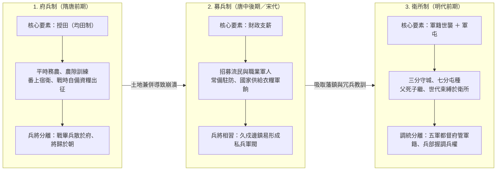
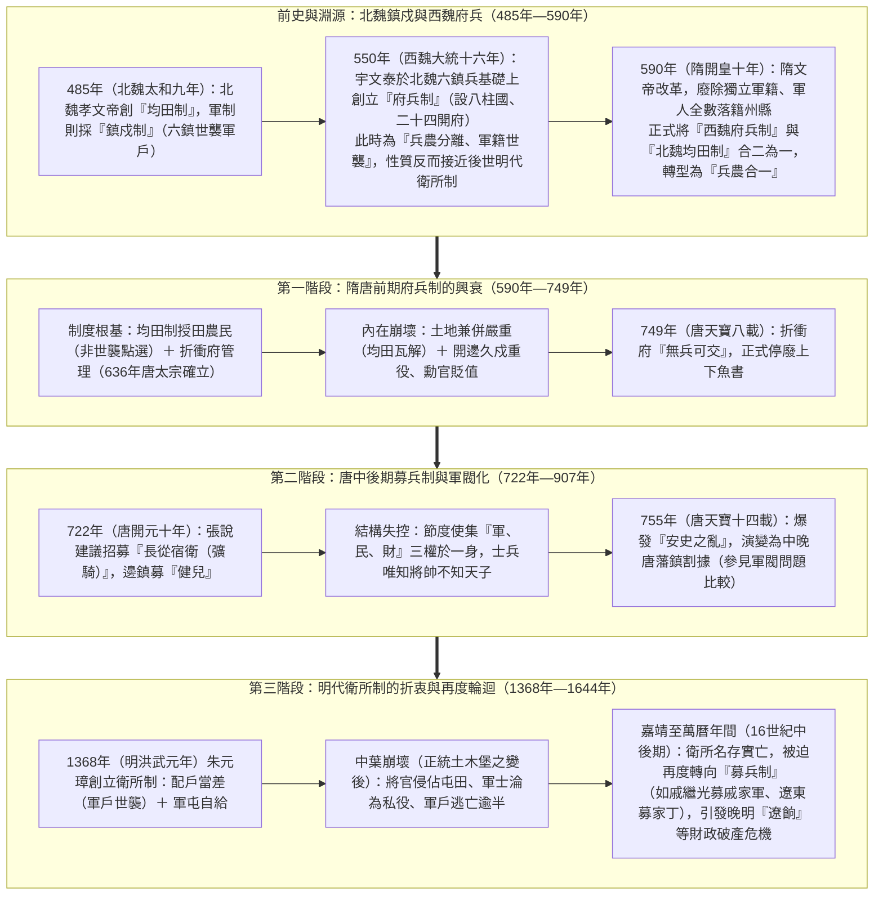
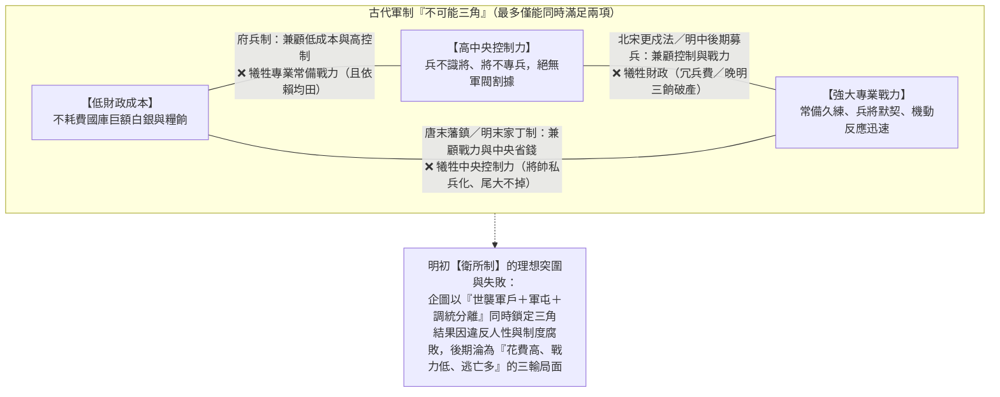

# 府兵、募兵與衛所制度之軍事演化比較研究

## 歷史背景與演化邏輯

中國古代軍事制度的演變，核心在於解決「國家如何養兵」這一永恆課題。從唐初的府兵制到中後期的募兵制，再到明朝的衛所制，反映了國家在財政負擔、軍事戰鬥力與中央控制力三者間的權衡與轉型。

這三種制度代表了三種不同的養兵邏輯：

1. **[府兵制](../../../唐朝/制度/府兵制.md)**：靠「土地」養兵（兵農合一，根植於[均田制](../../../唐朝/制度/均田制.md)）。
2. **募兵制**：靠「金錢」養兵（職業軍人，如中晚唐藩鎮兵與北宋禁軍）。
3. **[衛所制](./衛所制.md)**：靠「身分」養兵（軍戶世襲、半兵農，結合[屯田制](../屯田制.md)與[戶籍制度](../戶籍制度.md)）。

---

## 軍制演化深度比較表

| 比較面向 | 府兵制 (西魏北周初期) | 府兵制 (隋唐鼎盛期) | 募兵制 (唐中後期) | 衛所制 (明朝) |
| :--- | :--- | :--- | :--- | :--- |
| 核心模式 | 兵農分離、軍籍世襲 | 兵農合一、定期點選 | 職業軍人 | 軍戶世襲 (半兵農) |
| 士兵來源 | 鮮卑鎮兵與關隴鄉兵 | 農民 (均田戶點選) | 社會招募 | 軍戶 (世代服役) |
| 平時狀態 | 專職訓練與作戰 (免賦役) | 務農 (農隙訓練) | 專職當兵 | 務農與屯練並行 |
| 戰時動員 | 開府將軍直接統率出征 | 臨時徵召、兵將分離 | 常備軍直接出戰 | 衛所調動、調統分離 |
| 薪資制度 | 免除全家租調徭役 | 自給 (依賴均田授田) | 國家發放薪俸 | 國家給屯田、部分自給 |
| 財政負擔 | 中等 | 極低 | 極高 | 中等 |
| 軍事專業度 | 極高 (關隴精銳) | 低至中 | 高 | 中 (後期極低) |
| 中央控制力 | 強 (八柱國系統) | 強 | 弱 (依賴地方將領) | 制度設計強，後期轉弱 |
| 核心優點 | 凝聚關隴集團、戰力強悍 | 節省開支、防範軍閥 | 戰力強、反應迅速 | 不需供養大量常備軍 |
| 致命缺陷 | 兵源受限於特定軍籍群體 | 均田制瓦解即崩潰 | 容易導致軍閥化 | 軍戶逃亡、戰力日益低下 |
| 潰敗或轉型 | 590年隋文帝改為兵農合一 | 轉向募兵制 | 引發安史之亂、藩鎮割據 | 導致倭寇之亂與邊防崩潰 |

---

## 制度演化路徑分析

### 1. 府兵制：從「世襲軍戶」到「兵農合一」的極致節流（依賴土地）

[府兵制](../../../唐朝/制度/府兵制.md)的演變經歷了兩個截然不同的階段：

- **淵源與初創（北魏至西魏北周，兵農分離）**：許多人常誤以為府兵制創於北魏，實則**北魏**（485年，北魏太和九年）創立的是作為其經濟根基的「[均田制](../../../唐朝/制度/均田制.md)」與北防「六鎮」的世襲鎮戍兵制。534年北魏分裂後，**西魏**權臣宇文泰收編原北魏六鎮鮮卑兵與關隴豪強，於550年（西魏大統十六年）前後創立「八柱國、二十四開府」的**府兵制**。此時的府兵「不入民籍、世代相傳、專職作戰」，屬於世襲軍戶制。
- **隋唐轉型與鼎盛（兵農合一）**：590年（隋開皇十年），隋文帝下令將府兵全數編入州縣民籍，正式把「西魏的府兵制」與「北魏的[均田制](../../../唐朝/制度/均田制.md)」結合；636年（唐貞觀十年）唐太宗確立「折衝府」體制。國家通過分配均田土地，以非世襲的定期「點選」方式，換取農民在農暇時接受訓練並在戰時自備武器資糧服役。
- **關鍵崩潰點**：只要「土地分配」制度失效（唐高宗、武則天後土地兼併加劇），農民失去授田卻仍須承擔沉重的番上與遠征兵役，遂紛紛逃亡。至749年（唐天寶八載），各折衝府已到了「無兵可交」的境地，府兵制隨之瓦解。

### 2. 募兵制：金錢換取戰力（依賴財政）

隨著均田制與府兵制破壞，722年（唐開元十年）唐玄宗採納宰相張說建議，改以國家財政招募職業軍人（中央募「彍騎」、邊疆募「長征健兒」）。

- **關鍵點**：募兵制雖保證了邊軍強悍的專業戰力，但高昂的財政成本與長期作戰需求，迫使朝廷賦予邊疆節度使自籌軍餉與長期統兵之權，最終導致外重內輕與軍權下放，引發755年（唐天寶十四載）的「安史之亂」與藩鎮割據（詳見[軍閥問題比較](./軍閥問題比較.md)）。

### 3. 衛所制：折衷與世襲（依賴身分）

1368年（明洪武元年）明太祖[朱元璋](../../皇帝/朱元璋.md)建國後，汲取唐宋教訓設計了[衛所制](./衛所制.md)，試圖達成「養兵百萬，不費百姓一粒米」的理想目標。

- **關鍵點**：透過「軍戶」制度（參見[戶籍制度](../戶籍制度.md)），將士兵身分世襲化，平時「三分守城、七分屯種」（[屯田制](../屯田制.md)），戰時由兵部調動、五軍都督府撥兵（參見[三權分立](../三權分立.md)）。然而，明代中葉以後勳貴軍官大肆侵吞軍屯田地，軍戶地位形同苦役導致大規模逃亡（正統年間已逃亡過半），在1449年（明正統十四年）[土木堡之變](../../事件/英宗危機與復辟/土木堡之變.md)與嘉靖年間東南倭患中暴露戰力崩潰，最終迫使明廷在嘉靖、萬曆年間（如[戚繼光](../../人物/武將/戚繼光.md)招募義烏礦工組建「戚家軍」）重回高成本的**募兵制**老路。

---

## 研究總結：不可兼得的「三角難題」

從這三種制度的更迭可以看出，中國古代軍政設計始終在一個無解的「不可能三角（Impossible Trinity）」中掙扎：

- **成本**：如何降低國家財政養兵壓力？
- **戰力**：如何保持軍隊的專業素養與常備反應？
- **控制**：如何確保軍隊效忠皇權而不演變為地方割據勢力？

**結論**：

- **府兵制**：選擇了「低成本」與「高控制」，但犧牲了常備遠征戰力，且一旦土地制度（均田制）崩潰即無以為繼。
- **募兵制**：選擇了「強大戰力」，但若由地方籌餉則犧牲「中央控制力」（唐代藩鎮），若由中央養兵則犧牲「財政成本」（北宋冗兵、晚明三餉）。
- **衛所制**：在頂層設計上試圖透過強制性的「身分世襲」打破三角限制，兼顧低成本與高控制；但因忽視了土地兼併與底層軍戶的生存困境，最終在明代中後期全面瓦解，不得不再次向募兵制妥協。
