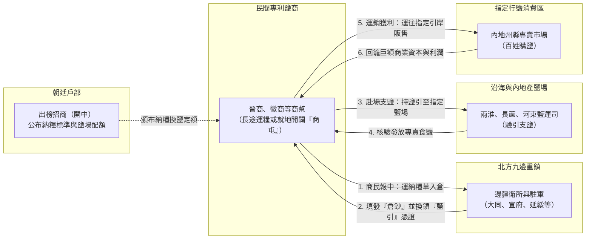
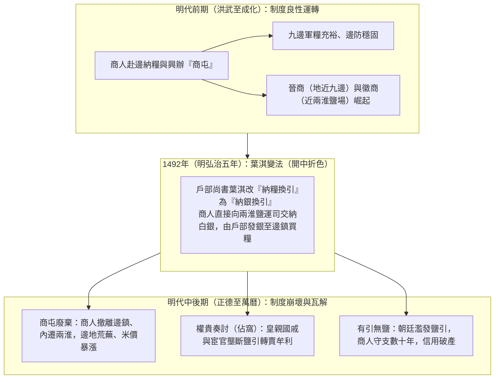
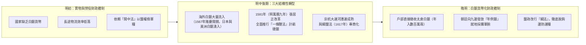

# 開中法及其演變

## 歷史背景

1368年（明洪武元年）明朝建立初期，北方邊境長期面臨北元與蒙古勢力的軍事壓力（參見[北伐](../事件/洪武時期/北伐.md)），朝廷需在「九邊重鎮」（如大同、宣府等）部署重兵。由於邊疆地區荒僻、糧食產量不足，且政府直接由江南或內地長途運糧至北方邊境的運輸成本極其高昂（耗費巨大、損耗率高），財政負擔沉重（參見[明初建國經濟體制](../經濟/明初建國經濟體制.md)）。為解決邊軍補給問題，明太祖[朱元璋](../皇帝/朱元璋.md)於1370年（明洪武三年）採納山西行省建議，利用國家對鹽業的壟斷經營權，正式確立了「開中法」。

## 制度核心內容

開中法本質上是一種**「以商養軍」**的特許經營制度，將軍事物流服務外包給民間市場。

### 1. 運作流程

- **商民報中**：商人響應朝廷公告（開中），將糧食、草料等戰略物資運送到政府指定的邊疆[衛所](./軍事/衛所制.md)。
- **發給鹽引**：政府在接收物資入倉後，發給商人「倉鈔」，再憑鈔換取名為「鹽引」的食鹽專賣兌換券。
- **赴場支鹽**：商人持有鹽引，前往指定的產鹽場（如兩淮、長蘆、山東、河東鹽場）領取食鹽。
- **販賣獲利**：商人將鹽運往指定區域（引岸）販賣，獲取高額的壟斷利潤。

### 2. 本質特徵

- **實物交換**：以「鹽的販賣權」交換「邊軍的物資補給」。
- **物流外包**：利用商人的資本與組織能力，解決國家行政力量難以負荷的長途運輸問題，並促使商人在邊鎮就地招募流民開墾「商屯」（參見[屯田制](./屯田制.md)）。

## 歷史影響與意義

### 1. 正面影響

- **穩固邊防**：有效緩解了邊境糧荒，確保了長期的軍事供給穩定。
- **促進商業繁榮**：催生了大型地域性商幫（如山西晉商、徽州徽商）的興起，帶動了全國性的物資流動與商業資本累積。
- **開墾邊地**：為節省長途運費，部分商人在邊疆招募農民屯田（商屯），直接在當地產糧換引，促進了邊疆農業開發。

### 2. 制度轉折與崩壞（明中後期）

- **弘治折色（葉淇變法）**：1492年（明弘治五年），明孝宗[朱祐樘](../皇帝/朱祐樘.md)時期的戶部尚書葉淇推行變法，規定商人不再赴邊鎮納糧，改為直接向鹽運司交納白銀換取鹽引（開中折色），再由戶部將白銀分發邊鎮自行買糧。此舉雖短期增加了中央太倉庫銀收入，卻導致邊塞「商屯」迅速廢弛，邊地糧價騰貴，山西商人亦分流轉往兩淮經營鹽業。
- **權貴侵利（奏討與佔窩）**：明代中後期，皇親國戚、勋貴與專權[太監](./廠衛/太監.md)（如[劉瑾](../人物/宦官/劉瑾.md)等）利用特權向皇帝「奏討」鹽引配額，再高價轉賣給普通鹽商（稱為「賣窩」），嚴重侵奪商利並破壞公平競爭。
- **鹽引貶值與投機盛行**：朝廷因財政短缺而超額濫發鹽引，導致鹽場食鹽產量趕不上憑證發行量（「有引無鹽」），鹽商赴場往往需苦等數年乃至數十年（守支），制度信用徹底崩潰，邊軍補給功能名存實亡。

## 轉型與演變：為何被「銀兩稅制」取代？

隨著明朝中後期經濟結構的轉型，開中法逐漸退出歷史舞台，主因如下：

1. **白銀經濟崛起**：隨著1567年（明隆慶元年）[隆慶開關](../事件/隆慶時期/隆慶開關.md)後海外白銀（日本、美洲）大量流入，中國社會全面進入白銀貨幣化時代，市場交易普遍改用白銀，朝廷與商界皆不再依賴實物交換。
2. **一條鞭法改革**：1581年（明萬曆九年），內閣首輔[張居正](../人物/文臣/張居正.md)在全國推行「一條鞭法」（參見[張居正經濟改革](../經濟/張居正經濟改革.md)），將田賦與徭役統一折算為白銀徵收。政府偏好徵收流動性強的「現金」（白銀）而非「實物」（糧食、鹽），轉而直接由戶部撥發「年例銀」至邊鎮採購軍糧。
3. **行政與鹽政轉型**：隨著京杭大運河漕運體系成熟，加之1617年（明萬曆四十五年）兩淮鹽政改行「綱鹽法」（將鹽引固定分攤給在冊特許綱商納銀專賣），國家直接以貨幣掌控財政的能力提升，開中法「運糧換鹽」的歷史使命正式終結。

## 研究結論

開中法是明朝前期智慧與現實妥協的產物。它成功地將政府的資源壟斷優勢轉化為邊防力量，並在無意中推動了中國近世地域商幫與商業資本的崛起。然而，隨著經濟從「實物交換」轉向「貨幣經濟」，這種以壟斷權換取實物物流的舊式機制，最終必然被更具流動性、更透明的現金財政體制（如一條鞭法與綱鹽制）所取代。而在晚明財政體系崩潰邊緣出現的[礦稅](./礦稅.md)，則代表了另一種更具掠奪性的非常規財政手段。

---
