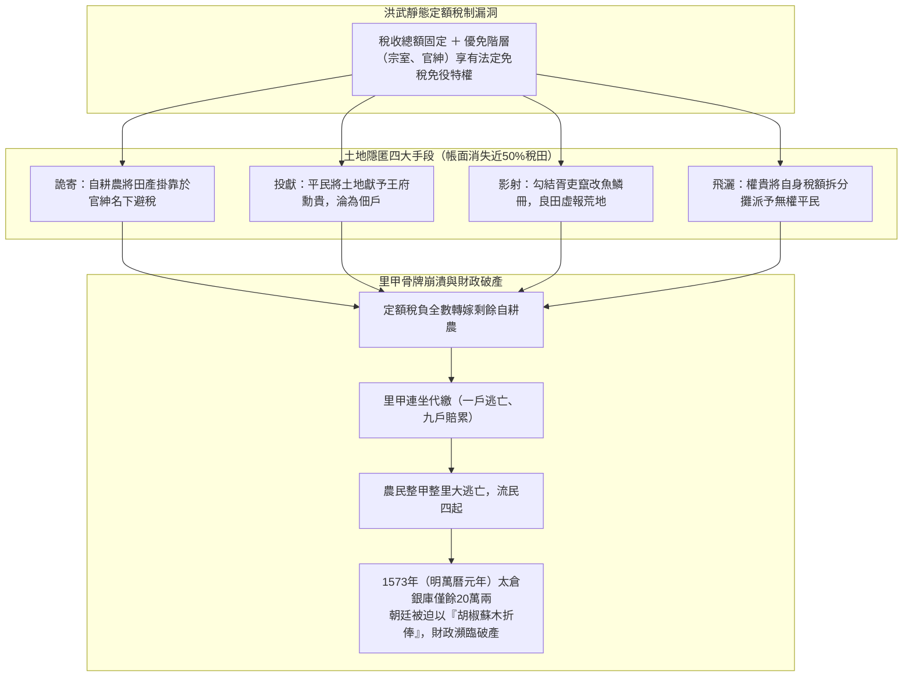
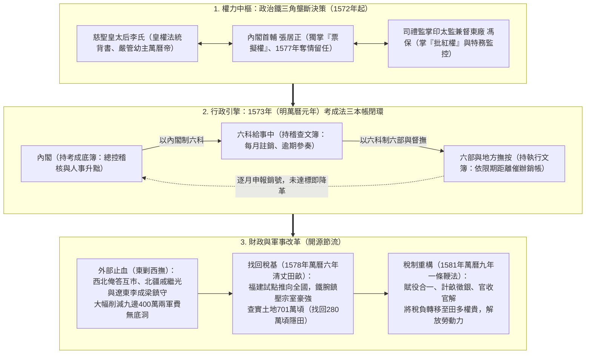
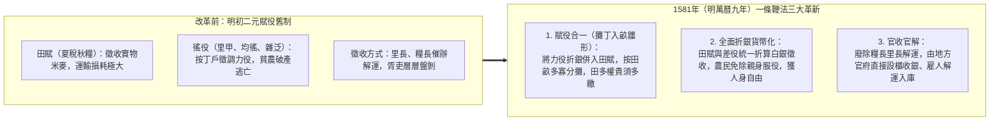
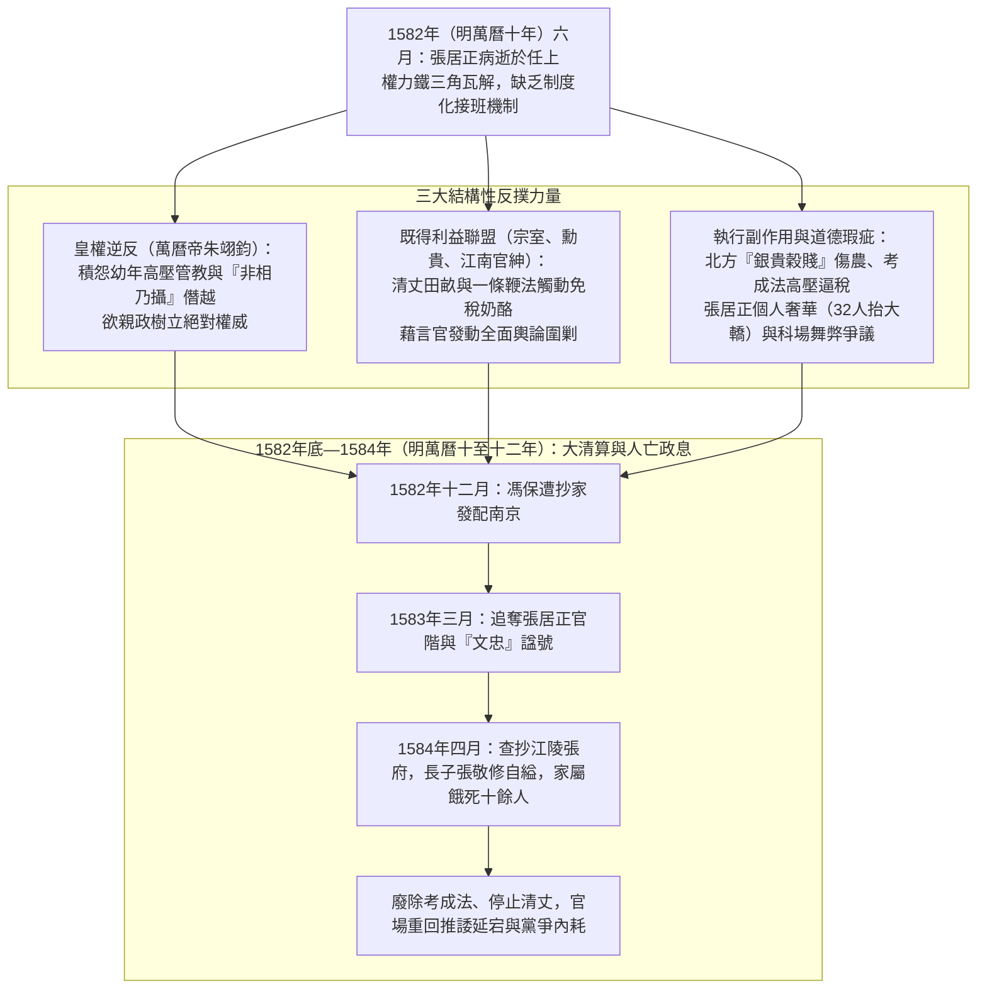

# 張居正經濟改革

## 歷史背景

明初[朱元璋](../皇帝/朱元璋.md)建構的財政體系（詳見[明初建國經濟體制](./明初建國經濟體制.md)），本質上是一個以「固定收支、自給自足」為核心的防禦性靜態經濟模型。透過「黃冊」（登記人口）與「魚鱗圖冊」（登記土地，詳見[戶籍制度](../制度/戶籍制度.md)）兩大基礎底冊，朝廷試圖將全國資源鎖定在洪武時期的定額框架內。然而，這套系統缺乏應對社會變遷的動態調整能力。當人口自然增長與土地流動發生時，僵化的「本色徵收」（實物稅）與「定額稅制」非但不能適應增長，反而成為特權階層蠶食稅基的制度漏洞。

「優免階層」包含皇族、勳貴、[外戚](../../通史/外戚.md)、官戶與儒戶（生員），依法享有法定的免稅、免役額度（詳見[宗室制度](../制度/宗室制度.md)）。經過兩百年的惡性膨脹，這一群體從洪武初期的微量規模演變為吞噬國防與民生的龐大黑洞。

**表一：明代資源配置與特權階層膨脹數據對比**

| 指標             | 洪武初期 | 嘉靖/萬曆年間                         | 增長倍率/變動情況     |
| :--------------- | :------- | :------------------------------------ | :-------------------- |
| **宗室人口**     | 數十人   | 62,000 人（1594年（明萬曆二十二年）） | 逾千倍增長            |
| **勳貴爵位**     | 49 人    | 8,203 人（嘉靖年間（1522年—1566年）） | 約 167 倍             |
| **登記徵稅土地** | 850 萬頃 | 422 萬頃（弘治年間（1488年—1505年）） | 帳面消失約 50%        |
| **山西宗室祿米** | 1 萬石   | 87 萬石                               | 87 倍（財政完全枯竭） |

在制度失靈的背景下，優免階層透過與地方胥吏勾結，利用以下手段實現資產的非正式轉移，導致國家稅收在帳面上發生「技術性消失」：

- **詭寄與投獻**：農民為規避重稅，將土地掛靠在權貴名下（詭寄）或直接獻給王府（投獻），使土地進入免稅網。
- **影射與飛灑**：透過作假將良田虛報為荒地（影射），或利用權勢將自身稅額強行分攤至全縣無權平民頭上（飛灑）。

由於「定額稅制」規定稅收總量不變，當一半土地脫離稅網後，剩餘的賦稅會產生激烈的「稅負轉嫁」：

- **里甲內骨牌效應**：依據里甲制，一人逃亡，同甲其餘九戶需代繳。這導致負擔倍增的農戶接連逃亡，最終引發整甲、整里的「空前大逃亡」。
- **體系崩壞**：這種連鎖反應導致太倉銀庫至 1573年（明萬曆元年）僅剩 20 萬兩白銀。中央被迫採取「胡椒蘇木折俸」等極端手段，將庫存香料折算成官員薪資，標誌著洪武體系的全面破產。

## 制度架構與核心內容

在利益結構極度固化的明末官場，制度改良已無路可走。[張居正](../人物/文臣/張居正.md)的戰略邏輯是：在啟動經濟「去槓桿」與「找回稅基」之前，必須先建立凌駕於現有法律與禮教之上的絕對威權，以此克服官僚體系的慣性阻力。

張居正成功構建了「李太后—張居正—馮保」的政治鐵三角。其權力運作的關鍵在於對資訊與決策鏈條的權力壟斷：

- **關鍵人物的角色重疊**：盟友[太監](../制度/廠衛/太監.md)馮保同時出任「司禮監掌印太監」與「提督[東廠](../制度/廠衛/東西內行廠.md)」。這種極罕見的職能結合（行政審核權與特務監督權合一），徹底繞過了原本的制衡機制。
- **政令鏈條的閉環**：張居正掌握[內閣](../制度/內閣制.md)的「票擬權」，馮保掌握「批紅權」，兩者結合使權力中樞成為「二人董事會」。
- **「奪情」的戰略意圖**：1577年（明萬曆五年）張居正父喪，他甘冒禮教大不韙留任（奪情），其核心意圖在於防止權力真空導致改革中斷。透過「廷杖」鎮壓異議，他確立了「非相，乃攝也」的半攝政地位。

張居正於1573年（明萬曆元年）推行「考成法」，試圖解決中央政令與地方執行之間的「資訊不對稱」問題，將官僚體系重塑為高效執行機器：

- **三重帳簿機制**：政令下達後，由發文衙門（六部）、六科給事中、內閣各持一式三份的文簿，按路程遠近設定限期銷帳。
- **權力結構的顛覆性重組**：原本獨立監控六部的「六科」（[言官](../制度/言官.md)）被納入內閣的監控之下（以內閣制六科，以六科制六部）。這使得內閣成功架空了傳統六部，使其淪為純粹的執行分支。
- **KPI 驅動的結果問責**：實施「結果問責制」，不達標者立即罰祿、降職或革職，實現了「朝下之令，夕奉行之」的戰略效率。

.png>)
.png>)

張居正採取了分階段實施的戰略：首要任務是透過軍事外交手段穩定外部環境，堵住每年高達 400 萬兩的軍費「失血口」，為內部核心利益區的財政手術創造穩定的「安全結界」。

針對[衛所兵制](../制度/軍事/衛所制.md)崩潰導致的巨額軍費開支，張居正實施了「東剿西撫」的差異化戰略：

- **西撫與經濟紅利**：對西北俺答汗實施「互市」政策（詳見[隆慶議和](../事件/隆慶時期/隆慶議和.md)與[隆慶開關](../事件/隆慶時期/隆慶開關.md)），以官方貿易取代軍事衝突，將敵對力量轉化為經濟夥伴，大幅削減了邊境維穩成本。
- **重用將領與戰略授權**：利用絕對權力支持[戚繼光](../人物/武將/戚繼光.md)、李成梁。張居正力排文官干擾，強行推動「南兵北調」於北方薊鎮練兵，建構了長期和平的外部環境。

在完成政治整肅與外部止血後，張居正發動了對既得利益者的總攻：

- **試點與全國擴張**：1578年（明萬曆六年）以地形最複雜的福建為試點，隨後頒布《清丈田糧八條》推廣至全國。
- **對抗既得利益集團**：面對山西大同潞城王府等宗室的帶頭抗爭，張居正採取鐵腕打擊，直接褫奪帶頭宗室的爵位。
- **資源回收成效**：僅用三年時間，至1581年（明萬曆九年）全國查實徵稅土地達 701 萬頃，成功找回了 280 萬頃隱瞞土地，為後續稅制改革奠定了數據基礎。

1581年（明萬曆九年）推行的「一條鞭法」，是將明代零碎、高行政成本的賦稅體系，進行貨幣化與邏輯整合的現代化轉型，旨在達成「不加賦而上用足」的極限效率：

- **將役歸田（賦役整合）**：廢除人頭勞役，按「田產多寡」分攤。這項改革將稅負重擔從貧農轉移至佔有土地的優免階層，實現了「均賦役」的公平性。
- **全面貨幣化**：除江南漕糧等極少數例外，全面折算白銀交納（參見[開中法](../制度/開中法.md)之貨幣化轉型）。此舉賦予農民人身自由，大批勞動力進入城市，直接推動了江南地區工商業的繁榮。

## 歷史影響與崩潰原因

**表二：萬曆新政財政儲備與成效量化表**

| 項目              | 改革前（1573年（明萬曆元年）） | 改革後（1582年（明萬曆十年，張居正逝世）） | 增幅/戰略儲備          |
| :---------------- | :----------------------------- | :----------------------------------------- | :--------------------- |
| **太倉銀庫儲備**  | 20 萬兩                        | 600 - 700 萬兩                             | 增長 30 - 35 倍        |
| **太僕寺銀庫**    | 數據缺失                       | 400 萬兩                                   | 重要財政備用金         |
| **京城/通州存糧** | 嚴重不足                       | 1,300 萬石                                 | 足夠支撐帝國 10 年開支 |
| **稅收土地基數**  | 422 萬頃                       | 701 萬頃                                   | 恢復 280 萬頃稅源      |

- **貨幣化陷阱**：該政策高度依賴白銀流入。在缺乏白銀的北方內陸地區，農民被迫在納稅季賤賣糧食換取白銀，導致「穀賤傷農、銀貴錢賤」，實質稅負因幣值變動而加重。
- **暴力催徵風險**：考成法的高壓 KPI 迫使基層官員為保官位而實施暴力逼稅（把催科當作撫字），導致行政效率的提升以社會矛盾的激化為代價。

張居正改革具備強烈的「個人英雄主義」色彩，其成功高度依賴個人威權與政治鐵三角的運作，而非制度性的慣性。當權力主體於1582年（明萬曆十年）病逝消失，缺乏共識基礎的改革措施隨即面臨被清算的系統性風險：

- **皇權恐懼與僭越**：張居正對[萬曆皇帝](../皇帝/朱翊鈞.md)的嚴苛管教，及「非相，乃攝也」的自傲言論，觸及了皇權的底線。隨著皇帝成人，這種輔助變成了威脅。
- **跨階層反對聯盟**：從山西宗室到江南官紳，改革幾乎得罪了所有既得利益集團。其死後發生的集體反撲，本質上是權力與利益的暴力回流。
- **道德與行政效率的悖論**：張居正個人的豪華座轎（32 人抬大轎）與其要求的朝廷節約形成鮮明對比，加之其子科舉及第爭議，成為政敵發動輿論攻勢、解構改革合法性的切入點。

1582年底至1584年（明萬曆十至十二年），萬曆皇帝隨即發動徹底清算：放逐馮保、抄沒張居正家產（長子張敬修自縊）、奪爵削諡、廢除考成法。明朝官場迅速回歸「推諉、延宕」的常態。

## 研究結論

張居正的改革在短期內為明朝續命六十年（累積的太倉白銀支撐了日後萬曆二十年代的[萬曆三大征](../事件/萬曆時期/萬曆三大征的影響.md)），有效緩解了財政枯竭的危機，並推動了江南商品經濟的繁榮。

然而，正如[海瑞](../人物/文臣/海瑞.md)所評價的：「工於謀國，拙於謀身」（詳見[徐高張海關係研究](../人物/文臣/徐高張海關係研究.md)）。張居正的悲劇與改革的夭折給予後世深刻啟示：制度改革若僅依靠絕對權力強推，而無政治權力的平穩銜接與社會利益的再平衡，終將難逃「人亡政息」的歷史規律（參見[專制與結構性困局](../../通史/專制與結構性困局.md)）。張居正雖為帝國打下了雄厚的財政基礎，但也因其激進的權力布局與個人道德爭議，留下了慘烈的政治遺產。

## 參考資料

1. [參考1](https://www.youtube.com/watch?v=W_LwHxf7owI)
2. [參考2](https://www.youtube.com/watch?v=PkODZm4mUBE)
3. [參考3](https://www.youtube.com/watch?v=2TRUvQ4hcHk)
