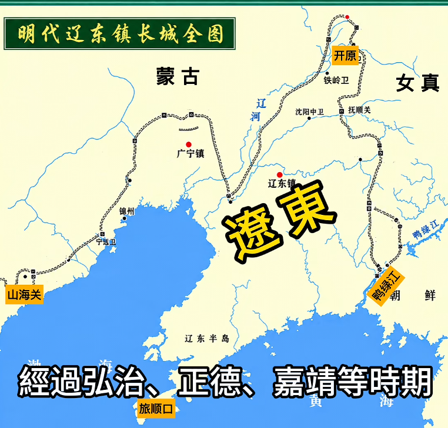
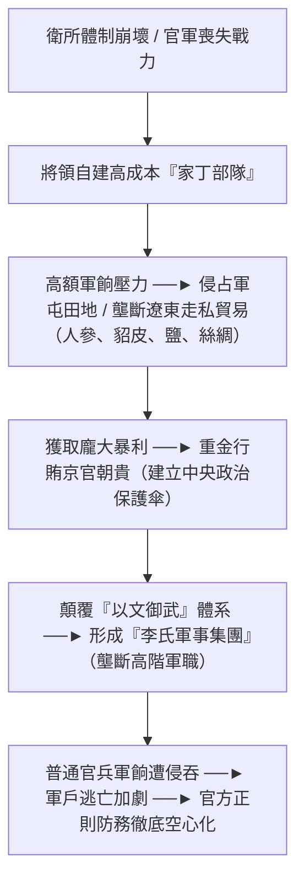
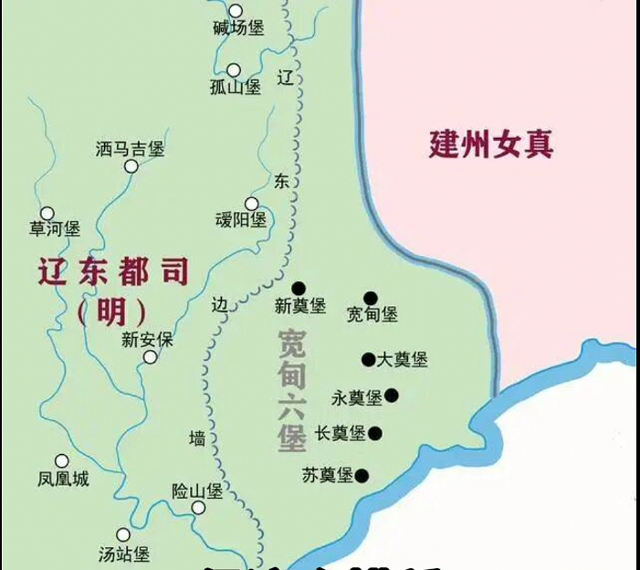
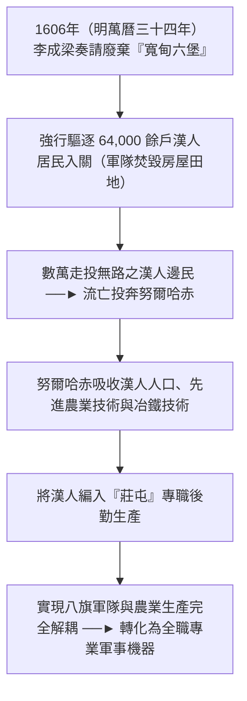

# 明朝遼東邊政體系與失控機制研究

## 歷史背景

自漢族政權失陷遼東長達六百餘年（時間跨度甚至超越失陷燕雲十六州）後，明朝於1368年（明洪武元年）建國初期重新收復此一東北戰略要地。按照明代行政劃分，遼東都指揮使司（遼東都司）管轄範圍東抵鴨綠江，西至山海關，南達旅順口，北至開原。為防禦蒙古與女真，明朝自永樂、正統年間起修築遼東邊牆，後經成化、弘治、嘉靖等朝不斷加固完善，構築起連結遼西、遼河至鴨綠江的防禦體系。邊牆內部為明朝直轄區，邊牆外部西北方為蒙古諸部，東北方則為女真各部。

明初在遼東的管轄體制經歷了從「軍民並治」到「純粹軍管」的根本轉變：

- **全面實行衛所軍管**：1371年（明洪武四年），明太祖[朱元璋](./皇帝/朱元璋.md)在遼東設置「都衛」，至1379年（明洪武十二年）進一步廢除遼東各地的府縣行政建制，全面轉由軍隊[衛所制](./制度/軍事/衛所制.md)進行直接管轄。當時明朝軍事重心需同時應對[北伐](./事件/洪武時期/北伐.md)後的北元殘餘勢力與南方雲南等地的戰事，國家財政負擔極重；遼東地區更因陸路補給艱難，長期需仰賴山東布政使司透過海運進行物資支援。
- **轉向羈縻衛所與間接統治**：由於全面征服東北女真各部需耗費巨大軍事與財政資源，明朝遂轉向羈縻政策。1403年（明永樂元年），明成祖[朱棣](./皇帝/朱棣.md)頒布詔敕招撫女真，正式設立「建州衛」，任命女真首領阿哈出為指揮使，隨後在東北地區陸續設立130多個大小衛所及「奴兒干都司」，將東北納入名義版圖。1412年（明永樂十年），明廷從建州衛分立出「建州左衛」，由圖們江流域的斡朵里部首領猛哥帖木兒（清太祖努爾哈赤之六世祖）出任指揮使；1442年（明正統七年），又從建州左衛分立出「建州右衛」，由猛哥帖木兒同母異父弟凡察擔任指揮使，正式形成「建州三衛」。1434年（明宣德九年），明宣宗[朱瞻基](./皇帝/朱瞻基.md)為節省開支撤銷奴兒干都司，明朝對女真的控制遂由直接軍事管轄轉為以羈縻衛所與朝貢體系為核心的間接統治。

---

## 制度架構與核心內容

明朝維持遼東邊疆穩定近兩百年的核心，在於一套將政治、經濟與軍事手段深度結合的綜合控制體系：

| 策略名稱     | 具體執行方式                                                                 | 核心控制機制                                                               | 實際效果與歷史案例                                                               |
| :----------- | :--------------------------------------------------------------------------- | :------------------------------------------------------------------------- | :------------------------------------------------------------------------------- |
| **政治羈縻** | 賜予敕書、冊封官職（如都督、指揮使、千百戶等），保留原部落自治體制。         | 賜官不發俸祿，以政治合法性約束部落，形成「部落首領兼具明朝官員」雙重身分。 | 女真各部名義歸順，首領冊封與繼承需朝廷批准，成功將女真納入名義版圖。             |
| **朝貢互市** | 憑敕書定期進京朝貢，並參與邊關馬市（如開原、撫順、寬甸）之貿易。             | 朝貢實行「薄來厚往」給予巨額賞賜；敕書為貿易入場券與經濟制裁之終極武器。   | 敕書成為財富與權力象徵，明廷以經濟利益換取邊疆控制權；收繳敕書即為嚴厲經濟封鎖。 |
| **以夷制夷** | 人為拆分強大部落（如分立建州左右衛、重分海西敕書），利用蒙古與朝鮮牽制女真。 | 人為製造內部實力均衡，防止單一勢力獨大；利用外部力量互相爭鬥牽制。         | 成功抑制女真長期無法統一；猛哥帖木兒曾因配合明軍而遭其他女真部落襲殺。           |
| **軍事威懾** | 對越界搶掠或叛亂之部落發動大規模武力剿滅（如「成化犁庭」）。                 | 以壓倒性軍事打擊徹底摧毀敵對部落之指揮中樞與經濟基礎，樹立軍事威嚴。       | 成化年間兩次圍剿重創建州女真，致其蟄伏近百年，不敢大規模犯境。                   |

### 1. 敕書控制與朝貢互市機制

在明朝的東北羈縻體系中，**「敕書」**是控制女真各部的核心工具。敕書兼具官方委任狀與貿易許可證功能，女真首領必須憑藉敕書方能進京朝貢，或進入撫順、開原、寬甸等邊關馬市交易土特產（如人參、貂皮），以換取耕牛、鐵鍋、布匹、食鹽、米糧等生存與生產必需品。

由於朝貢採取「薄來厚往」政策，經濟利益極高，敕書遂成為女真部落中最寶貴的資產，各部落甚至常為爭奪敕書而大打出手。明廷若遇部落不順從，便沒收其敕書、切斷馬市貿易，以此實施嚴厲的經濟制裁。

### 2. 「以夷制夷」與均勢拆分策略

明廷極力避免單一部落吞併他部而坐大，頻繁透過政治干預維持部落間的均勢：

- **拆分建州三衛**：正統年間，因建州左衛首領董山與叔父凡察爭權，明廷順勢將建州左衛拆分出「建州右衛」交由凡察管理，以分化其力量。
- **精確操控海西敕書配額**：萬曆年間，海西女真哈達部與葉赫部爭奪敕書，明廷將海西女真總計999道敕書重新分配為哈達部500道、葉赫部499道，透過極微小的差距刻意維持兩者實力均衡與相互敵視。此外，明廷亦頻繁調動女真、蒙古與朝鮮之間的地緣矛盾進行相互牽制。

### 3. 「成化犁庭」與毀滅性軍事威懾

一旦經濟制裁與政治拆分無效、部落勢力坐大並侵犯邊境時，明廷便發動毀滅性的軍事打擊。1449年（明正統十四年）[土木堡之變](./事件/英宗危機與復辟/土木堡之變.md)後，明朝財政緊縮導致朝貢賞賜減少，建州女真首領李滿住、董山等頻繁侵擾遼東都司，劫掠人口牲畜，致使遼東經濟幾近崩潰。

- **第一次成化犁庭（1467年，明成化三年）**：明憲宗[朱見深](./皇帝/朱見深.md)下令徹底剿滅建州衛，命總兵趙輔、左都御史李秉等率明軍五萬，並聯合朝鮮世祖李瑈派兵一萬夾擊。歷時一個月圍剿，明朝與朝鮮聯軍攻破四、五百座村寨，斬首建州女真1,700餘人。戰役中，建州衛首領李滿住及其子遭朝鮮軍擊斃，建州左衛首領董山則被明軍誘捕後處死。
- **第二次成化犁庭（1479年，明成化十五年）**：因建州餘部並未完全退卻，明憲宗再度發動大規模清剿，由太監汪直與撫寧侯朱永統率明軍出征，奉旨實施「搗其巢穴，絕其種類」之威懾戰略，攻陷450餘座村寨，斬首695人、俘虜486人，繳獲大量軍械盔甲。

這兩次被史家稱為「成化犁庭」的大規模圍剿，徹底摧毀了建州女真的首領層與指揮中樞，致使其一蹶不振並蟄伏近百年。然而，這套綜合控制體系的前提建立在明朝擁有強大的官方邊防軍隊作為後盾；到了明朝中後期，隨著[衛所制](./制度/軍事/衛所制.md)內部衰退與基層防務空虛，控制機制逐漸喪失武力支撐，裂痕開始全面顯現。

---

## 歷史影響與崩潰原因

明朝中後期遼東邊政的失控，並非單一突發事件，而是軍事體制畸變、離間策略破產、經濟橫徵暴斂與戰略防線自毀等多重結構性因素交織的必然結果。

### 1. 衛所制崩壞與李成梁「家丁制」的戰略雙刃劍

明代[衛所制](./制度/軍事/衛所制.md)實行軍戶與武官世襲制度。隨時間推移，遼東世襲武官形成盤根錯節的地方利益集團，因職務世代承襲而無需依靠戰功保位，導致軍政廢弛、疏於訓練。武官大量侵占[軍屯](./制度/屯田制.md)田地、克扣軍餉，甚至將軍戶視為私家奴役勞力，引發大規模軍戶逃亡潮。至隆慶年間，遼東官軍戰鬥力幾近崩潰，面對蒙古土蠻部與女真王杲等勢力的頻繁入侵，遼東防務陷入嚴峻真空。

在此背景下，世襲鐵嶺衛指揮僉事（祖籍朝鮮）的**李成梁**崛起，改變了遼東軍事格局。隆慶年間，李成梁憑藉抗擊蒙古入侵的卓越戰功（1567年／明隆慶元年救援永平、1569年／明隆慶三年斬殺蒙將張擺失、1570年／明隆慶四年代總兵擊退辛愛部）累功升任遼東總兵。李成梁未在舊衛所體制內進行修補，而是另闢蹊徑，大規模招募由漢人、蒙古人、女真人組成的精銳私軍——**「家丁部隊」**（詳見[軍閥問題比較](./制度/軍事/軍閥問題比較.md)）。他給予家丁高於普通士兵數倍的軍餉並進行高強度訓練，憑此鎮守遼東數十年，多次擊敗外敵（如1574年／明萬曆二年擊敗叛亂的女真首領王杲）。

然而，家丁制的引入是一把致命的戰略雙刃劍，對遼東政軍格局造成了嚴重畸變：

- **經濟壟斷與政治保護傘**：養育龐大家丁需耗費巨額資金，李成梁遂大量侵占屯田，並利用職權強制介入與壟斷遼東的人參、貂皮、食鹽、絲綢等走私與邊境貿易以獲取暴利；同時重金行賄朝廷權貴（如[張居正](./人物/文臣/張居正.md)等中樞重臣），構建中央政治保護傘，壓下[言官](./制度/言官.md)彈劾。
- **顛覆「以文御武」與軍事集團化**：明制本以「以文御武」為鐵律，遼東總兵應受[遼東巡撫與總督](./制度/巡撫總督.md)節制。但李成梁憑藉私軍力量、經濟壟斷及朝中人脈成為實質上的「遼東王」，使歷任巡撫、巡按不得不順從於他；其子弟（如李如松、李如柏、李如梅、李如楨）及親信部將更大量安插於遼東高階軍職，形成盤根錯節的「李氏軍事集團」。朝廷撥給遼東的軍餉大半用於供養李家私軍，普通官兵權益受損，基層防務徹底空心化。
- **總兵「十年八換」的戰略真空**：1591年（明萬曆十九年），隨著朝中政治靠山接連失勢與言官猛烈彈劾，明神宗[朱翊鈞](./皇帝/朱翊鈞.md)下詔罷免李成梁。李氏集團高度壟斷的局勢在李成梁去職後引發嚴重政軍動盪——自1591年至1601年（明萬曆十九年至二十九年）的十年間，遼東總兵竟「十年八換」。繼任者皆無法有效控制李成梁留下的私軍與複雜局面，致使遼東軍政陷入長期混亂與戰略真空，給予外圍[女真崛起與統一](./事件/萬曆時期/女真崛起與統一.md)絕佳的擴張縫隙。

### 2. 離間策略的破產與努爾哈赤勢力坐大

1583年（明萬曆十一年），李成梁圍剿王杲之子阿台所在的古勒城。努爾哈赤的祖父覺昌安與父親塔克世入城勸降時，因圖倫城主尼堪外蘭在城下喊話誘降引發城內大亂，明軍趁機攻城，導致覺昌安與塔克世在亂軍中慘死。李成梁自知理虧，朝廷遂給予努爾哈赤世襲建州左衛都指揮使頭銜與敕書作為補償。年僅25歲的努爾哈赤依靠祖父留下的「十三副甲冑」起兵討伐尼堪外蘭，短短五年內統一建州女真本部，並於1593年（明萬曆二十一年）在古勒山之戰中大敗海西女真九部聯軍，成為女真諸部中最強大的勢力。

面對努爾哈赤失控崛起，明廷與李成梁試圖重施故技，扶植努爾哈赤的親弟、建州「二把手」**舒爾哈齊**（蘇爾哈奇）以分化建州內部。明廷授予舒爾哈齊「建州等衛都督同知」等高官頭銜，並於1595年（明萬曆二十三年）、1597年（明萬曆二十五年）、1606年（明萬曆三十四年）、1608年（明萬曆三十六年）四次召其進京朝貢，給予極高規格接待；李成梁更將次子李如柏之女嫁予舒爾哈齊，透過聯姻深度拉攏。舒爾哈齊長期受明朝厚待與經濟利益誘惑，產生維護對明友好、反對與明衝突的傾向，兄弟間的戰略分歧逐漸公開化：

1. **1599年（明萬曆二十七年）征哈達部**：努爾哈赤命舒爾哈齊率軍攻打哈達部，舒爾哈齊臨陣拒絕動手，致使兄弟產生嚴重戒心。
2. **1607年（明萬曆三十五年）烏碣岩之戰**：努爾哈赤派舒爾哈齊、褚英、代善等人前往接應投靠的東海瓦爾喀部斐優城居民，途中遭遇海西烏拉部首領布占泰軍阻擊。因舒爾哈齊與布占泰有重疊姻親關係（舒爾哈齊既是布占泰岳父亦是其妹夫），舒爾哈齊再度按兵不動，甚至在褚英、代善擊退敵軍後禁止追擊。戰後努爾哈赤削奪其兵權，並處死其兩名親信將領。
3. **黑扯木自立與局勢激化**：兵權被奪後，舒爾哈齊計畫帶領私屬部隊搬遷至靠近明朝鐵嶺及烏拉部的「黑扯木」（黑城木），試圖依靠明朝與外部勢力實施割據自立。

1609年（明萬曆三十七年），舒爾哈齊自北京朝貢歸來後準備直奔黑扯木。努爾哈赤果斷採取行動，率先下令處死舒爾哈齊的兩個兒子，將其徹底孤立。正當舒爾哈齊面臨滅頂之災、亟需外部支援時，明朝中央卻爆發嚴重政治內鬥——言官集體彈劾二次復職的李成梁，定性其「兵權太盛、割據擁兵」，萬曆帝與言官妥協後下旨令李成梁退休並嚴令「永不再用」。失去李成梁的軍事背書與明朝實質支援，舒爾哈齊頓失外援被迫投降，遭努爾哈赤永久幽禁，於1611年（明萬曆三十九年）抑鬱致死。

明廷對建州女真離間分化策略的徹底破產，暴露出三大系統性戰略盲點：

- **情報工作嚴重失真**：明廷誤以為舒爾哈齊與努爾哈赤在部族內擁有對等實力，未能洞察努爾哈赤透過八旗制度已掌握建州絕對的軍事與政治控制權，盲目高估了代理人的獨立割據能力。
- **戰略承諾空洞化與支援缺失**：明廷僅給予舒爾哈齊頭銜、朝貢賞賜與聯姻等軟性政治資本，但在代理人面臨生死存亡的關鍵軍事對壘時刻，卻因朝廷官僚內鬥（彈劾李成梁去職）而徹底喪失軍事介入能力，致使代理人孤立無援被迅速掃除。
- **忽視女真內部追求統一的集體意志**：女真各部深刻體認到，若不實現統一，必將長期在明朝「以夷制夷」政策下陷入內耗與被剝削境地。努爾哈赤代表的統一勢力順應了抵抗明朝壓迫的內部訴求，而對明廷抱有幻想的舒爾哈齊最終被統一浪潮淘汰。

### 3. 經濟榨取與自毀長城：礦稅肆虐與棄守寬甸六堡

萬曆晚期，明朝中央財政因「[萬曆三大征](./事件/萬曆時期/萬曆三大征的影響.md)」與宮殿營建陷入嚴峻危機。明神宗為充實內庫私房錢，打破祖制大興[礦稅](./制度/礦稅.md)，於1599年（明萬曆二十七年）派[太監](./制度/廠衛/太監.md)**高淮**（高懷）作為礦稅使前往遼東。高淮在遼東肆虐長達十年（1599年－1608年，明萬曆二十七年至三十六年），實施了毀滅性的經濟搜刮：

- **對普通百姓**：不論當地是否具備礦產資源，強行將固定礦稅指標攤派至每戶百姓頭上，實施層層加碼的極端抽取。
- **對商賈貿易**：把持遼東各個邊關關口與馬市，抽取巨額過關稅與交易稅，導致外地商人不敢進入遼東，邊境貿易急劇萎縮。
- **對邊軍軍餉**：截留與盤剝遼東邊軍極為微薄的軍餉，引發多起邊軍兵變與民變。

當時遼東官員痛陳邊疆局勢為**「狂虜（女真與蒙古）掐血、稅璫（高淮）挑筋、貪將（李成梁集團）蝕骨」**（史料亦作「狂虜劫血、稅璫挑起、貪將吹氣」）。二次復職的李成梁（時年76歲）深知高淮背後為萬曆皇帝，為保全自身財路與官位，對高淮的肆虐採取放任與配合態度，一同大肆搜刮。三股力量交織徹底掏空了遼東的經濟基礎與民生底線，致使大量漢人邊民走投無路，被迫逃往建州女真投靠努爾哈赤。

在經濟崩潰的同時，明朝在防線布局上更實施了「自毀長城」式的戰略後退。**「寬甸六堡」**（包含寬甸、長甸、永甸、大奠、新奠、孤山／靉陽等向外推進之六座堡壘）位於建州女真進入遼東腹地的咽喉要道。萬曆初年李成梁向東推進興建寬甸六堡，將分散的防禦點連成連貫防線，既能封鎖女真出山要道，且該地區土地肥沃，適宜屯兵自給。

然而至1606年（明萬曆三十四年），因衛所制徹底毀壞、邊務完全仰賴高成本的私家家丁，76歲的李成梁認為守備邊牆之外的寬甸六堡軍費負擔過重，為收縮防線、節省私軍開支，主動向朝廷奏請**「廢棄寬甸六堡」**，將防線全面撤回舊邊牆內部。

寬甸地區經三十餘年經營，當時已聚居64,000餘戶漢人居民。百姓不願拋棄田園家業，李成梁竟調動軍隊實施強行驅逐，沿途焚毀房屋田地，致使數十萬邊民流離失所。這項決策產生了根本性的資敵後果：

1. **土地與人口拱手讓敵**：寬甸肥沃的土地與大批走投無路的漢人流民直接流入建州，連帶將先進的漢人農業耕作技術與鐵器冶煉技術輸入後金。
2. **促成八旗軍事機器質變**：努爾哈赤將流入的漢人編入「莊屯」，建立起高效的後勤農業生產體系，為八旗軍隊提供穩定充沛的糧餉支援。這一轉化使八旗兵丁得以完全脫離農業生產，轉變為專職作戰的精銳職業軍人，後金政權的戰略動員能力發生了質的飛躍。

時任遼東巡按[熊廷弼](./人物/文臣/熊廷弼.md)曾極力反對棄地，上奏嚴厲彈劾李成梁此舉非「棄地」而是「獻地資敵」，痛陳寬甸乃遼東屏障、棄之必招大禍。然而，熊廷弼的奏摺被長期[怠政](./事件/萬曆時期/萬歷怠政.md)的萬曆皇帝留中不發，李成梁未受任何懲處，熊廷弼反而被調離遼東。官僚體制的僵化與決策失誤，錯失了挽救遼東防線的最後機會。

---

## 研究結論

明朝遼東邊政的失控與崩潰，絕非單一戰役失利或個別將領之過，而是明朝政治、經濟、軍事體制全面僵化與失能的系統性必然結果。從制度演變的視角審視，遼東崩潰呈現出嚴密的層遞邏輯：

1. **正則軍事體制崩塌**：[衛所制](./制度/軍事/衛所制.md)世襲腐敗與軍屯兼併引發軍戶逃亡潮，官軍完全喪失戰鬥力，造成遼東防禦真空。
2. **私屬武力對國家體制的替代與反噬**：將領被迫建立高成本的「家丁部隊」，高額軍費誘發屯田侵占、貿易壟斷與政治行賄，形成顛覆「以文御武」原則的「李氏軍事集團」；一旦核心將領去職，即引發「十年八換總兵」的政軍體系大亂。
3. **離間策略破產與戰略資敵**：情報失真與朝堂內鬥導致對舒爾哈齊的扶持半途而廢，「以夷制夷」徹底失效；而礦稅監高淮的極端經濟搜刮逼反邊民，加上主動棄守寬甸六堡，直接將人口、技術與戰略要地拱手讓敵，助推後金完成後勤與軍事機器的質變。

至1619年（明萬曆四十七年）[薩爾滸之戰](./事件/萬曆時期/薩爾滸之戰.md)前夕，明朝遼東防線與努爾哈赤後金政權的實力對比已發生根本性翻轉：

| 對比維度       | 萬曆末期明朝遼東防線                                                         | 努爾哈赤後金政權                                                             |
| :------------- | :--------------------------------------------------------------------------- | :--------------------------------------------------------------------------- |
| **軍事體制**   | 衛所制徹底腐化，將領頻繁更換（十年八換總兵），過度依賴昂貴且有限的私人家丁。 | 建立「八旗體制」，軍政合一、軍紀嚴明，具備極高的組織力與野戰機動戰鬥力。     |
| **後勤與經濟** | 財政枯竭，邊軍軍餉遭礦稅監高淮與貪將扣掠，邊關貿易因重稅與封鎖而萎縮崩潰。   | 完全接管寬甸肥沃土地，利用流入漢人建立「莊屯」專職生產，後勤補給充足穩定。   |
| **邊民與民心** | 遭「狂虜、稅璫、貪將」三重極端搜刮，邊民民不聊生，大批流亡走投無路逃往女真。 | 吸收大量漢人勞動力、先進農業技術與鐵器製造技術，實現八旗兵丁與農業生產解耦。 |
| **戰略主動權** | 放棄寬甸六堡後防線全面收縮，防禦點鬆散；朝廷官僚內鬥嚴重，對邊政反應遲鈍。   | 徹底掃除內部分化隱患（幽禁舒爾哈齊），完全掌握戰略進攻主動權。               |

1618年（明萬曆四十六年），積蓄足夠戰略資本的努爾哈赤以「七大恨」誓師討明，正式開啟大規模對明戰爭；次年（1619年，明萬曆四十七年）爆發[薩爾滸之戰](./事件/萬曆時期/薩爾滸之戰.md)，明軍四路大敗。明朝在遼東經營兩百年所積累的制度紅利與戰略優勢至此消耗殆盡，東北防線全面崩潰，最終引發了中原大地長達數十年的戰亂與明清政權更迭。

---

## 參考資料

1. [參考1](https://www.youtube.com/watch?v=o7VHrJAGmos)
2. [參考2](https://www.youtube.com/watch?v=zTbCbdWD6lA)
