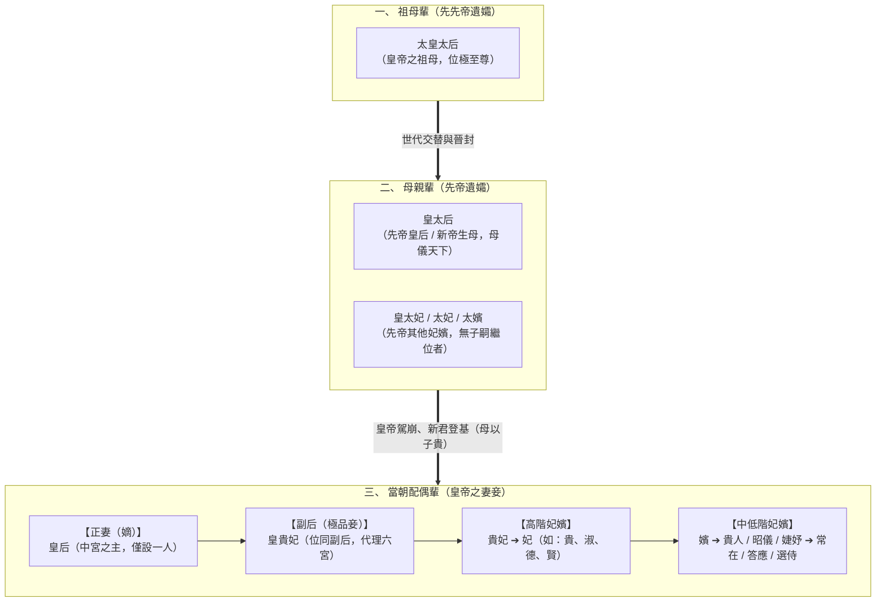
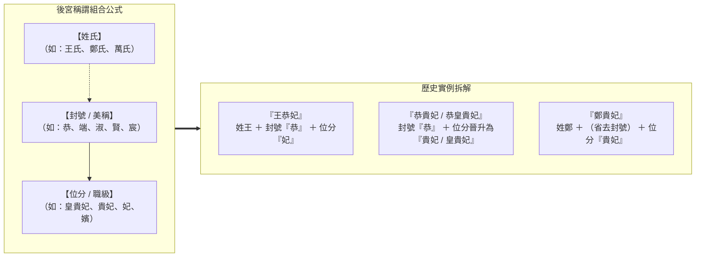

# 後宮稱號與品級制度

## 歷史背景

在中國古代君主專制與宗法禮制結合的政治架構下，後宮並非單純的帝王私人家庭生活空間，而是高度科層化、與前朝官制及皇位繼承制度緊密聯動的政治場域。皇帝身旁的女性稱呼，本質上是一套嚴密的**「宗法輩分」與「品級職等」雙軌標記系統**。

《禮記·昏義》記載：「古者天子後立六宮，三夫人，九嬪，二十七世婦，八十一御妻，以聽天下之內治，以明章婦順，故天下內和而家理。」這套源於先秦、確立於秦漢、並在唐宋明清不斷演進的後宮制度，核心目的在於三個層面：

- **確立「嫡庶之辨」**：嚴格區分正妻（皇后）與妾室（妃嬪）的法理界線，確保皇位繼承遵循「有嫡立嫡，無嫡立長」的宗法正統，避免儲位爭奪引發朝局動盪。
- **規範「尊卑輩分」**：隨著新舊帝王更替，先朝遺孀與當朝配偶並存於深宮，必須透過「太皇太后、皇太后、太妃」等跨世代尊號，維持孝道秩序與宮廷倫理。
- **制衡後宮與外戚權力**：透過將後宮名位與俸祿、儀仗、撫養權及親族封賞掛鉤，防止單一妃嬪或[外戚](./外戚.md)勢力過度膨脹而威脅皇權。

---

## 制度架構與核心內容

要徹底釐清後宮紛繁複雜的稱呼，必須先將其拆解為**「縱向的世代輩分」**、**「橫向的當朝位分」**以及**「封號與位分的組合語法」**三大邏輯維度。

### 1. 縱向世代輩分：從「皇后」到「皇太后」的跨越

後宮稱呼中最首要的區別是**「她與當今皇帝的親屬輩分關係」**。隨著老皇帝駕崩、新皇帝登基，女性的稱呼會發生世代性的晉升：

- **太皇太后**：當今皇帝的**祖母**（即先帝的皇太后）。這是後宮女性在輩分與禮制上的最高峰，如西漢竇太皇太后、明朝誠孝昭皇后（張太皇太后，[朱高熾](../明朝/皇帝/朱高熾.md)之妻、[朱瞻基](../明朝/皇帝/朱瞻基.md)之母、[朱祁鎮](../明朝/皇帝/朱祁鎮.md)之祖母）以及清朝孝莊太皇太后。
- **皇太后（太后）**：當今皇帝的**母親**。秦漢時期確立「帝母稱皇太后」之制。在宗法制度下，皇太后主要分為兩類，有時會出現「兩宮太后並尊」的局面：
  - **母后皇太后（嫡母）**：先帝的正式皇后（正妻），無論新皇帝是否為她親生，她都是法理上的嫡母，尊號通常居首（如清代咸豐帝皇后慈安太后）。
  - **聖母皇太后（生母）**：新皇帝的親生母親（原本只是先帝的妃嬪），因兒子登基而「母以子貴」晉封為皇太后（如明代萬曆帝生母慈聖李太后、清代同治帝生母慈禧太后）。
- **太妃 / 皇太妃**：先帝駕崩後，其餘未能成為皇太后的遺孀（即非先帝皇后、且親生兒子亦未登基當皇帝的妃嬪），新皇帝會尊稱她們為「皇太妃」、「太妃」或「太嬪」，於宮中安養晚年。

### 2. 橫向位分階級：當朝皇帝的「一妻多妾」體系

中國古代帝王在法律與禮制上實行嚴格的**「一夫一妻多妾制」**。後宮即便有佳麗三千，在法理上只有**唯一的一位妻子**，其餘無論位分多高，本質上皆屬於「妾（側室）」：

- **皇后（正妻 / 中宮）**：
  - **法理定位**：皇帝唯一的合法正妻，與皇帝共體，稱為「天下母」、「中宮」或「元后」。皇后擁有獨立的印綬（金冊金寶），其所生之子為**「嫡子」**，在皇位繼承上享有絕對優先權。
  - **冊立與廢黜**：冊立皇后屬於國家大典，需昭告天地宗廟；廢黜皇后（如[朱見深](../明朝/皇帝/朱見深.md)廢吳皇后、[朱瞻基](../明朝/皇帝/朱瞻基.md)廢胡皇后）則往往引發前朝文官集團的強烈震動。
- **皇貴妃（副后 / 妾室之首）**：
  - **起源與定位**：創設於明朝宣德、成化年間。1468年（明成化四年），明憲宗[朱見深](../明朝/皇帝/朱見深.md)為專寵的萬貞兒（萬貴妃）特設「皇貴妃」一職，位居貴妃之上、僅次於皇后，形同「副后」。
  - **政治敏感性**：由於皇貴妃逼近中宮權威，明清兩代通常不在皇后健在時輕易冊封皇貴妃。萬曆年間，[朱翊鈞](../明朝/皇帝/朱翊鈞.md)（萬曆帝）將鄭貴妃越級晉封為皇貴妃，立刻被外廷文官視為意圖「廢長立幼、挑戰中宮」的危險訊號，直接引爆長達十五年的「[爭國本](../明朝/事件/萬曆時期/爭國本.md)」大戰。清代則多在皇后崩逝後由皇貴妃「攝六宮事」，或於寵妃病危臨終前加封以示哀榮。
- **貴妃與妃（高階側室）**：
  - **唐宋四夫人**：唐代在皇后之下設「貴妃、淑妃、德妃、賢妃」（合稱四夫人，正一品），「貴妃」自此成為高階寵妃的代名詞（如唐玄宗之楊貴妃）。
  - **明清體制**：明代於皇后、皇貴妃下設貴妃與諸妃；清代康熙朝定制後，設「貴妃」二人、「妃」四人，皆享有專屬冊寶與宮殿主位資格（一宮主位）。
- **嬪與低階內官（中低階側室）**：
  - **嬪（九嬪）**：位居「妃」之下，清代定額六人，為後宮中層骨幹，部分可成為一宮主位。
  - **貴人、昭儀、婕妤、常在、答應、選侍**：位於「嬪」之下的基層侍妾。漢唐多用昭儀、婕妤、美人、才人；明代東宮或後宮有淑女、選侍（如引發「移宮案」的李選侍，參見[朱常洛](../明朝/皇帝/朱常洛.md)）；清代則定為「貴人、常在、答應」三級，無定額，地位接近高級侍女，無獨立宮院居住權。

### 3. 解碼「恭貴妃」、「王恭妃」：封號與位分的組合語法

歷史文獻與影視作品中常出現如「恭貴妃」、「端貴妃」、「王恭妃」、「鄭貴妃」等稱呼，容易令人混淆。其實這是由**「徽號（封號）＋ 等級（位分）」**或**「姓氏 ＋ 封號 ＋ 位分」**組合而成的命名語法：

- **為什麼會有「恭」字？（封號／徽號的作用）**：
  - 後宮中「妃」與「嬪」往往有多人（例如同時有四位妃、六位嬪）。為了區分彼此並褒揚其品德，朝廷會在冊封時賜予一至二字的美好字眼作為**「封號」**，如「恭」（恭敬謙順）、「端」（端莊持重）、「賢」（賢良淑德）、「淑」（溫和善良）、「宸」（帝居之尊）等。
- **「恭妃」與「恭貴妃」差在哪裡？**：
  - **恭妃**：代表她的位分是**「妃」**，封號是**「恭」**。最著名的例子是明神宗萬曆皇帝的**王恭妃**（明光宗[朱常洛](../明朝/皇帝/朱常洛.md)生母）。1582年（明萬曆十年），宮女王氏懷孕後獲封「恭妃」，後來雖因兒子被立為太子於1606年（明萬曆三十四年）進封為「慈聖皇太后」之下的**「恭皇貴妃」**，但終其一生在萬曆帝的冷落下鬱鬱而終。
  - **恭貴妃**：代表她的位分已經從「妃」晉升到了高一階的**「貴妃」**，但依然保留原本的封號**「恭」**（或直接受封為封號「恭」的貴妃）。例如清代道光帝的「莊順皇貴妃」烏雅氏，曾先後歷經「琳貴人 $\rightarrow$ 琳嬪 $\rightarrow$ 琳妃 $\rightarrow$ 琳貴妃」的晉升，其「琳」字即為不變的封號，後面的「貴人、嬪、妃、貴妃」則是隨恩寵與資歷步步高升的職等。
- **何時加「姓氏」、何時加「封號」？**：
  - 當某個高階位分**只有一人**（例如當時只有一位貴妃或一位皇貴妃），或史書為了凸顯其外戚家族背景時，常直接以**「姓氏 ＋ 位分」**稱呼，如成化朝的「萬貴妃」、萬曆朝的「鄭貴妃」。
  - 當同一位分有多人並存，或在正式宮廷冊文、禮制紀錄中，則必須使用**「封號 ＋ 位分」**（如「恭妃」、「德妃」、「端恪皇貴妃」）以示精確與尊崇。

### 4. 歷代後宮品級體系演進對照

不同朝代對後宮位分的名稱與定員設計各有不同，呈現出「由繁入簡、由世族化走向官僚與制度化」的趨勢：

| 階級層次 | 漢朝（西漢／東漢） | 唐朝（開元定制後） | 明朝（中後期定制） | 清朝（康熙定制後） |
| :--- | :--- | :--- | :--- | :--- |
| **正妻（中宮）** | 皇后（1人） | 皇后（1人） | 皇后（1人） | 皇后（1人） |
| **特設副后** | *無* | *無* | 皇貴妃（無定額，極罕） | 皇貴妃（1人） |
| **高階妃位** | 昭儀、婕妤、娙娥（視同丞相、列侯） | 四夫人：貴妃、淑妃、德妃、賢妃（正一品，4人）；或三夫人（惠、麗、華） | 貴妃、妃（冠以恭、端、莊、敬、順、康、寧等封號） | 貴妃（2人）、妃（4人） |
| **中階嬪位** | 容華、充依、美人 | 九嬪：昭儀、昭容、昭媛、修儀、修容、修媛、充儀、充容、充媛（正二品，9人） | 九嬪：德嬪、賢嬪、莊嬪、麗嬪、惠嬪、安嬪、和嬪、僖嬪、康嬪等 | 嬪（6人） |
| **低階侍妾** | 良人、八子、七子、長使、少使（東漢簡化為貴人、美人、采女） | 婕妤（9人）、美人（9人）、才人（9人）；寶林、御女、采女（各27人） | 婕妤、昭儀、貴人、美人；選侍、淑女（無定額） | 貴人、常在、答應（無定額，另設官女子） |

---

## 歷史影響與崩潰原因

後宮稱號與品級制度看似只是宮闈內部的禮儀名分，實則直接牽動著帝國中樞的皇位繼承、外戚干政與朝堂黨爭：

### 1. 「嫡庶之分」與儲位爭奪的制度死結

在宗法制度下，**「皇后之子為嫡，妃嬪之子為庶」**。母后的位分直接決定了皇子繼承皇位的法理優先權（有嫡立嫡，無嫡立長）。然而，當皇帝個人的情感偏愛（寵愛貴妃、皇貴妃）與宗法禮制（皇后或長子生母位分較低）發生衝突時，後宮位分的升降便會演變為嚴重的政治危機：

- **明代萬曆「[爭國本](../明朝/事件/萬曆時期/爭國本.md)」**：萬曆帝不喜歡生下皇長子[朱常洛](../明朝/皇帝/朱常洛.md)的「王恭妃」，卻將生下皇三子朱常洵的鄭貴妃超封為「皇貴妃」。名位上的倒掛引發文官集團對「以母貴廢長立幼」的極度恐慌，最終導致君臣決裂、萬曆怠政三十年與東林黨爭爆發。
- **清代「母以子貴」與[秘密建儲制](../清朝/制度/宮鬥.md)**：清代前期（如順治、康熙朝）仍受嫡庶與母家門第影響；直至1723年（清雍正元年）雍正帝確立「秘密建儲制」，不再公開冊立太子，也不完全以生母位分決定儲君，才在制度上拆解了因后妃位分高低而引發的前朝結黨奪嫡亂象（參見[明清宮鬥比較](../明朝/制度/明清宮鬥比較.md)）。

### 2. 「皇太后」稱號背後的垂簾聽政與外戚危機

當一名后妃跨越世代晉升為**「皇太后」**時，她在法理上便擁有了以「孝道」約束年輕皇帝、甚至在幼主即位時「臨朝稱制（垂簾聽政）」的政治合法性：

- **漢唐模式（外戚與女禍）**：西漢呂太后、王政君（王莽之姑），以及東漢多位臨朝太后，皆因享有皇太后之尊而將軍政大權交予娘家父兄，釀成[外戚](./外戚.md)專權與篡位之禍；唐代武則天則由「才人 $\rightarrow$ 昭儀 $\rightarrow$ 皇后 $\rightarrow$ 皇太后」步步攀升，最終改唐為周、親登帝位。
- **兩宮太后並立的權力制衡與傾軋**：當先帝皇后（母后皇太后）與新君生母（聖母皇太后）同時健在時，兩宮太后的權力界線極易引發衝突。例如明英宗於1457年（明天順元年）「[奪門之變](../明朝/事件/英宗危機與復辟/奪門之變.md)」復辟後，其子明憲宗[朱見深](../明朝/皇帝/朱見深.md)即位時，嫡母錢太后與生母周太后（原為貴妃）便因「皇太后徽號添加」與死後合葬禮制爆發激烈的朝堂禮儀爭端；晚清同治、光緒年間，慈禧太后（聖母皇太后）更憑藉政治手腕壓制慈安太后（母后皇太后），獨攬晚清朝政近半個世紀。

---

## 研究結論

中國古代皇帝身旁女性的稱呼體系，絕非隨意取用的文學詞藻，而是一套精密運作的**「皇權安全與宗法秩序調節閥」**：

1. **輩分決定權威（太皇太后 $>$ 皇太后 $>$ 皇后）**：透過縱向的世代尊號，確保在老皇帝駕崩、新君年幼的權力交接脆弱期，皇室內部能以「孝道」維持最高權力的穩定過渡。
2. **位分決定繼承（皇后 $>$ 皇貴妃 $>$ 貴妃 $>$ 妃 $>$ 嬪）**：透過橫向的「一妻多妾」嚴格等級，將後宮女性的地位制度化，使皇子們的繼承順位有法可依（嫡長子繼承制）。
3. **封號標記個體（如「恭」妃、「端」貴妃）**：在龐大的科層後宮中，以道德教化字眼作為封號前綴，既滿足了冊封禮儀的區別需求，亦時刻提醒後宮女性恪守「婦德」與不干政之本分。

從秦漢的「外戚合夥」到明清的「草根選妃」與「八旗內務府管控」，後宮稱謂與品級制度的不斷嚴密化，深刻反映了中國君主專制體制向極致集權演進的歷史軌跡。

---

## 參考資料

1. 《禮記·昏義》與《周禮·天官》六宮制度記載
2. 《明史·后妃傳》與《清史稿·后妃傳》品級規制
3. 本知識庫關聯研究：[皇帝名稱](./皇帝名稱.md) · [外戚](./外戚.md) · [明清宮鬥比較](../明朝/制度/明清宮鬥比較.md) · [清朝宮鬥](../清朝/制度/宮鬥.md)
